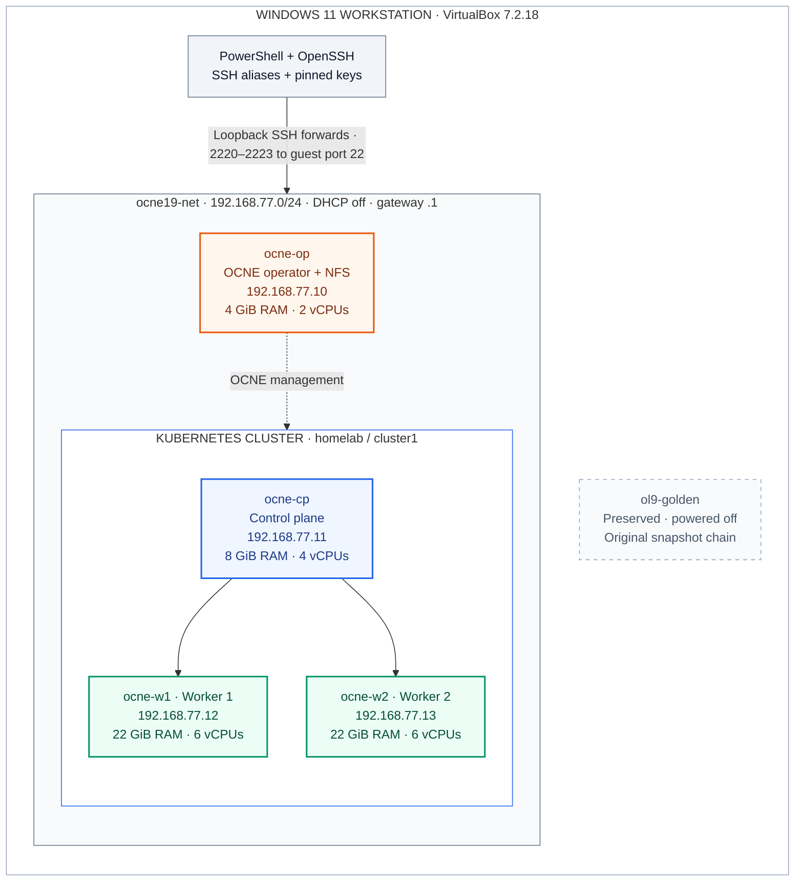

# OCNE 1.9 lab — D:\OCNE19-Lab

The cloning lab was completed and verified on **1 October 2026 at 22:08 EDT**, including an ordered power cycle. The subsequent OCNE report completed at 22:10. This documentation was reconciled with those results on 8 October; that is a documentation review date, not a new live health check.

For the shorter fresh-install sequence, use **[fresh-build: OCNE, Database Operator, RAC](fresh-build/README.md)**. Each chapter separates prerequisites/setup and includes commands, expected results and corrective actions.

For a new manual build, start with the **[four-part OCNE-to-RAC manual](docs/OCNE-RAC-END-TO-END-MANUAL.md)** ([printable HTML](docs/OCNE-RAC-END-TO-END-MANUAL.html)). See the **[test scenario matrix: commands, expected versus actual results](docs/RAC-TEST-SCENARIO-MATRIX.md)**. The manual covers OCNE, Database Operator, RAC prerequisites/provisioning, and a [28-scenario operations workbook](docs/RAC-POD-EXERCISES.md) with full captured output and clearly labeled unexecuted exercises.

For the existing lab, use [Operating the lab](docs/OPERATING-LAB.md) and [RAC deployment/acceptance](docs/RAC-DEPLOYMENT.md). RAC completed on 11 October: both instances OPEN, LABPDB READ WRITE, SGA 3 GiB, HugePages disabled, and SQL through both worker listeners verified. Controlled instance/service, cordon, sequential pod replacement and operator-restart exercises are now recorded. Both instances and SQL paths were healthy on 12 October at11:44UTC. Pod2 required assisted GI recovery; pod1 recovered with a duplicate-start image defect still logged. RMAN backup/read validation passed; actual restore and worker/full-lab failure recovery remain untested. **Do not rerun creation, identity resets or formatting.**

For adding unused shared ASM disks after provisioning, see [the separate shared candidate disk exercise](docs/RAC-ADD-SHARED-CANDIDATE-DISKS.md). It records the physical disks, OTHERS manifest update, pod replacement and ASM verification.

Fresh builds use [rac-database.yaml](config/rac-database.yaml). The existing CR retains an immutable legacy service field and uses [rac-database-live.yaml](config/rac-database-live.yaml) for in-place reconciliation; its working application service is labpdb_app. The manual explains this difference and the stale operator connection summary.

For the deployed frontend and Node.js/Python/Java application, see [RAC Lab Board](apps/rac-lab-board/README.md). Its source, architecture, deployment/destroy walkthroughs and failover workbook are saved separately under apps/rac-lab-board. Eight pods were deployed and verified against LABPDB on 13 October 2026; see the application deployment results for actual tests and remaining scenarios.

## Architecture at a glance



Blue is the control plane; green marks the two workers; orange is the OCNE operator/NFS server. Arrows show logical management relationships, not a complete firewall or traffic map. The operator is a separate VM outside Kubernetes. The golden VM is retained as the original source.

See [Architecture and data paths](docs/ARCHITECTURE.md) for SSH forwarding, storage layout and operating boundaries. These diagrams show the OCNE foundation and installed RAC prerequisites. Database Operator and RAC are installed; see the dated acceptance and recovery limits above.

## Documentation map

| Document | Use |
|---|---|
| [End-to-end manual](docs/OCNE-RAC-END-TO-END-MANUAL.md) | Four ordered chapters with commands, diagrams, output and troubleshooting |
| [Architecture and data paths](docs/ARCHITECTURE.md) | Visual VM topology, SSH forwarding and storage |
| [Operating the lab](docs/OPERATING-LAB.md) | Access, startup, shutdown, health checks, storage and credential locations |
| [SSH access](docs/SSH-ACCESS.md) | Windows hosts, NAT forwarding, guest mesh and pinned keys |
| [Cloning entry point](README-CLONING.md) | Build sequence and the actual source adaptations |
| [Golden VM cloning guide](docs/OCNE-1.9-Golden-VM-Cloning-Guide.md) | Source inspection, full clones, unique identities and storage |
| [OCNE installation guide](docs/OCNE-1.9-OL9-Setup-Guide.md) | Oracle's full Installation procedure, linked Kubernetes continuation and separate NFS addition |
| [Certificate distribution recovery](docs/CERTIFICATE-DISTRIBUTION.md) | Privilege prerequisites, preserved PKI, observed recovery and verification |
| [Troubleshooting](docs/TROUBLESHOOTING.md) | Actual hiccups, resolutions and the unresolved report discrepancy |
| [Script reference](docs/SCRIPT-REFERENCE.md) | Execution contexts, one-time helpers and historical recovery scripts |
| [Execution summary](docs/RUN-LOG.md) | Completed stages and documentation changes |
| [Detailed cloning log](docs/CLONING-RUN-LOG.md) | Chronological evidence, errors, adaptations and final acceptance |

Printable copies: [cloning guide](docs/OCNE-1.9-Golden-VM-Cloning-Guide.html) and [installation guide](docs/OCNE-1.9-OL9-Setup-Guide.html). They are generated from the Markdown sources; edit Markdown first.

## Verified baseline

| VM | Lab address | RAM | vCPUs | Independent virtual disks |
|---|---|---:|---:|---|
| ocne-op | 192.168.77.10 | 4 GiB | 2 | 100 GiB OS + 100 GiB NFS |
| ocne-cp | 192.168.77.11 | 8 GiB | 4 | 100 GiB OS |
| ocne-w1 | 192.168.77.12 | 22 GiB | 6 | 100 GiB OS + 100 GiB container XFS |
| ocne-w2 | 192.168.77.13 | 22 GiB | 6 | 100 GiB OS + 100 GiB container XFS |

All names also use `.lab.test`. NAT network: `ocne19-net`, `192.168.77.0/24`, gateway `.1`, DHCP disabled. Windows SSH uses loopback ports 2220–2223 through [the alias configuration](config/windows-ssh.conf).

Observed software: Oracle Linux 9.8, UEK R7 `5.15.0-324.217.5.3.el9uek.x86_64`, OCNE 1.9.6, Kubernetes `v1.29.14+2.el9`, CRI-O 1.29.1. The golden VM `ol9-golden` and its snapshot chain were preserved.

The Windows host reports 28 logical processors and 61.66 GiB visible physical RAM. VM allocations total 56 GiB and 18 vCPUs, leaving about 5.66 GiB of nominal visible RAM capacity for Windows/overhead; actual free memory varies. Successful base-lab checks do not establish workload capacity. Operator/control-plane allocations remain below Oracle's published 8/16 GB minimums; no OOM was observed during the recorded acceptance checks. See [Oracle host requirements](https://docs.oracle.com/en/operating-systems/olcne/1.9/install/hosts.html).

## Project storage and secrets

| Path | Contents | Track in Git? |
|---|---|---|
| docs/, config/, scripts/, README files | Sanitized documentation, local configuration and helpers | Review first |
| ISO/ | ISO/preparation media | No, except folder marker |
| vms/ | Clone VM configuration and disks | No |
| logs/ | Raw execution output and local documentation backups | No |
| private/ | SSH keys, encrypted credentials and local tooling | No |

All new lab VM disks are under this project. VirtualBox global registration and the existing golden VM retain their original Windows locations. Linux state, platform certificates and the Kubernetes administrator kubeconfig reside inside guests.

The operator's separate 100 GiB NFS filesystem is mounted at `/srv/nfs`, exporting `/srv/nfs/share`. Clients mount `/mnt/ocne-share`; `labadmin` UID/GID 1001 has read/write access. Root squashing and SELinux remain enabled. No Kubernetes NFS PV/PVC or provisioner was added. Subsequent RAC preparation added shared ASM partitions and Database Operator; RAC now uses the shared ASM disks; NFS remains separate.

## Build and maintenance boundaries

The completed lab used the cloning workflow. Scripts **02 and 03 were not used and must not be run for this workflow**. The installation guide retains Part A as an explicitly separate fresh-ISO reference; its creation blocks are not instructions for the existing clones.

Windows/VirtualBox orchestration is local implementation. Linux/OCNE operations follow the cited Oracle Installation manual and its Kubernetes continuation. NFS is a separately sourced Oracle Linux addition. Source attribution and licensing remain in both guides.

For future work, first inspect the host and existing resources, parse any PowerShell scripts being changed or run, and read the relevant helper. Resume necessary steps from observed state. Do not delete/recreate resources to resolve conflicts.

## Documentation maintenance

Regenerate the printable guides from the project root:

```powershell
python -m pip install --disable-pip-version-check --no-cache-dir --target D:\OCNE19-Lab\private\doc-tools Markdown==3.7
python .\scripts\Render-Documentation.py
python .\scripts\Render-Documentation.py --check
```

The renderer writes the foundation guides, four-part manual, scenario workbook and captured-output HTML files. Manual SVG diagrams are local assets under docs/diagrams/. Its dependency is installed locally under ignored `private/`. Check mode validates source/HTML agreement, local Markdown links, balanced code fences, and stale project paths; it does not execute guest commands.

## Git and GitHub

The user authorized publication to [roopla/ocne-lab-codex](https://github.com/roopla/ocne-lab-codex) on 8 October 2026. The local repository uses branch main and that URL as origin. Publication outcomes are recorded in the run logs.

Only reviewed documentation, non-secret configuration, helper scripts and empty directory markers belong in Git. Runtime folders and common credential/media formats are excluded by .gitignore. Exclusions are not a credential scanner or a backup.

From the project root, review changes before each commit:

```powershell
git status --short --untracked-files=all
git check-ignore -v vms/ocne-op/ocne-op.vdi private/workstation_ed25519
git diff
git diff --cached --name-only
git diff --cached
```

Never stage passwords, CA/private keys, kubeconfigs, raw credentials, logs or VM media. Review filenames and content rather than using a blanket add command. Back up guest state and NFS data separately; cloning this repository restores procedures and helpers, not a running lab.

A future push to a different destination requires the user's authorization. Use the operating runbook for these existing VMs; publishing the documentation does not authorize rerunning creation/formatting scripts.
