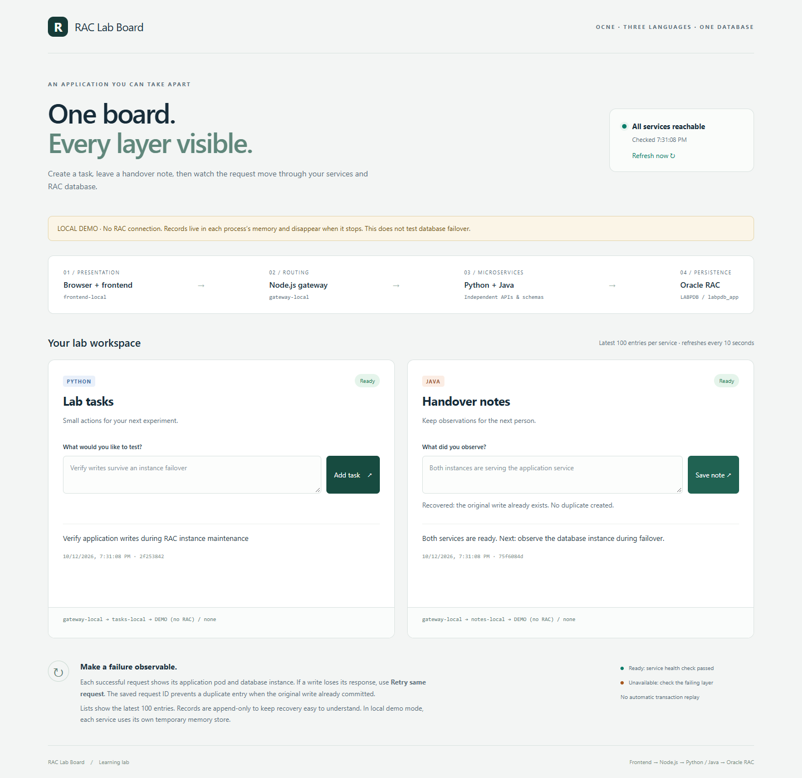

# RAC Lab Board

A small application for learning how a browser, three microservices, Kubernetes and Oracle RAC work together. Create lab tasks through Python and handover notes through Java. Node.js routes requests and reports service health. Every successful API response identifies the serving application pod and database instance.

**Status: developed and tested locally; NOT deployed. No Oracle users/tables, Kubernetes resources or container images have been installed by this work.** The local demo uses temporary memory stores. Live Oracle integration and RAC failover acceptance remain future steps.



## Start here

1. [Architecture and design decisions](docs/ARCHITECTURE.md) - layers, networking, schemas, resources and what failover means.
2. [Local development](docs/LOCAL-DEVELOPMENT.md) - Windows and Bash commands, build and local tests.
3. [Future deployment walkthrough](docs/DEPLOYMENT.md) - inspect, create the app schemas, build/stage images, create Secrets, deploy and verify. **Not executed.**
4. [Failover scenarios and commands](docs/FAILOVER.md) - expected results, workload generator, recovery and evidence collection. **Cluster scenarios not executed.**
5. [Actual validation results](docs/VALIDATION.md) - what ran locally, outputs, issues found and limits.
6. [API contract](docs/API.md) - requests, responses and retry rules.

## Separate folders

```text
apps/rac-lab-board/
  frontend/                     Browser UI, static server and Dockerfile
    public/                     index.html, app.js, style.css
  backend/
    node-gateway/               Node.js routing and health API
    python-tasks/               Python tasks API and Oracle adapter
    java-notes/                 Java notes API and Oracle adapter
      src/                      Java source
      dependencies.lock.json    Pinned dependency URLs and SHA256 hashes
  database/                     Future schema creation and verification SQL
  kubernetes/                   Namespace, ConfigMap, Deployments, Services, PDBs
  scripts/                      Local preparation, builds, demo and opt-in HTTP probe
  tests/                        HTTP, transaction and browser checks
  docs/                         Architecture, walkthroughs, evidence, diagrams
```

Ignored Java libraries/build output stay next to the Java service. The portable JDK, Python virtual environment and future secrets are under `D:\OCNE19-Lab\private`. Raw local test output is under `D:\OCNE19-Lab\logs`. Source and reviewed documentation are included in Git; runtime binaries and private assets are excluded.

## Run the local demo on this workstation

The development dependencies have already been prepared locally. From PowerShell:

```powershell
Set-Location D:\OCNE19-Lab\apps\rac-lab-board
python scripts/dev.py
```

Open **http://localhost:8080**. Keep that terminal running. Press Ctrl+C to stop the four local processes. The launcher binds only to loopback, explicitly forces `STORE_MODE=memory`, removes database credentials from child environments, and never contacts RAC. Each restart clears its demo records. See [local development](docs/LOCAL-DEVELOPMENT.md) for a fresh machine.

## Proposed cluster architecture


Four Deployments, two replicas each, in namespace `rac-app`. The existing database stays in `rac`. There are no application volumes, new RAC disks or database operator changes. Both backends connect to the existing `labpdb_app` service through the two verified node listeners.

This is an intentionally small, unauthenticated learning application. It is designed for the isolated lab and localhost access through SSH, not public exposure. It implements bounded calls and explicit idempotent retries, not Oracle Application Continuity or a zero-interruption guarantee.
