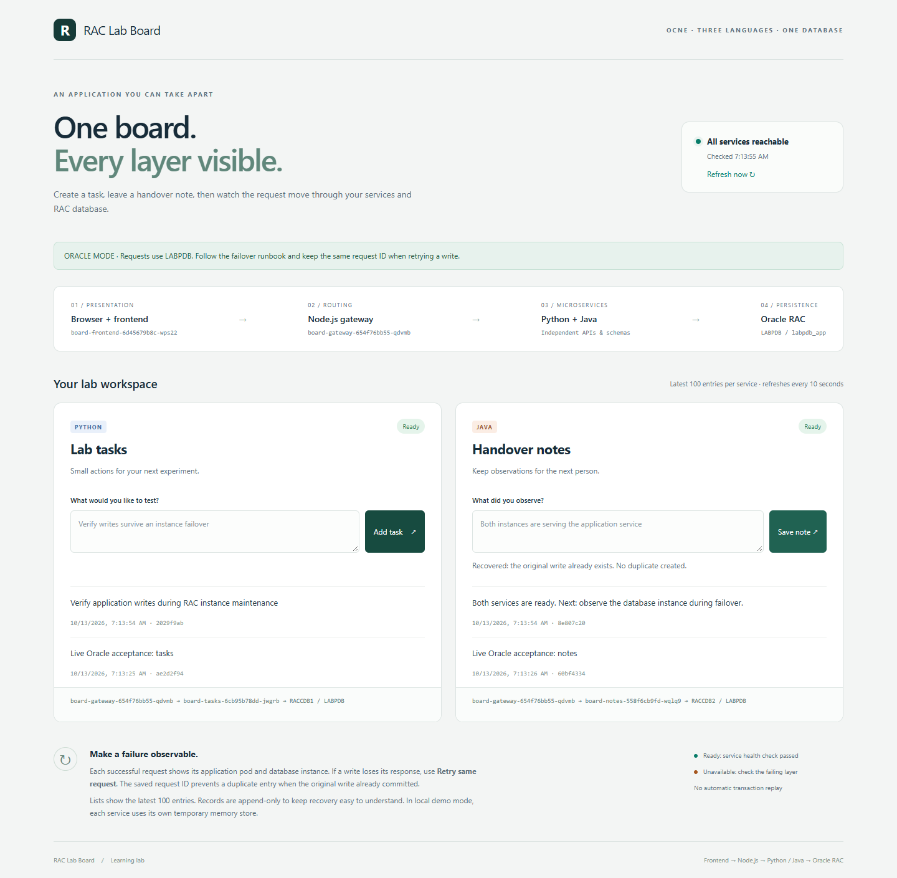
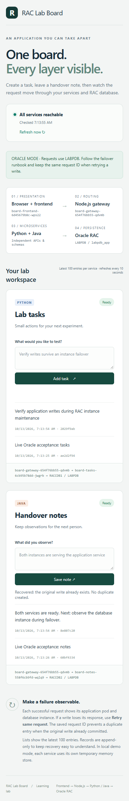
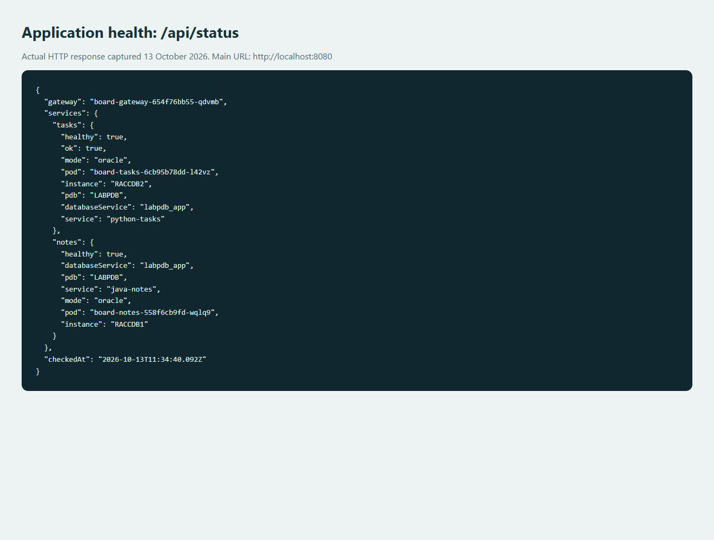
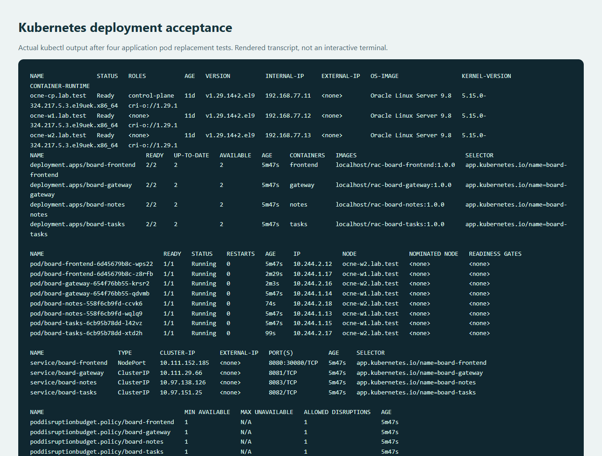
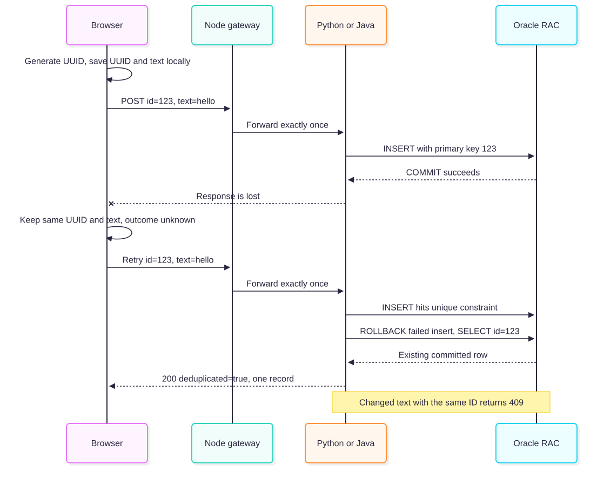

# RAC Lab Board: complete illustrated manual

**Deployed and verified on 13 October 2026.** This manual explains the application from prerequisites to browser access, internal request flow, verification, troubleshooting and teardown. It assumes the OCNE cluster and Oracle RAC database already exist. For a new platform, first follow the [OCNE/RAC end-to-end manual](../../../docs/OCNE-RAC-END-TO-END-MANUAL.md).

**Main URL: [http://localhost:8080](http://localhost:8080)** on your workstation, while the SSH tunnel runs. This lab is already deployed: start at **section 7**, then section 10 to understand the request flow. Sections1-6 are for a first installation; do not rerun one-time credential/user creation against this running app. Section 12 explains how to uninstall and redeploy while preserving records.

This document includes the full deployment and teardown procedures plus the internal-workings chapter. It is generated from those reviewed source documents by scripts/render_manual.py, so corrections can be kept consistent. [Full actual results](DEPLOYMENT-RESULTS.md) include complete command transcripts, image digests, SQL output and per-scenario probe summaries. Actual and expected outputs are labelled; pod names, UIDs, timestamps and new-install ClusterIPs will differ next time.

## Before you start: requirements and execution locations

| Location | This lab | Use it for |
|---|---|---|
| Windows workstation | D:\OCNE19-Lab | Source, protected files, SSH/SCP, browser and probes |
| Operator | ocne-op | Existing rootless Podman builder |
| Control plane | ocne-cp  / 192.168.77.11 | Existing authorized kubectl context |
| Worker1 | ocne-w1.lab.test  / 192.168.77.12 | Rootful image import; application pods and RACCDB1 |
| Worker2 | ocne-w2.lab.test  / 192.168.77.13 | Rootful image import; application pods and RACCDB2 |
| Application namespace | rac-app | Four Deployments/Services/PDBs, ConfigMap and two Secrets |
| Database namespace | rac | Existing RAC resources; preserved by app teardown |
| Oracle target | LABPDB  / labpdb_app | Separate LAB_TASKS and LAB_NOTES schemas |
| Protected workstation files | private/ | Credentials, tools, image archives, tunnel PID |
| Raw evidence | logs/ | Local command output and per-request JSONL |

Prerequisites: verified SSH aliases for all four VMs; existing kubectl access on ocne-cp; root/sudo access for image import on workers; both workers Ready and labelled raccluster=raccluster01; both RAC instances open; LABPDB READ WRITE; labpdb_app active on both instances; USERS online and AL32UTF8. First installation also requires unused LAB_TASKS/LAB_NOTES usernames and available NodePort 30080. Names already belonging to another project are investigated, never deleted to resolve conflicts.

The application adds 325m CPU/512 MiB requested memory per worker,650m/1 GiB total. Inspect requests and actual usage before applying. Workers remain22 GiB each. OP/CP remain the user's 4/8 GiB, below Oracle minimum sizing; this app acceptance does not validate those platform choices.

**Shell rule:** PowerShell means your Windows workstation. A block labelled Bash on ocne-cp, operator or worker runs after SSH to that VM. Type exit to return to Windows before a workstation command. Linux workstation examples use the checkout's actual path and python3; Git Bash on this Windows host uses /d/OCNE19-Lab and may name the interpreter python. Choose one alternative for each creation step, not both.

If adapting to your own environment, map your actual SSH aliases, node labels, PDB/service, listener DNS names/ports, namespace, tablespace and NodePort first. Update YAML, SQL and commands consistently. lab.psd1 does not dynamically rewrite these app files or a live cluster. There are no VM creation, disk formatting or RAC provisioning commands in the application procedure.

## Architecture and source orientation



The browser loads HTML/CSS/JavaScript from the frontend. Frontend proxies same-origin /api requests to Node.js. Node routes tasks to Python and notes to Java. Each database service has its own account/table in the same Oracle PDB. RAC's two instances access the same database; an acknowledged record is not tied to its original app pod or Oracle instance.

| Folder | Contents | Runtime responsibility |
|---|---|---|
| frontend/public | HTML/CSS/browser JavaScript | Forms, lists, health, saved retry UUID |
| frontend/server.mjs | Node static server/proxy | Port 8080, routes /api to gateway |
| backend/node-gateway | Node HTTP router | Port 8081, routing and aggregated health |
| backend/python-tasks | Python HTTP API and Oracle Thin pool | Port 8082, LAB_TASKS.BOARD_TASKS |
| backend/java-notes/src | Java HTTP API, JDBC Thin / HikariCP | Port 8083, LAB_NOTES.BOARD_NOTES |
| database | Create, verify and optional drop SQL | Administrator-only schema lifecycle |
| kubernetes | Namespace, ConfigMap, workloads and Services | Two replicas per component |
| scripts | Individually invoked helpers | Build, credentials, verification, pod tests, teardown |

No Oracle Instant Client is needed. Runtime users do not receive DBA privileges. Containers run as UID/GID 10001 with read-only root filesystems, dropped capabilities, no service-account token and a small disk-backed /tmp. Each Python/Java replica allows at most two Oracle connections; eight total across those four replicas. Java heap is capped at 128 MiB. See [ARCHITECTURE.md](ARCHITECTURE.md) for the full resource/timeout table.

This is an unauthenticated learning app for the isolated lab. The SSH tunnel listens only on workstation loopback, but it does not make the underlying cluster NodePort private. Do not expose the app publicly.

## Prepare workstation dependencies before the image-build step

The running lab already has these dependencies. On a new Windows checkout, from PowerShell:

```powershell
Set-Location D:\OCNE19-Lab\apps\rac-lab-board
node --version
python --version
# Only if JDK21 is not already installed:
.\scripts\Install-Local-JDK.ps1
python scripts/prepare.py
if ($LASTEXITCODE -ne 0) { throw 'Dependency preparation failed' }
```

Expected: Node.js 24, Python 3.10+, Java 21; five Java jars match their locked hashes; Java compiles; pinned Python packages install in the private virtual environment. Actual runtime packages include python-oracledb3.4.2, ojdbc11 23.9.0.25.07, HikariCP5.1.0, Gson2.13.2 and SLF4J2.0.17. Containers use Linux Python 3.12 and Java 21; all four image builds passed.

Equivalent Bash workstation, with Node.js 24/Python 3.10+/JDK 21 already installed:

```bash
cd /path/to/OCNE19-Lab/apps/rac-lab-board
node --version
python3 --version
javac -version
python3 scripts/prepare.py
```

Do not run scripts/dev.py for the live deployment. That is a separate memory-only demonstration, and its port 8080 conflicts with the live SSH tunnel. [LOCAL-DEVELOPMENT.md](LOCAL-DEVELOPMENT.md) explains that optional mode.


This chapter changes the live lab when you run it. The user authorized deployment on 13 October 2026. See [deployment evidence](DEPLOYMENT-RESULTS.md) for actual results and [teardown/redeployment](DESTROY.md) for removal commands. It is a manual procedure, not an auto-run installer. Finish the preflight, schemas and image checks before creating app pods. Use the existing lab; do not rerun VM creation, OS cloning, RAC provisioning or disk formatting.

## 1. Read-only preflight

From Windows PowerShell:

```powershell
Set-Location D:\OCNE19-Lab
ssh ocne-cp
```

The following commands run in **Bash on ocne-cp**, using its existing authorized kubectl context:

```bash
set -euo pipefail
kubectl config current-context
kubectl get nodes -o wide
kubectl get nodes -l raccluster=raccluster01 -o wide
kubectl -n rac get pods -o wide
kubectl -n rac get services racnode1-0-lsnr racnode2-0-lsnr
kubectl get services -A -o custom-columns=NS:.metadata.namespace,NAME:.metadata.name,NODEPORT:.spec.ports[*].nodePort
kubectl describe node ocne-w1.lab.test
kubectl describe node ocne-w2.lab.test
kubectl -n rac exec racnode1-0 -- su - oracle -c '/u01/app/oracle/product/19c/dbhome_1/bin/srvctl status database -db RACCDB'
kubectl -n rac exec racnode1-0 -- su - oracle -c '/u01/app/oracle/product/19c/dbhome_1/bin/srvctl status service -db RACCDB -service labpdb_app'
```

Expected: both workers Ready, worker label on both, both RAC instances running, application service running on both, and listener Services exposing 31522 and 31523. Port 30080 must be unused, or already owned by this exact app on a subsequent run. If another project uses it, choose a free NodePort and consistently update the frontend manifest and SSH commands. Do not delete conflicting resources.

Confirm one replica of each service's additional 325m CPU / 512 MiB memory fits **each** worker's current requests. Inspect actual host/container use and disk space too. Requests are scheduling reservations, not spare physical RAM. Reassess admission after every material lab change. The existing single control plane and undersized OP/CP are lab limitations. Keep workers at 22 GiB unless separately changed by the user.

Check that `rac-app`, the four board Deployments, and LAB_TASKS/LAB_NOTES do not belong to another project. If a partial earlier run exists, inspect it and continue the missing steps. Never use delete/recreate as a naming-conflict remedy.

## 2. Prepare local secrets without printing them

On Windows, from the app root:

```powershell
Set-Location D:\OCNE19-Lab\apps\rac-lab-board
python scripts/make_secrets.py
if ($LASTEXITCODE -ne 0) { throw 'Secret preparation failed' }
```

Equivalent Bash from the app root:

```bash
python3 scripts/make_secrets.py
```

This creates four files in the project's ignored `private/rac-app-secrets`: tasks/notes username and password files. Usernames are LAB_TASKS and LAB_NOTES; passwords are different 30-character random lowercase hexadecimal strings. There are no newline bytes in these files. The helper restricts the directory ACL on Windows or uses mode 0700/0600 on POSIX. It refuses to overwrite an existing directory. It was run during the authorized deployment. Oracle 19c passwords are limited to 30 bytes; the original 32-character generator failed with ORA-00972 and was corrected before either user existed. See [Oracle password requirements](https://docs.oracle.com/en/database/oracle/oracle-database/19/dbseg/minimum-requirements-passwords.html).

Do not put passwords into YAML, environment-example files, shell history or source control. Reuse these exact passwords at the Oracle prompts and when creating Kubernetes Secrets. Password rotation later requires a coordinated database change, Secret update and controlled app rollout; changing the Secret alone does not change an Oracle password or existing process environment.

## 3. Create the two application schemas once

Inspect the SQL first: [01-create-schemas.sql](../database/01-create-schemas.sql). It targets LABPDB, requires AL32UTF8 and an existing online USERS tablespace, rejects pre-existing app users, grants only CREATE SESSION, and caps each user's quota at 100 MiB. It does not create a tablespace or format/attach storage. An administrator creates the tables and indexes in the two schemas; runtime services do not migrate schema.

Windows PowerShell, app root:

```powershell
ssh ocne-cp 'mkdir -p ~/rac-app/database ~/rac-app/kubernetes'
scp database/01-create-schemas.sql database/02-verify.sql ocne-cp:rac-app/database/
scp kubernetes/00-namespace.yaml kubernetes/10-config.yaml kubernetes/20-workloads.yaml kubernetes/kustomization.yaml ocne-cp:rac-app/kubernetes/
```

The same `ssh` and `scp` commands work from Bash in the app root. For a different environment, adjust this known lab's SSH alias, PDB/service/listener addresses, worker selector, usernames and tablespace **together**, based on observed state. The configuration here does not dynamically rewrite an existing cluster.

On ocne-cp:

```bash
kubectl cp "$HOME/rac-app/database/01-create-schemas.sql" rac/racnode1-0:/tmp/rac-board-create-schemas.sql
kubectl exec -it -n rac racnode1-0 -- su - oracle -c 'ORACLE_SID=RACCDB1 /u01/app/oracle/product/19c/dbhome_1/bin/sqlplus -L / as sysdba @/tmp/rac-board-create-schemas.sql'
```

At each hidden ACCEPT prompt, paste the corresponding protected file's password, not the file path. Do not enable SQL echo/spooling. On Windows you can copy one value into the clipboard without printing it:

```powershell
Get-Content -Raw D:\OCNE19-Lab\private\rac-app-secrets\tasks-password.txt | Set-Clipboard
# Paste only into the LAB_TASKS hidden SQL prompt.
Get-Content -Raw D:\OCNE19-Lab\private\rac-app-secrets\notes-password.txt | Set-Clipboard
# Paste only into the LAB_NOTES hidden SQL prompt, then clear the clipboard.
Set-Clipboard -Value ''
```

On a Linux graphical workstation, use your protected password manager/file viewer, or `xclip -selection clipboard -i ../../private/rac-app-secrets/tasks-password.txt` from the app root if xclip is installed; repeat for notes, then `printf '' | xclip -selection clipboard`. This manual route uses interactive password entry. Do not paste a password into a shell command. The scripts accept exactly the generated hexadecimal format, avoiding SQL quoting ambiguity.

Expected final SQL rows: `LAB_NOTES BOARD_NOTES` and `LAB_TASKS BOARD_TASKS`. Oracle DDL auto-commits; failure halfway through can leave some objects created. Inspect `dba_users`, `dba_tables`, indexes and grants, and execute only missing DDL. Do not blindly rerun the create-users script or drop existing application records.

Verify on ocne-cp:

```bash
kubectl cp "$HOME/rac-app/database/02-verify.sql" rac/racnode1-0:/tmp/rac-board-verify.sql
kubectl exec -i -n rac racnode1-0 -- su - oracle -c 'ORACLE_SID=RACCDB1 /u01/app/oracle/product/19c/dbhome_1/bin/sqlplus -L -s / as sysdba @/tmp/rac-board-verify.sql'
```

Expected: LABPDB, two tables, zero initial records, OPEN user accounts, CREATE SESSION grants and labpdb_app active on both instances. Application writes are verified after deployment, not by inserting dummy administrator-owned data now.

### Noninteractive alternative used for this deployment

The reviewed helper reads the protected files locally, validates the usernames and 30-character hexadecimal passwords, and sends SQL or Secret JSON through encrypted SSH standard input. It does not place passwords in command arguments or print them. SQL errors are redacted before output. It uses the existing authorized ocne-cp SSH alias and OS SYSDBA access inside racnode1-0.

From the Windows app root:

```powershell
python scripts/provision_access.py create-schemas
if ($LASTEXITCODE -ne 0) { throw 'Inspect partial schema state before retrying' }
python scripts/provision_access.py verify
```

Bash workstation equivalent:

```bash
python3 scripts/provision_access.py create-schemas
python3 scripts/provision_access.py verify
```

Choose either this method or the interactive method above for schema creation, not both. Existing users cause creation to stop deliberately. After section 5 creates the namespace, `python scripts/provision_access.py create-secrets` (Bash: `python3`) creates the two Secrets directly from protected local files without transferring plaintext files to the guest. Choose this helper or section 5's manual Secret commands, not both. A partial Secret creation is inspected and completed individually, never silently overwritten.

## 4. Build and stage the four container images

### Linux Podman builder used in this lab

Docker Desktop was stopped. The existing operator VM had rootless Podman 5.8.2, SELinux enabled, cgroup v2, about 2.2 GiB available RAM and 82 GiB free root-disk space. We built sequentially there with a 1 GiB build-memory limit. This is our local build implementation, not an OCNE installation requirement. Base images use explicit docker.io/library names to avoid ambiguous short-name registry lookup.

Prepare locked Java jars first using the local-development instructions. Transfer only app build contexts and scripts, including ignored Java lib jars, excluding secrets, node_modules, build output and logs. From the Windows app root:

```powershell
python scripts/package_build.py
scp ../../private/rac-app-source-1.0.0.tar.gz ocne-op:rac-app-source-1.0.0.tar.gz
ssh ocne-op
```

Bash workstation equivalent:

```bash
python3 scripts/package_build.py
scp ../../private/rac-app-source-1.0.0.tar.gz ocne-op:rac-app-source-1.0.0.tar.gz
ssh ocne-op
```

On the operator, **first build only** (the directory already exists after this deployment):

```bash
set -euo pipefail
podman info
free -m
df -h "$HOME"
test ! -e "$HOME/rac-app-build"
mkdir "$HOME/rac-app-build"
tar -xzf "$HOME/rac-app-source-1.0.0.tar.gz" -C "$HOME/rac-app-build"
python3 "$HOME/rac-app-build/scripts/build_images.py" --engine podman --archive "$HOME/rac-app-images-1.0.0.tar"
sha256sum "$HOME/rac-app-images-1.0.0.tar"
```

The helper verifies all locked Java jars, builds linux/amd64 images, and exports a multi-image docker archive. For later code changes, choose a new version tag, directory and archive, update all four manifest tags consistently, and retain the previous version for rollback. Do not overwrite a deployed tag and assume running pods changed. For redeployment of this unchanged version, reuse the verified images/archive.

Because workstation NAT-forwarded transfer was slow, the actual worker transfer used the existing verified inter-VM SSH connections, from the operator:

```bash
scp -C -o BatchMode=yes -o StrictHostKeyChecking=yes "$HOME/rac-app-images-1.0.0.tar" labadmin@ocne-w1:rac-app-images-1.0.0.tar
scp -C -o BatchMode=yes -o StrictHostKeyChecking=yes "$HOME/rac-app-images-1.0.0.tar" labadmin@ocne-w2:rac-app-images-1.0.0.tar
```

Keep a workstation copy under private/ too. Worker import remains **rootful**, as described below. Sources: [Podman build](https://docs.podman.io/en/latest/markdown/podman-build.1.html), [multi-image save](https://docs.podman.io/en/latest/markdown/podman-save.1.html), [load](https://docs.podman.io/en/latest/markdown/podman-load.1.html).

### Docker build alternative and workstation transfer

Follow [local build instructions](LOCAL-DEVELOPMENT.md). After a successful build/export on Windows:

```powershell
Get-FileHash D:\OCNE19-Lab\private\rac-app-images-1.0.0.tar -Algorithm SHA256
scp D:\OCNE19-Lab\private\rac-app-images-1.0.0.tar ocne-w1:rac-app-images-1.0.0.tar
scp D:\OCNE19-Lab\private\rac-app-images-1.0.0.tar ocne-w2:rac-app-images-1.0.0.tar
ssh ocne-w1
```

Bash workstation equivalent, app root:

```bash
sha256sum ../../private/rac-app-images-1.0.0.tar
scp ../../private/rac-app-images-1.0.0.tar ocne-w1:rac-app-images-1.0.0.tar
scp ../../private/rac-app-images-1.0.0.tar ocne-w2:rac-app-images-1.0.0.tar
ssh ocne-w1
```

On **each worker separately**, first inspect the tool/runtime/storage state:

```bash
command -v podman
command -v crictl
df -h "$HOME" /var/lib/containers/storage
sha256sum "$HOME/rac-app-images-1.0.0.tar"
sudo podman info --format '{{.Store.GraphRoot}}'
sudo crictl info
```

Compare the archive hash with the workstation. Do not import a different archive or invent a new CRI-O storage path. With the existing rootful container-storage tooling available:

```bash
sudo podman load --input "$HOME/rac-app-images-1.0.0.tar"
sudo crictl images | grep rac-board
```

Expected: all four exact `localhost/rac-board-*:1.0.0` tags visible through **crictl on both workers**. A rootless Podman import is not sufficient. If Podman is missing, or CRI-O cannot see those tags, stop and resolve the observed tooling/storage mismatch before applying Deployments. See the deployment evidence for the actual imports. Do not install Docker or alter CRI-O just to bypass the check.

Record image IDs and build/base-image digests with the deployment evidence. Dockerfile tags can move; rebuilds are not assumed bit-for-bit identical.

## 5. Create the namespace and the two Secrets

On ocne-cp, after reviewing the copied files:

```bash
kubectl apply --dry-run=client -f "$HOME/rac-app/kubernetes/00-namespace.yaml"
kubectl apply -f "$HOME/rac-app/kubernetes/00-namespace.yaml"
mkdir -p "$HOME/private/rac-app-secrets"
chmod 700 "$HOME/private/rac-app-secrets"
```

From PowerShell, transfer the four individual secret files over SSH:

```powershell
scp D:\OCNE19-Lab\private\rac-app-secrets\tasks-username.txt D:\OCNE19-Lab\private\rac-app-secrets\tasks-password.txt D:\OCNE19-Lab\private\rac-app-secrets\notes-username.txt D:\OCNE19-Lab\private\rac-app-secrets\notes-password.txt ocne-cp:private/rac-app-secrets/
```

Bash workstation equivalent from app root:

```bash
scp ../../private/rac-app-secrets/tasks-username.txt ../../private/rac-app-secrets/tasks-password.txt ../../private/rac-app-secrets/notes-username.txt ../../private/rac-app-secrets/notes-password.txt ocne-cp:private/rac-app-secrets/
```

On ocne-cp, passwords remain out of command-line arguments and printed output:

```bash
chmod 600 "$HOME/private/rac-app-secrets/"*.txt
kubectl -n rac-app create secret generic board-tasks-db \
  --from-file=username="$HOME/private/rac-app-secrets/tasks-username.txt" \
  --from-file=password="$HOME/private/rac-app-secrets/tasks-password.txt"
kubectl -n rac-app create secret generic board-notes-db \
  --from-file=username="$HOME/private/rac-app-secrets/notes-username.txt" \
  --from-file=password="$HOME/private/rac-app-secrets/notes-password.txt"
kubectl -n rac-app label secret board-tasks-db board-notes-db app.kubernetes.io/part-of=rac-lab-board
kubectl -n rac-app get secret board-tasks-db board-notes-db
```

Expected: two Opaque Secrets with two data entries each. Do not use `-o yaml` or decode them into a transcript. If already present, inspect ownership and intended credentials; do not delete/recreate automatically. Protect or remove the **specific temporary transferred files** according to your credential handling procedure after verification, retaining the protected master copies needed for recovery. No generic recursive cleanup command is provided.

## 6. Validate and apply only the application

On ocne-cp:

```bash
kubectl apply --dry-run=server -k "$HOME/rac-app/kubernetes"
# Review all names/namespaces/images; this next command actually deploys the app.
kubectl apply -k "$HOME/rac-app/kubernetes"
for name in board-frontend board-gateway board-tasks board-notes; do
  kubectl -n rac-app rollout status "deployment/$name" --timeout=180s
done
kubectl -n rac-app get deployments,pods,services,pdb -o wide
kubectl -n rac-app get endpointslices -l kubernetes.io/service-name=board-tasks
kubectl -n rac-app get endpointslices -l kubernetes.io/service-name=board-notes
```

Expected: four Deployments with 2/2 available, eight Ready pods, four Services, four PDBs with one allowed disruption under healthy conditions, and two ready backend endpoints per backend. If all replicas of a service landed on one worker, inspect scheduling/resources; the spread preference is not a guarantee. Do not force a worker drain to fix placement in this RAC lab.

If rollout fails, use [troubleshooting below](#9-troubleshooting). Never treat a Ready RAC TCP probe as proof of SQL availability. The new backend probes execute SQL; their failures can reveal an existing database/service/schema issue.

## 7. Access through SSH and verify real Oracle mode

From Windows PowerShell or Bash on the workstation, keep this session running:

```text
ssh -o ExitOnForwardFailure=yes -o ServerAliveInterval=30 -N -L 127.0.0.1:8080:192.168.77.12:30080 ocne-cp
```

Use http://localhost:8080. The tunnel goes through the existing SSH alias/NAT forwarding and targets the frontend **Service** via a worker NodePort. A normal frontend pod replacement should not bind the tunnel to the old pod. `kubectl port-forward deployment/...` can be convenient for diagnostics, but its chosen pod connection can end during a pod-replacement test, confounding the result.

For maintenance of worker1, use worker2 as the tunnel destination: `ssh -N -L 127.0.0.1:8080:192.168.77.13:30080 ocne-cp` after stopping the old tunnel. A tunnel whose fixed destination is powered off will fail independently of app health.

PowerShell verification:

```powershell
Invoke-RestMethod http://localhost:8080/api/status | ConvertTo-Json -Depth 8
$task = @{id=[guid]::NewGuid().ToString();text='First real RAC task'} | ConvertTo-Json -Compress
Invoke-RestMethod http://localhost:8080/api/tasks -Method Post -ContentType application/json -Body $task | ConvertTo-Json -Depth 8
Invoke-RestMethod http://localhost:8080/api/tasks -Method Post -ContentType application/json -Body $task | ConvertTo-Json -Depth 8
$note = @{id=[guid]::NewGuid().ToString();text='Java also writes to LABPDB'} | ConvertTo-Json -Compress
Invoke-RestMethod http://localhost:8080/api/notes -Method Post -ContentType application/json -Body $note | ConvertTo-Json -Depth 8
```

Bash equivalent:

```bash
curl --fail-with-body -sS http://localhost:8080/api/status | python3 -m json.tool
task=$(python3 -c 'import json,uuid; print(json.dumps({"id":str(uuid.uuid4()),"text":"First real RAC task"}))')
curl --fail-with-body -sS http://localhost:8080/api/tasks -H 'Content-Type: application/json' -d "$task"
curl --fail-with-body -sS http://localhost:8080/api/tasks -H 'Content-Type: application/json' -d "$task"
note=$(python3 -c 'import json,uuid; print(json.dumps({"id":str(uuid.uuid4()),"text":"Java also writes to LABPDB"}))')
curl --fail-with-body -sS http://localhost:8080/api/notes -H 'Content-Type: application/json' -d "$note"
```

Expected: `mode=oracle`, `pdb=LABPDB`, real RACCDB1/RACCDB2 names, one created task followed by `deduplicated=true`, and one created note. A connection pool can remain on the same instance for multiple calls; a 50/50 split is not promised. Verify each language can recover through either listener during the controlled scenarios. Repeat the SQL verification from section 3; counts and unique IDs should agree.

## 8. Acceptance gate before fault injection

Capture the context, nodes, resource reservations, pod UIDs/placement, image IDs, both SQL paths, app status and test record IDs. Ensure current database backup/recovery readiness and a maintenance window. Run the no-fault HTTP probe first. Only then follow [FAILOVER.md](FAILOVER.md), starting with app pods. Do not combine multiple faults; restore and verify after each one.

## 9. Troubleshooting

| Symptom | Check | Corrective action |
|---|---|---|
| ErrImageNeverPull | `kubectl -n rac-app describe pod <name>`; `sudo crictl images` on its worker | Load exact image/tag into rootful CRI-O-visible storage on both workers |
| CreateContainerConfigError | Pod events, Secret/ConfigMap names (without printing values) | Create the missing app-only prerequisite; verify key names |
| Pending | `kubectl -n rac-app describe pod <name>`; worker labels and requests | Fix label substitution or capacity after inspection; do not evict RAC or increase worker RAM silently |
| Python/Java live but not ready | Backend logs and `/api/status`; listener Services, PDB, schema | Correct the actual DB service, user/password, account state or missing tables; no blind schema reset |
| ORA-01017 / ORA-28000 | Restricted operator investigation; application log deliberately suppresses raw driver details | Match Secret to the intended Oracle user; investigate account locking instead of repeated bad logins |
| ORA-00942 | Run the read-only schema verification SQL | Finish missing schema objects using the correct owner; do not grant DBA |
| TCP works but database service unavailable | `srvctl status service`; SQL to LABPDB | Restore registered application service/instance; TCP alone is insufficient |
| Browser shows LOCAL DEMO | ConfigMap and Deployment env | Stop acceptance: Kubernetes must use Oracle mode; do not claim data persistence |
| Browser shows 503 while only one backend fails | Status for tasks vs notes, gateway logs | Diagnose that backend independently; the other service should remain usable |
| Unknown write outcome | Saved request ID/body and exact-ID GET | Retry identical payload; never invent a new ID to hide ambiguity |
| OOMKilled or repeated Java restarts | `kubectl describe pod`, previous logs, current resources | Measure workload/heap/native memory and available worker headroom before tuning |
| UI unavailable after frontend pod delete | Whether access used pod-pinned port-forward | Reconnect or use the documented worker NodePort SSH tunnel |

Useful Bash commands on ocne-cp:

```bash
kubectl -n rac-app get pods -o wide
kubectl -n rac-app get events --sort-by=.lastTimestamp
kubectl -n rac-app logs -l app.kubernetes.io/name=board-tasks --prefix --tail=100
kubectl -n rac-app logs -l app.kubernetes.io/name=board-notes --prefix --tail=100
kubectl -n rac-app logs -l app.kubernetes.io/name=board-gateway --prefix --tail=100
```

Use `kubectl logs <pod> --previous` for a container restart. Keep raw logs in the project's ignored `logs/`; sanitize evidence before adding it to documentation. These commands apply to the deployed application. Read the evidence before treating any fault scenario as executed.


This chapter is also included in the [complete manual](MANUAL.md). Commands marked Bash on ocne-cp use its existing kubectl context. Workstation Python commands run from the app root; use python3 in Bash. Read-only inspections are distinguished from tests that write records or replace app pods.

## 10. Follow a request through every layer

### 10a. Main URL and the SSH path

**Main application: [http://localhost:8080](http://localhost:8080)**. In this deployment a hidden SSH tunnel already runs. After a workstation reboot or closed SSH session, reopen it from a dedicated PowerShell or Bash workstation terminal:

```text
ssh -o ExitOnForwardFailure=yes -o ServerAliveInterval=30 -N -L 127.0.0.1:8080:192.168.77.12:30080 ocne-cp
```

Success is normally silent; leave the terminal open. This means:

1. Browser connects to 127.0.0.1:8080 on Windows.
2. SSH encrypts the connection to the existing ocne-cp SSH endpoint.
3. From inside the guest network, ocne-cp connects to worker1 at192.168.77.12:30080.
4. Kubernetes NodePort routes to a Ready frontend pod, possibly on either worker.

-N runs no remote command; -L forwards the local port. ExitOnForwardFailure catches bind errors, and ServerAliveInterval detects broken SSH connectivity. The tunnel targets a Service via a worker address, not a specific frontend pod. App-pod replacement therefore does not require retargeting it. If worker1 itself is unavailable, use 192.168.77.13 after verifying worker2 and stopping the previous tunnel. Do not bind two tunnels to the same localhost port.

If port 8080 is already used, inspect it before stopping anything. PowerShell:

```powershell
Get-NetTCPConnection -State Listen -LocalPort 8080 | Select-Object LocalAddress,OwningProcess
$status = Invoke-RestMethod http://127.0.0.1:8080/api/status
$status | ConvertTo-Json -Depth 8
if (-not $status.services.tasks.healthy -or -not $status.services.notes.healthy) { throw 'A backend is unhealthy' }
if ($status.services.tasks.mode -ne 'oracle' -or $status.services.notes.mode -ne 'oracle') { throw 'Not in Oracle mode' }
```

Bash workstation:

```bash
ss -ltnp 'sport = :8080'
curl --fail-with-body -sS http://127.0.0.1:8080/api/status | python3 -m json.tool
```

A closed workstation tunnel does not stop the cluster app. Reopen it before redeploying anything. The hidden tunnel PID is recorded in private/rac-app-tunnel.json; verify the actual process before stopping it, because PIDs can be reused.

### 10b. What the browser should show

Open localhost:8080. The health card should say **All services reachable**, the banner **ORACLE MODE**, and both panels Ready. Add a task and a note, then refresh: both remain because Oracle stores them. The panel footers identify the gateway/backend pod and RACCDB1 or RACCDB2. Pool reuse means an instance can appear repeatedly; 50/50 routing is not promised.



Live mobile-size capture from the same acceptance:



/api/status is JSON health, not a second UI. It can return HTTP 200 while a backend is unhealthy: inspect both healthy fields, both mode=oracle values and PDB=LABPDB. Actual response captured at 11:34:40 UTC13 October:

```json
{
  "gateway": "board-gateway-654f76bb55-qdvmb",
  "services": {
    "tasks": {
      "healthy": true,
      "ok": true,
      "mode": "oracle",
      "pod": "board-tasks-6cb95b78dd-l42vz",
      "instance": "RACCDB2",
      "pdb": "LABPDB",
      "databaseService": "labpdb_app",
      "service": "python-tasks"
    },
    "notes": {
      "healthy": true,
      "databaseService": "labpdb_app",
      "pdb": "LABPDB",
      "service": "java-notes",
      "mode": "oracle",
      "pod": "board-notes-558f6cb9fd-wqlq9",
      "instance": "RACCDB1"
    }
  },
  "checkedAt": "2026-10-13T11:34:40.092Z"
}
```



Use localhost for the browser. UUID creation relies on its secure-context API available on localhost; raw worker-IP HTTP is not the documented browser entry point. The worker NodePort URLs are useful for command-line diagnostics from ocne-cp.

### 10c. Routing table

| Browser route | Frontend forwards to | Gateway forwards to | Oracle operation |
|---|---|---|---|
| GET / | Static local files | None | None |
| GET /api/status | board-gateway:8081/api/status | Both backend /readyz endpoints | Connection/PDB/table checks |
| POST /api/tasks | board-gateway:8081/api/tasks | board-tasks:8082/tasks | Insert/commit LAB_TASKS.BOARD_TASKS |
| POST /api/notes | board-gateway:8081/api/notes | board-notes:8083/notes | Insert/commit LAB_NOTES.BOARD_NOTES |
| GET /api/tasks or /api/notes | Corresponding /api route | /tasks or /notes | Latest100 records |
| GET /api/tasks/UUID or /api/notes/UUID | Exact-ID route | Exact-ID route | That UUID, including records older than100 |

Kubernetes DNS resolves short Service names within rac-app. Service ClusterIPs remain stable while a pod is replaced; EndpointSlices change to the new pod IP. No component needs a hard-coded peer pod address.

Bash on ocne-cp:

```bash
kubectl -n rac-app get services -o wide
kubectl -n rac-app get endpointslices -o wide
kubectl -n rac-app get pods -o wide
```

Actual EndpointSlices after the replacement tests:

```text
NAME                   ADDRESSTYPE   PORTS   ENDPOINTS                 AGE
board-frontend-s8pzp   IPv4          8080    10.244.2.12,10.244.1.17   22m
board-gateway-7kpgh    IPv4          8081    10.244.1.14,10.244.2.16   22m
board-notes-5wgwm      IPv4          8083    10.244.1.13,10.244.2.18   22m
board-tasks-rcd96      IPv4          8082    10.244.1.15,10.244.2.17   22m

```

### 10d. Test internal connectivity without an extra diagnostic image

The frontend contains Node, so use its fetch implementation. This read-only check runs on ocne-cp:

```bash
kubectl -n rac-app exec deployment/board-frontend -- node -e 'Promise.all(["http://board-gateway:8081/readyz","http://board-tasks:8082/readyz","http://board-notes:8083/readyz"].map(async u=>{const r=await fetch(u);console.log(u,r.status,await r.text());})).catch(e=>{console.error(e.message);process.exitCode=1;})'
```

Actual output:

```text
http://board-gateway:8081/readyz 200 {"ok":true,"pod":"board-gateway-654f76bb55-qdvmb"}
http://board-tasks:8082/readyz 200 {"ok": true, "mode": "oracle", "pod": "board-tasks-6cb95b78dd-l42vz", "instance": "RACCDB2", "pdb": "LABPDB", "databaseService": "labpdb_app", "service": "python-tasks"}
http://board-notes:8083/readyz 200 {"pod":"board-notes-558f6cb9fd-ccvk6","instance":"RACCDB2","databaseService":"labpdb_app","pdb":"LABPDB","service":"java-notes","mode":"oracle"}

```

This checks Service DNS/routing and real backend SQL readiness. A Service selects one endpoint per connection; inspect individual pod logs/events when diagnosing just one replica.

### 10e. What each Kubernetes object does

| Object or setting | Purpose here |
|---|---|
| Deployment | Maintains two replicas; creates a replacement when a pod disappears |
| Service | Stable address selecting current Ready pods |
| NodePort | Maps worker port 30080 to frontend Service port 8080 |
| EndpointSlice | Current pod addresses behind each Service |
| ConfigMap | Oracle mode, expected PDB, two-listener connect descriptor |
| Secret | Per-backend username/password; browser never receives these |
| Backend readiness probe | Checks Oracle connection, PDB and required table |
| Liveness probe | Checks the process, not Oracle availability |
| PDB | PodDisruptionBudget, minAvailable=1; different meaning from Oracle pluggable database LABPDB |
| nodeSelector/spreading | Limits placement to labelled workers and prefers balanced replicas |
| imagePullPolicy Never | Requires exact staged tags in both workers' CRI-O storage |

There is no app PV/PVC; durable records live in Oracle. Each container's small /tmp is disposable. PDBs govern voluntary eviction, not direct kubectl delete pod or host failure. Rolling updates use maxSurge=0 / maxUnavailable=1 to avoid extra pod reservations in this small lab.

The recorded post-test kubectl transcript:



This is a rendering of real captured text, not an invented terminal screen. Full selectable output is in [DEPLOYMENT-RESULTS.md](DEPLOYMENT-RESULTS.md).

### 10f. How database connections and retries work

The ConfigMap's DESCRIPTION contains both racnode1-0-lsnr.rac.svc.cluster.local:31522 and racnode2-0-lsnr.rac.svc.cluster.local:31523, requesting labpdb_app and checking LABPDB. It enables address load balancing/connect-time failover with bounded connect timeouts. The existing SCAN Service selected node1, so the app does not use it as its sole connection endpoint.

Python and Java maintain small connection pools. A request may reuse a session rather than reconnect. Each reports the instance/PDB from the connection used for its SQL. Both languages observed both RAC instances during real tests; this is not an injected instance-outage test.



1. Browser creates a lowercase UUID and saves UUID/text in localStorage before POST.
2. API validates JSON, request size, UUID and UTF-8 text length.
3. Parameter-bound SQL inserts the row and commits. HTTP 201 acknowledges a new row.
4. A timeout or missing reply leaves the outcome unknown; it does not prove rollback.
5. Browser retains the payload and offers **Retry same request**, including after reload.
6. The UUID primary key prevents another row. Identical text returns 200/deduplicated=true; changed text returns 409 and preserves the original.

The live browser test deliberately hid a completed response after a real commit, then reloaded and retried; exactly one note remained. This is application idempotency for these append-only records, not Oracle Application Continuity, Transaction Guard, FAN/FCF or arbitrary transaction replay. Tasks and notes are independent transactions, with no cross-service atomicity.

## 11. Hands-on writes and application pod recovery

### 11a. Manual write/retry test

This writes one real task. PowerShell, with the tunnel running:

```powershell
$id = [guid]::NewGuid().ToString()
$payload = @{id=$id;text='Manual task: verify Oracle persistence'} | ConvertTo-Json -Compress
Invoke-RestMethod http://127.0.0.1:8080/api/tasks -Method Post -ContentType application/json -Body $payload | ConvertTo-Json -Depth 8
Invoke-RestMethod http://127.0.0.1:8080/api/tasks -Method Post -ContentType application/json -Body $payload | ConvertTo-Json -Depth 8
Invoke-RestMethod "http://127.0.0.1:8080/api/tasks/$id" | ConvertTo-Json -Depth 8
```

Bash equivalent:

```bash
id=$(python3 -c 'import uuid; print(uuid.uuid4())')
payload=$(python3 -c 'import json,sys; print(json.dumps({"id":sys.argv[1],"text":"Manual task: verify Oracle persistence"}))' "$id")
curl --fail-with-body -sS http://127.0.0.1:8080/api/tasks -H 'Content-Type: application/json' -d "$payload"
curl --fail-with-body -sS http://127.0.0.1:8080/api/tasks -H 'Content-Type: application/json' -d "$payload"
curl --fail-with-body -sS "http://127.0.0.1:8080/api/tasks/$id"
```

Expected: first deduplicated=false, second=true, same UUID/text, exact-ID GET one item; meta.mode=oracle and meta.pdb=LABPDB. Repeat with /api/notes and a fresh UUID to exercise Java. Reusing a UUID with different text returns 409.

For the recorded concurrent acceptance, workstation app root:

```powershell
python scripts/verify_live.py --allow-writes
if ($LASTEXITCODE -ne 0) { throw 'Live acceptance failed' }
python scripts/provision_access.py verify
```

Bash uses python3 for both commands. Actual: first POST 201 per language, four concurrent retries all 200/deduplicated, conflicting text 409, exact-ID row count 1. SQL checkpoint after initial acceptance/probes:

```text
KIND   ROWS_TOTAL  UNIQUE_IDS
tasks         165         165
notes         164         164
```

Both accounts were OPEN with CREATE SESSION only; labpdb_app active on both instances. Counts will increase with your tests. The UI deliberately shows only 100 recent records; use exact-ID GET for older accepted rows.

### 11b. Start workloads, then replace one pod

Begin with eight Ready app pods and both APIs healthy. Use **two workstation terminals**, one command per terminal, from the app root:

```powershell
python scripts/load_probe.py --kind tasks --seconds 120 --interval 1 --allow-writes --out ../../logs/manual-frontend-tasks-01.jsonl
```

```powershell
python scripts/load_probe.py --kind notes --seconds 120 --interval 1 --allow-writes --out ../../logs/manual-frontend-notes-01.jsonl
```

Bash uses python3 with the same relative paths. These create real test rows. Use new filenames each time; the probe refuses to overwrite earlier evidence. It retains one unresolved UUID and verifies each exact ID afterward; it does not inject a fault.

In a third terminal, **Bash on ocne-cp**:

```bash
set -euo pipefail
kubectl -n rac-app get pods -l app.kubernetes.io/name=board-frontend -o wide
pod=$(kubectl -n rac-app get pods -l app.kubernetes.io/name=board-frontend -o jsonpath='{.items[0].metadata.name}')
test -n "$pod"
kubectl -n rac-app get pod "$pod" -o custom-columns=NAME:.metadata.name,UID:.metadata.uid
kubectl -n rac-app delete pod "$pod" --wait=true --timeout=120s
kubectl -n rac-app rollout status deployment/board-frontend --timeout=120s
kubectl -n rac-app get pods -l app.kubernetes.io/name=board-frontend -o wide
```

Expected: one pod disappears, a new name/UID appears, two Ready replicas return and Oracle rows remain. The Service/tunnel keeps its stable address. A request in flight can still fail: preserve its UUID and retry identical text if the outcome is unknown.

Actual frontend output:

```text
pod "board-frontend-6d45679b8c-phfmw" deleted
Waiting for deployment "board-frontend" rollout to finish: 1 of 2 updated replicas are available...
deployment "board-frontend" successfully rolled out
```

New UID a832821f-8db2-4e7f-9e96-0631a6c983c0; delete+rollout3.39 seconds. Each backend created/verified38 records in that20-second sample with zero failures/missing IDs. This is sampled behavior, not a zero-interruption guarantee.

Repeat independently for gateway, tasks and notes only after healthy recovery, using their exact Deployment/label names and new probe filenames. The explicitly opt-in automated equivalent is:

```powershell
python scripts/exercise_app_pods.py --allow-pod-replacement
```

Bash: `python3 scripts/exercise_app_pods.py --allow-pod-replacement`. It replaces one app pod per tier sequentially, runs both probes, records new UIDs, and verifies RAC pod identities/restarts stayed unchanged.

### 11c. Actual results and limits

| Replaced tier | Tasks created/verified | Notes created/verified | Failed attempts / missing IDs | Delete plus rollout |
|---|---|---|---|---|
| Frontend |38/38|38/38|0/0|3.39s|
| Node gateway |38/38|38/38|0/0|3.05s|
| Python tasks |38/38|38/38|0/0|4.69s|
| Java notes |38/38|38/38|0/0|4.33s|

All ended with eight Ready app pods, zero container restarts and unchanged RAC pod UIDs/restarts. Times measure delete plus rollout completion, not outage duration. [Full actual output](DEPLOYMENT-RESULTS.md) includes commands, IDs and probe summaries.

RAC instance/service outages remain separate future exercises in [FAILOVER.md](FAILOVER.md). RAC pod/container replacement and worker power failure remain deferred due the supplied RAC image's startup defects. App-pod recovery does not prove Oracle-container restart safety. Backup restoration and sustained production performance were not tested.

## 12. Stop, destroy and redeploy

This procedure concerns **only the application in rac-app**. The existing Oracle operator, RAC namespace, database instances, service labpdb_app, ASM disks, PVCs, NFS, OCNE nodes and VirtualBox VMs are preserved. App tasks and notes are in LABPDB, not in pod filesystems.

**Execution status:** the removal helper's plan is checked against the live cluster; uninstall and data deletion are documented for your later exercise and have not been executed. Commands marked destructive below are deliberate future actions.

### Choose the result you want

| Choice | Application pods | Kubernetes configuration | Oracle records | Use case |
|---|---|---|---|---|
| Pause | Scaled to zero | Retained | Retained | Stop the app temporarily |
| Uninstall (default) | Removed | Exact four Deployments, Services, PDBs and app ConfigMap removed; namespace and two Secrets retained | Retained | Practice deploy/destroy without losing records |
| Uninstall with Secrets | Removed | Same as above plus two app Secrets removed; namespace retained | Retained | Remove app access objects; protected master credentials remain on workstation |
| Delete app data (separate) | Must already be removed | As chosen above | Both LAB_TASKS/LAB_NOTES schemas and all their records permanently deleted | Intentionally start with empty app data |

The namespace remains so that unrelated resources someone may later add are not accidentally removed. Do not use `kubectl delete -k kubernetes`: the kustomization includes the namespace, so that command can remove everything in it. No image pruning or VM deletion is part of app teardown.

### 12.1. Inspect and capture before changing anything

From PowerShell:

```powershell
Set-Location D:\OCNE19-Lab\apps\rac-lab-board
ssh ocne-cp
```

From Bash on your workstation, run `ssh ocne-cp`. The following block is **Bash on ocne-cp**:

```bash
set -euo pipefail
kubectl config current-context
kubectl get namespace rac-app --show-labels
kubectl -n rac-app get deployments,pods,services,pdb,configmaps
kubectl -n rac-app get secret board-tasks-db board-notes-db
kubectl -n rac get pods -o wide
```

Check the context and app ownership label `app.kubernetes.io/part-of=rac-lab-board`. Do not print Secret YAML. Save wanted tasks/notes or take an appropriate database export before any optional data deletion. Pausing/uninstalling alone does not erase them.

### 12.2. Pause and resume (alternative to uninstall)

Bash on ocne-cp:

```bash
kubectl -n rac-app scale deployment board-frontend board-gateway board-tasks board-notes --replicas=0
kubectl -n rac-app wait --for=delete pod -l app.kubernetes.io/part-of=rac-lab-board --timeout=120s
kubectl -n rac-app get deployments
```

Expected: desired replicas zero, no app pods, database still running. PDBs do not prevent an explicit Deployment scale-down. Existing requests may be interrupted; retain the same request UUID when resolving an unknown write outcome.

Resume:

```bash
kubectl -n rac-app scale deployment board-frontend board-gateway board-tasks board-notes --replicas=2
for name in board-frontend board-gateway board-tasks board-notes; do
  kubectl -n rac-app rollout status "deployment/$name" --timeout=180s
done
```

PowerShell equivalent from the workstation for the scale commands:

```powershell
ssh ocne-cp 'kubectl -n rac-app scale deployment board-frontend board-gateway board-tasks board-notes --replicas=0'
# Later, resume:
ssh ocne-cp 'kubectl -n rac-app scale deployment board-frontend board-gateway board-tasks board-notes --replicas=2'
```

Run only the intended action, not both sequentially as a pause test.

### 12.3. Uninstall the application, preserving records

First copy the reviewed helper from the app root (same commands in PowerShell and Bash):

```text
scp scripts/remove_app.py ocne-cp:rac-app/remove_app.py
ssh ocne-cp 'python3 ~/rac-app/remove_app.py'
```

The default is a read-only **plan**. It checks namespace ownership and all 13 named object labels before any deletion. It reports the current kubectl context. It stops if a resource belongs to someone else, and rechecks object UIDs before deleting.

When you intentionally want to remove the app, run from either workstation shell:

```text
ssh ocne-cp 'python3 ~/rac-app/remove_app.py --execute'
```

Expected output: deletion of the four Deployments, four Services, four PodDisruptionBudgets and rac-board-config. Dependent ReplicaSets/pods are removed by Kubernetes. The namespace, two Secrets and Oracle data remain. A partial failure is inspected before rerunning; absent named resources are skipped.

If you also want the two Kubernetes Secrets removed, use this **instead**, or after the default uninstall:

```text
ssh ocne-cp 'python3 ~/rac-app/remove_app.py --execute --remove-secrets'
```

This does not change Oracle passwords. Keep the matching protected files in D:\OCNE19-Lab\private\rac-app-secrets for redeployment. There is no need to delete those master files or generate new passwords just because pods were removed.

Inspect afterward, Bash on ocne-cp:

```bash
kubectl -n rac-app get deployments,pods,services,pdb,configmaps
kubectl -n rac get pods -o wide
kubectl get nodes
```

Expected: no named board workloads/Services/PDBs/ConfigMap; RAC still running and nodes Ready. Kubernetes may retain the namespace's automatic kube-root-ca.crt ConfigMap and default ServiceAccount. These are not app workloads. Any unrelated resources are preserved.

### 12.4. Redeploy with the existing records

**Do not rerun make_secrets.py or create-schemas.** Verify the retained schemas and image tags using [deployment sections 3-4](DEPLOYMENT.md). If you removed Secrets, recreate just the two Secrets from the matching protected files:

PowerShell, app root:

```powershell
python scripts/provision_access.py verify
# Only if both app Secrets were removed:
python scripts/provision_access.py create-secrets
```

Bash workstation equivalent:

```bash
python3 scripts/provision_access.py verify
# Only if both app Secrets were removed:
python3 scripts/provision_access.py create-secrets
```

If only one Secret is absent, create only that missing Secret using the per-Secret commands in the deployment guide. The helper deliberately does not overwrite existing ones.

On ocne-cp, after verifying the copied manifests match your intended version:

```bash
kubectl apply --dry-run=server -k "$HOME/rac-app/kubernetes"
kubectl apply -k "$HOME/rac-app/kubernetes"
for name in board-frontend board-gateway board-tasks board-notes; do
  kubectl -n rac-app rollout status "deployment/$name" --timeout=180s
done
kubectl -n rac-app get pods -o wide
```

Reopen the SSH tunnel from [deployment section 7](DEPLOYMENT.md). Existing IDs/text should be readable again. Verify /api/status reports Oracle and LABPDB. GET both collections and use exact-ID GET for older rows beyond the latest 100. Retrying an earlier successful UUID with its identical text returns deduplicated=true and must not create a second row.

### 12.5. Optional permanent deletion of the application schemas

**This is data loss, not normal uninstall. It was not executed.** Export any records you want to keep. First uninstall all app pods and stop any direct clients using LAB_TASKS or LAB_NOTES. Review [03-drop-app-schemas.sql](../database/03-drop-app-schemas.sql). It targets only LABPDB, checks for active app sessions, unexpected schema objects and foreign keys from other schemas, and requires the exact confirmation DELETE_RAC_BOARD_DATA. It will not remove the database or PDB.

From the workstation app root (same PowerShell/Bash commands):

```text
scp database/03-drop-app-schemas.sql ocne-cp:rac-app/database/03-drop-app-schemas.sql
ssh ocne-cp
```

Bash on ocne-cp:

```bash
kubectl cp "$HOME/rac-app/database/03-drop-app-schemas.sql" rac/racnode1-0:/tmp/rac-board-drop-schemas.sql
kubectl exec -it -n rac racnode1-0 -- su - oracle -c 'ORACLE_SID=RACCDB1 /u01/app/oracle/product/19c/dbhome_1/bin/sqlplus -L / as sysdba @/tmp/rac-board-drop-schemas.sql'
```

Read the prompt. Press Enter to refuse, or type the confirmation only if you intend permanent deletion. Expected successful end: both users dropped and no rows for those usernames. Oracle DDL auto-commits; a partial failure is inspected and completed deliberately. Do not change the PDB name to CDB$ROOT or broaden the usernames.

To reinstall after this optional deletion, use the original protected credentials with create-schemas, verify zero initial rows, recreate any missing Secrets and apply the manifests. Reusing the existing protected values avoids an accidental mismatch with retained Kubernetes Secrets. If you intentionally rotate credentials, coordinate database and Kubernetes changes before starting pods.

### 12.6. Close the workstation tunnel

If you ran ssh -N interactively, Ctrl+C closes just that tunnel. The deployed lab may also have a hidden tunnel started by Codex, with its PID recorded in private/rac-app-tunnel.json. Inspect the process before stopping it:

```powershell
$info = Get-Content D:\OCNE19-Lab\private\rac-app-tunnel.json -Raw | ConvertFrom-Json
Get-CimInstance Win32_Process -Filter "ProcessId = $($info.pid)" | Select-Object ProcessId,Name,CommandLine
# Only after confirming this is the app's exact ssh -N -L process:
Stop-Process -Id $info.pid
```

On a Bash workstation, use `ps -p <recorded-pid> -o pid,args` and then `kill <recorded-pid>` after the same check. Never kill every ssh process. Closing the tunnel does not stop cluster pods. A stale PID file is not proof the original process is still running.

### References

- [Kubernetes Deployment scaling and rollout](https://kubernetes.io/docs/concepts/workloads/controllers/deployment/)
- [Kubernetes disruption budgets](https://kubernetes.io/docs/concepts/workloads/pods/disruptions/)
- [Oracle DROP USER](https://docs.oracle.com/en/database/oracle/oracle-database/19/sqlrf/DROP-USER.html)
