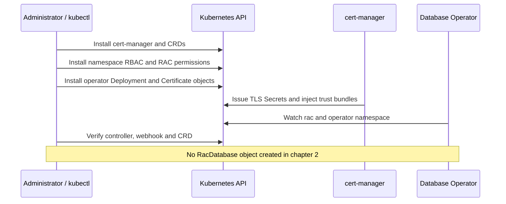

# 2. Install Oracle Database Operator

[Manual start](OCNE-RAC-END-TO-END-MANUAL.md) | Previous: [1. OCNE](MANUAL-01-OCNE.md) | Next: [3. RAC](MANUAL-03-RAC.md)

## 2a. Prerequisites for installing Oracle Database Operator

### 2a.1 Understand what this stage creates

Installing Database Operator adds Kubernetes API types, permissions, a controller and its admission webhook. It does not create a database. `cert-manager` supplies the controller's TLS certificates. RBAC grants the controller the permissions it needs to observe nodes, networks and manage RAC volumes. The operator's Linux VM from chapter 1 and this Kubernetes operator are different components.



### 2a.2 Verify Kubernetes and your administrative access

**Run on ocne-cp as labadmin:**

```bash
export KUBECONFIG="$HOME/.kube/config"
chmod 600 "$KUBECONFIG"
kubectl config current-context
kubectl cluster-info
kubectl get nodes -o wide
kubectl get pods -A -o wide
kubectl get deployments -A
kubectl auth can-i create customresourcedefinitions.apiextensions.k8s.io
kubectl auth can-i create clusterroles.rbac.authorization.k8s.io
kubectl auth can-i create namespaces
kubectl get ns cert-manager oracle-database-operator-system rac
```

Expected: three Ready nodes, healthy system workloads and `yes` for all required permissions. The last command returns NotFound for namespaces on a fresh build; that is inventory, not installation failure. If an operator is already installed, inspect its version/watch scope/RBAC rather than installing a second instance. Do not copy administrator kubeconfig into Git or public output.

Worker image downloads require registry/DNS/HTTPS access; the control plane needs image access for cert-manager as scheduled. Check time on all guests (`date -u`, `chronyc tracking`) before diagnosing webhook certificate failures. Confirm actual available CPU/memory (`free -h`, `kubectl describe nodes`) rather than relying only on requested VM RAM.

### 2a.3 Select the pinned compatible assets

| Component | Value used in this manual | Why |
|---|---|---|
| Kubernetes | 1.29.14+2.el9 | Installed by the OCNE 1.9 module |
| cert-manager | 1.17.4 | Its release branch supports Kubernetes 1.29; now outside community maintenance |
| Database Operator | 2.2.0, source ff6f9178c1650df30afbf203ebdb633e9b80760a | Source inspected for this RAC API and sample |
| Controller image | sha256:f378d66fd0b47b6089f01caf4ca86f90f3b3593cdca75292ff6491955c451cc0 | Verified amd64 image, avoids mutable latest |
| Watch scope | oracle-database-operator-system,rac | Namespace-scoped installation; both require access |
| Controller replicas | 1 | Local lab capacity choice |

Use the reviewed assets under [config/vendor](../config/vendor/README.md); its README records upstream origin, hashes, license and local changes. Check [cert-manager supported releases](https://cert-manager.io/docs/releases/) before any substitution. Do not install the newest cert-manager onto Kubernetes 1.29 without verifying compatibility. This manual reproduces the specified historical lab rather than claiming a currently maintained production stack.

On **Windows PowerShell**, check and transfer only the prerequisite files:

```powershell
Set-Location D:\OCNE19-Lab
Get-ChildItem .\config\vendor\*.yaml | Get-FileHash -Algorithm SHA256
ssh ocne-cp 'install -d -m 0755 ~/ocne-rac-prereqs'
scp .\config\vendor\cert-manager-v1.17.4.yaml ocne-cp:~/ocne-rac-prereqs/
scp .\config\vendor\oracle-database-operator-2.2.0-rbac.yaml ocne-cp:~/ocne-rac-prereqs/
scp .\config\vendor\oracle-database-operator-2.2.0-system.yaml ocne-cp:~/ocne-rac-prereqs/
scp .\config\vendor\rac-pv-rbac.yaml .\config\vendor\rac-multus-rbac.yaml .\config\vendor\rac-node-rbac.yaml ocne-cp:~/ocne-rac-prereqs/
```

Equivalent **Git Bash**:

```bash
cd /d/OCNE19-Lab
sha256sum config/vendor/*.yaml
ssh ocne-cp 'install -d -m 0755 ~/ocne-rac-prereqs'
scp config/vendor/cert-manager-v1.17.4.yaml config/vendor/oracle-database-operator-2.2.0-rbac.yaml config/vendor/oracle-database-operator-2.2.0-system.yaml config/vendor/rac-pv-rbac.yaml config/vendor/rac-multus-rbac.yaml config/vendor/rac-node-rbac.yaml ocne-cp:~/ocne-rac-prereqs/
```

On **ocne-cp**, compare destination hashes to the workstation values:

```bash
cd ~/ocne-rac-prereqs
sha256sum cert-manager-v1.17.4.yaml oracle-database-operator-2.2.0-rbac.yaml oracle-database-operator-2.2.0-system.yaml rac-pv-rbac.yaml rac-multus-rbac.yaml rac-node-rbac.yaml
```

Never run `kubectl apply -R -f config/`: that directory also contains the RAC provisioning manifest and diagnostic pods.

### 2a.4 If you want to reproduce the namespace manifest generation

This is an optional source-reproduction path, **not a second operator installation**. Run in a separate directory on a workstation/guest with Git and Bash. The vendor YAML already contains the reviewed result.

```bash
git clone https://github.com/oracle/oracle-database-operator.git oracle-database-operator-src
cd oracle-database-operator-src
git checkout --detach ff6f9178c1650df30afbf203ebdb633e9b80760a
git rev-parse HEAD
bash scripts/generate-namespace-install.sh --watch-namespaces oracle-database-operator-system,rac --output-dir dist/install
```

Inspect the generated system YAML. For this lab change only the controller Deployment to one replica and the verified image digest listed above; preserve its selectors, environment, service account, webhook, certificate and CRD definitions. Compare your output to the vendor manifests. The separate RAC PV/Multus/node RBAC assets are required in addition to namespace generation. They do not provision volumes merely by granting permissions.

**Gate 2a:** healthy foundation, authorized cluster access, versions selected, individual manifests copied and hashes matched.

## 2b. Installing Oracle Database Operator step by step

All commands below run **on ocne-cp as labadmin**, from `~/ocne-rac-prereqs`. This is a new-install sequence. Stop at the first unexpected error.

### 2b.1 Create the database namespace

```bash
kubectl get namespace rac --ignore-not-found
# Run only if the result above is empty:
kubectl create namespace rac
```

Expected new-install output: `namespace/rac created`. Later Multus YAML contains the same namespace and adds a descriptive label. Keep the name consistent with the controller watch list.

### 2b.2 Install cert-manager

```bash
cd ~/ocne-rac-prereqs
kubectl apply --server-side -f cert-manager-v1.17.4.yaml
kubectl rollout status deployment/cert-manager -n cert-manager --timeout=240s
kubectl rollout status deployment/cert-manager-cainjector -n cert-manager --timeout=240s
kubectl rollout status deployment/cert-manager-webhook -n cert-manager --timeout=240s
kubectl get deployments,pods -n cert-manager -o wide
```

The apply output has one created/configured line per resource. Each rollout must finish successfully; all three Deployments must have 1/1 Ready and one available replica. If a rollout times out, inspect events and the named pod's describe/logs. Do not continue with an unavailable webhook.

### 2b.3 Install namespace permissions and required RAC permissions

```bash
kubectl apply --server-side -f oracle-database-operator-2.2.0-rbac.yaml
kubectl apply --server-side -f rac-pv-rbac.yaml
kubectl apply --server-side -f rac-multus-rbac.yaml
kubectl apply --server-side -f rac-node-rbac.yaml
```

Verify the exact service-account identity. These commands ask Kubernetes authorization; they do not impersonate it to make changes:

```bash
identity=system:serviceaccount:oracle-database-operator-system:oracle-database-operator-controller-manager
kubectl auth can-i list pods --as="$identity" -n rac
kubectl auth can-i list pods --as="$identity" -n oracle-database-operator-system
kubectl auth can-i get nodes --as="$identity"
kubectl auth can-i create persistentvolumes --as="$identity"
kubectl auth can-i list network-attachment-definitions.k8s.cni.cncf.io --as="$identity" -n rac
```

Expected: `yes` for each. Before Multus is installed, kubectl may warn that the NAD resource type is not discovered; repeat that check after chapter 3 installs its CRD. A `no` is a permissions error to fix before database provisioning. Do not grant cluster-admin as a shortcut.

### 2b.4 Install the controller, APIs and certificates

```bash
kubectl apply --server-side -f oracle-database-operator-2.2.0-system.yaml
kubectl wait --for=condition=Established crd/racdatabases.database.oracle.com --timeout=120s
kubectl wait --for=condition=Ready certificates --all -n oracle-database-operator-system --timeout=180s
kubectl rollout status deployment/oracle-database-operator-controller-manager -n oracle-database-operator-system --timeout=240s
```

Expected: CRD condition met, both operator certificates Ready, Deployment successfully rolled out. CRD existence alone is not controller readiness. Certificates rely on the cert-manager webhook/cainjector installed above.

### 2b.5 Check installation and learn the RAC API

```bash
kubectl get pods,certificates -n oracle-database-operator-system -o wide
kubectl get crd racdatabases.database.oracle.com
kubectl api-resources --api-group=database.oracle.com
kubectl explain racdatabase --api-version=database.oracle.com/v4
kubectl explain racdatabase.spec --api-version=database.oracle.com/v4
kubectl get racdatabases -A
kubectl get validatingwebhookconfigurations
```

On a new installation, the RacDatabase list is empty. On the completed lab it already contains rac19c. `kubectl explain` describes the installed schema; the pinned source/admission code supplies additional restrictions, including at least 16 GiB ordinary pod memory and immutable service naming after creation.

Inspect logs locally if a condition fails:

```bash
kubectl get events -n oracle-database-operator-system --sort-by=.metadata.creationTimestamp
kubectl describe deployment oracle-database-operator-controller-manager -n oracle-database-operator-system
kubectl logs deployment/oracle-database-operator-controller-manager -n oracle-database-operator-system --tail=100
```

Raw logs may contain provisioning details; review/redact them before sharing. Do not dump Secret data. A certificate error requires checking Certificate conditions, webhook endpoints, CA injection and clock validity; a Forbidden error requires checking the denied verb/resource against the applied RBAC.

### 2b.6 Completion gate and captured output

**Captured 11 October 2026 at 18:45 UTC**, full output of the listed checks:

```text
$ kubectl -n cert-manager get deployments
NAME                      READY   UP-TO-DATE   AVAILABLE   AGE
cert-manager              1/1     1            1           30h
cert-manager-cainjector   1/1     1            1           30h
cert-manager-webhook      1/1     1            1           30h

$ kubectl -n oracle-database-operator-system get pods,certificates
NAME                                                              READY   STATUS    RESTARTS   AGE
pod/oracle-database-operator-controller-manager-7c5c7c7f4-5k4kv   1/1     Running   1          30h

NAME                                                                 READY   SECRET                AGE
certificate.cert-manager.io/oracle-database-operator-metrics-certs   True    metrics-server-cert   30h
certificate.cert-manager.io/oracle-database-operator-serving-cert    True    webhook-server-cert   30h
```

Your pod suffix, ages and restart counts will differ. Healthy current conditions matter; investigate unexpected new restarts. This gate establishes the operator installation. RAC storage, networks, media and validation are chapter 3.

Sources: [pinned namespace generator](https://github.com/oracle/oracle-database-operator/blob/ff6f9178c1650df30afbf203ebdb633e9b80760a/scripts/generate-namespace-install.sh), [operator RAC prerequisites](https://github.com/oracle/oracle-database-operator/blob/ff6f9178c1650df30afbf203ebdb633e9b80760a/docs/rac/provisioning/prerequisites_oracle_rac_db.md), [vendor provenance and licenses](../config/vendor/README.md).

[Continue to 3. RAC](MANUAL-03-RAC.md)
