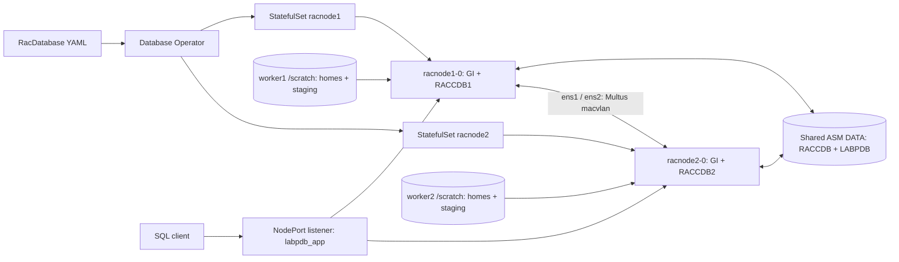

# 3. Prepare and provision the RAC database

[Manual start](OCNE-RAC-END-TO-END-MANUAL.md) | Previous: [2. Operator](MANUAL-02-DATABASE-OPERATOR.md) | Next: [4. Operations](MANUAL-04-RAC-OPERATIONS.md)

This chapter creates a **new two-instance RAC database**. Do not run disk preparation or kubectl create against the completed lab. The corrected fresh-build YAML appears in full below. Every local disk identifier must be discovered on your own build.

## 3a. Prerequisites to provision RAC

### 3a.1 Inventory the resources and data paths

| Resource | Worker 1 | Worker 2 | Purpose |
|---|---|---|---|
| Worker VM | ocne-w1.lab.test, .77.12 | ocne-w2.lab.test, .77.13 | 22 GiB RAM, 6 vCPU each |
| RAC pod | racnode1-0 | racnode2-0 | 16 GiB ordinary memory / 4 CPU each |
| Database instance | RACCDB1 | RACCDB2 | SGA 3 GiB / PGA target 2 GiB each |
| Private parent NICs | enp0s8, enp0s9 | enp0s8, enp0s9 | Unnumbered host interfaces; inspect real names |
| Pod private IPs | .78.120 / .79.120 | .78.121 / .79.121 | Cluster interconnects |
| Local scratch | Independent 128 GiB XFS | Independent 128 GiB XFS | /scratch, Oracle homes and media |
| Shared ASM | Same two 50 GiB fixed VDIs | Same two UUIDs, not copies | DATA disk group, EXTERNAL redundancy |
| Node listener | 192.168.77.12:31522 | 192.168.77.13:31523 | Service labpdb_app |
| Scan listener | racnode-scan-lsnr, NodePort 31521 | Same Kubernetes service | Inspect endpoints; currently targets node1 |



The 16 GiB limit includes ordinary-memory SGA, PGA, GI and other processes. A PGA target is not a hard memory cap. EXTERNAL redundancy has no ASM mirroring; hostPath homes tie recovery to actual worker storage. NFS is separate.

### 3a.2 Shut down workers cleanly and add hardware

**Before RAC exists**, run sudo shutdown -h now on each worker. Confirm both powered off. Inspect all attachments and NICs. This example uses free SATA3 for scratch, SATA4/5 for ASM and NIC2/3 for private networks. Do not detach existing disks.

**Windows PowerShell, project root; new paths only:**

```powershell
$VBox = Join-Path $env:ProgramFiles 'Oracle\VirtualBox\VBoxManage.exe'
function Invoke-VBoxChecked {
    & $VBox @args
    if ($LASTEXITCODE -ne 0) { throw "VBox command failed: $args" }
}
foreach ($Node in @('ocne-w1','ocne-w2')) {
    $Info = & $VBox showvminfo $Node --machinereadable
    if ($LASTEXITCODE -ne 0 -or $Info -notcontains 'VMState="poweroff"') { throw "$Node must be powered off" }
    $Info | Select-String 'SATA|nic[123]|intnet|macaddress|VMState'
}
$Confirmed = Read-Host 'Type FREE after verifying SATA3/4/5 and NIC2/3 are unused on both workers'
if ($Confirmed -cne 'FREE') { throw 'Attachment inventory not confirmed' }
$Shared = 'D:\OCNE19-Lab\vms\rac-shared'
New-Item -ItemType Directory -Force $Shared | Out-Null
$Scratch1 = 'D:\OCNE19-Lab\vms\ocne-w1\rac-scratch.vdi'
$Scratch2 = 'D:\OCNE19-Lab\vms\ocne-w2\rac-scratch.vdi'
$Asm1 = Join-Path $Shared 'asm01.vdi'
$Asm2 = Join-Path $Shared 'asm02.vdi'
foreach ($Path in @($Scratch1,$Scratch2,$Asm1,$Asm2)) {
    if (Test-Path -LiteralPath $Path) { throw "Existing disk: $Path. Inspect; do not overwrite." }
}
foreach ($Path in @($Scratch1,$Scratch2)) {
    Invoke-VBoxChecked createmedium disk --filename $Path --size 131072 --format VDI --variant Standard
}
foreach ($Path in @($Asm1,$Asm2)) {
    Invoke-VBoxChecked createmedium disk --filename $Path --size 51200 --format VDI --variant Fixed
    Invoke-VBoxChecked modifymedium disk $Path --type shareable
    Invoke-VBoxChecked showmediuminfo disk $Path
}
Invoke-VBoxChecked storageattach ocne-w1 --storagectl SATA --port 3 --device 0 --type hdd --medium $Scratch1
Invoke-VBoxChecked storageattach ocne-w2 --storagectl SATA --port 3 --device 0 --type hdd --medium $Scratch2
foreach ($Node in @('ocne-w1','ocne-w2')) {
    Invoke-VBoxChecked storageattach $Node --storagectl SATA --port 4 --device 0 --type hdd --medium $Asm1
    Invoke-VBoxChecked storageattach $Node --storagectl SATA --port 5 --device 0 --type hdd --medium $Asm2
    Invoke-VBoxChecked modifyvm $Node --nic2 intnet --intnet2 ocne-rac-priv1 --nictype2 82540EM --nicpromisc2 allow-vms --cableconnected2 on --nic3 intnet --intnet3 ocne-rac-priv2 --nictype3 82540EM --nicpromisc3 allow-vms --cableconnected3 on
    Invoke-VBoxChecked showvminfo $Node --machinereadable
}
```

Review before startvm. Both worker ASM01 attachments must resolve to the **same** UUID, as must ASM02. showmediuminfo7.2 does not accept --machinereadable. Ordinary snapshots do not coordinate shared-disk backup.

Equivalent **Windows Git Bash**, an alternative to PowerShell, never an additional run:

```bash
set -euo pipefail
VBOX='/c/Program Files/Oracle/VirtualBox/VBoxManage.exe'
for node in ocne-w1 ocne-w2; do
  "$VBOX" showvminfo "$node" --machinereadable
  "$VBOX" showvminfo "$node" --machinereadable | grep -Fx 'VMState="poweroff"'
done
read -r -p 'Type FREE after checking SATA3/4/5 and NIC2/3 are unused on both VMs: ' answer
test "$answer" = FREE
mkdir -p /d/OCNE19-Lab/vms/rac-shared
for node in ocne-w1 ocne-w2; do test ! -e "/d/OCNE19-Lab/vms/$node/rac-scratch.vdi"; done
for n in 1 2; do test ! -e "/d/OCNE19-Lab/vms/rac-shared/asm0$n.vdi"; done
for node in ocne-w1 ocne-w2; do
  "$VBOX" createmedium disk --filename "D:/OCNE19-Lab/vms/$node/rac-scratch.vdi" --size 131072 --format VDI --variant Standard
  "$VBOX" storageattach "$node" --storagectl SATA --port 3 --device 0 --type hdd --medium "D:/OCNE19-Lab/vms/$node/rac-scratch.vdi"
done
for n in 1 2; do
  disk="D:/OCNE19-Lab/vms/rac-shared/asm0$n.vdi"
  "$VBOX" createmedium disk --filename "$disk" --size 51200 --format VDI --variant Fixed
  "$VBOX" modifymedium disk "$disk" --type shareable
  "$VBOX" showmediuminfo disk "$disk"
  for node in ocne-w1 ocne-w2; do
    "$VBOX" storageattach "$node" --storagectl SATA --port "$((n+3))" --device 0 --type hdd --medium "$disk"
  done
done
for node in ocne-w1 ocne-w2; do
  "$VBOX" modifyvm "$node" --nic2 intnet --intnet2 ocne-rac-priv1 --nictype2 82540EM --nicpromisc2 allow-vms --cableconnected2 on --nic3 intnet --intnet3 ocne-rac-priv2 --nictype3 82540EM --nicpromisc3 allow-vms --cableconnected3 on
  "$VBOX" showvminfo "$node" --machinereadable
done
```

### 3a.3 Map every new disk before initializing it

Start workers after reviewing hardware. On **each worker as root**:

```bash
lsblk -b -o NAME,SIZE,TYPE,FSTYPE,MOUNTPOINTS,SERIAL,UUID,PARTUUID
findmnt
ls -l /dev/disk/by-id/
ip -br link
```

Match VBox path/UUID/slot to Linux serial, size and device. Device letters changed on worker2 in this run. A50GiB disk is not automatically ASM01. Inspect each candidate with wipefs --no-act, child partitions, mounts and /sys/class/block/DEVICE/holders. Failed inspection is not proof of blankness. Preserve unrelated disks.

### 3a.4 Create scratch once per worker

**Root on each worker, new blank scratch disk only.** This parameterized form retains the executed helper's checks but uses **your** verified serial.

```bash
#!/bin/bash
# One-time local provisioning using the inspected new scratch-disk serials.
# XFS/mount procedure: Oracle Linux filesystem sources cited in guide Part D.
set -euo pipefail
[[ $(id -u) == 0 ]]
case $(hostname -s) in ocne-w1|ocne-w2) ;; *) exit 1;; esac
read -r -p 'Verified NEW 128 GiB scratch disk serial: ' serial
[[ -n "$serial" ]]
label=rac-scratch
mapfile -t matches < <(lsblk -dnpo NAME,SERIAL | awk -v serial="$serial" '$2==serial {print $1}')
[[ ${#matches[@]} == 1 ]] || { echo 'Expected exactly one scratch serial'; exit 1; }
disk=${matches[0]}
[[ $(blockdev --getsize64 "$disk") == 137438953472 ]]
[[ $(lsblk -dnro TYPE "$disk") == disk ]]
[[ $(lsblk -nrpo NAME "$disk" | wc -l) == 1 ]]
[[ -z $(lsblk -nrpo MOUNTPOINTS "$disk") ]]
signatures=$(wipefs --no-act --noheadings --output TYPE "$disk")
[[ -z "$signatures" ]]
[[ -z $(ls -A "/sys/class/block/${disk##*/}/holders") ]]
! findmnt -rn -S "$disk" >/dev/null
! mountpoint -q /scratch
! awk '$1 !~ /^#/ && $2=="/scratch" {found=1} END {exit !found}' /etc/fstab
[[ ! -e /scratch || ( -d /scratch && -z $(ls -A /scratch) ) ]]
printf 'Identified blank scratch device: %s serial=%s\n' "$disk" "$serial"
lsblk -b -o NAME,SIZE,TYPE,FSTYPE,MOUNTPOINTS,SERIAL "$disk"
mkfs.xfs -L "$label" "$disk"
uuid=$(blkid -s UUID -o value "$disk")
[[ $uuid =~ ^[0-9a-f-]{36}$ && $(blkid -s TYPE -o value "$disk") == xfs ]]
cp -a /etc/fstab "/etc/fstab.before-rac-scratch-$(date +%Y%m%d%H%M%S)"
mkdir -p /scratch
printf 'UUID=%s /scratch xfs defaults 0 0\n' "$uuid" >> /etc/fstab
systemctl daemon-reload
mount /scratch
[[ $(findmnt -nro UUID -M /scratch) == "$uuid" ]]
[[ $(findmnt -nro FSTYPE -M /scratch) == xfs ]]
findmnt -n -o SOURCE,UUID,FSTYPE,TARGET -M /scratch
df -h /scratch
printf 'Scratch mounted; ASM disks and existing root/container filesystems were not modified.\n'
```

Expected: XFS /scratch with a new recorded UUID, existing filesystems unchanged. An existing signature/mount is a stop condition, not a reason to force mkfs.

### 3a.5 Partition shared ASM disks on worker1 only

**Root on worker1, blank shared disks only.** Do not partition them again on worker2. No mkfs is used on ASM.

```bash
#!/bin/bash
# One-time GPT labels for two inspected blank shared ASM disks, on worker1 only.
# No filesystem or ASM disk group is created here.
# https://docs.oracle.com/en/operating-systems/oracle-linux/9/stordev/stordev-UsingDiskPartitions.html
set -euo pipefail
[[ $(id -u) == 0 && $(hostname -s) == ocne-w1 ]]
read -r -p 'Verified blank ASM01 disk serial: ' serial1
read -r -p 'Verified blank ASM02 disk serial: ' serial2
[[ -n $serial1 && -n $serial2 && $serial1 != "$serial2" ]]
serials=("$serial1" "$serial2")
names=(ocne-rac-asm01 ocne-rac-asm02)
disks=()
for i in 0 1; do
 serial=${serials[$i]}
 mapfile -t matches < <(lsblk -dnpo NAME,SERIAL | awk -v serial="$serial" '$2==serial {print $1}')
 [[ ${#matches[@]} == 1 ]]
 disk=${matches[0]}
 [[ $(blockdev --getsize64 "$disk") == 53687091200 ]]
 [[ $(lsblk -nrpo NAME "$disk" | wc -l) == 1 ]]
 mounts=$(lsblk -nrpo MOUNTPOINTS "$disk")
 [[ -z "$mounts" ]]
 signatures=$(wipefs --no-act --noheadings --output TYPE "$disk")
 [[ -z "$signatures" ]]
 [[ -z $(ls -A "/sys/class/block/${disk##*/}/holders") ]]
 [[ ! -e /dev/disk/by-partlabel/${names[$i]} ]]
 disks+=("$disk")
 printf 'Verified blank 50 GiB ASM disk: %s %s\n' "$disk" "$serial"
done
for i in 0 1; do
 disk=${disks[$i]}
 name=${names[$i]}
 parted -s -a optimal "$disk" mklabel gpt mkpart "$name" 1MiB 100%
 partprobe "$disk"
 udevadm settle
 partition=/dev/disk/by-partlabel/$name
 [[ -b $partition ]]
 [[ $(lsblk -nro PKNAME "$partition") == "${disk##*/}" ]]
 signatures=$(wipefs --no-act --noheadings --output TYPE "$partition")
 [[ -z "$signatures" ]]
 lsblk -b -o NAME,SIZE,TYPE,FSTYPE,PARTLABEL,PARTUUID,SERIAL "$disk"
done
```

On **both workers**, refresh and compare PARTUUIDs and attachments:

```bash
sudo partprobe
sudo udevadm settle
for label in ocne-rac-asm01 ocne-rac-asm02; do
  path=/dev/disk/by-partlabel/$label
  test -b "$path" || break
  lsblk -b -o NAME,SIZE,TYPE,FSTYPE,MOUNTPOINTS,PARTLABEL,PARTUUID,SERIAL "$path"
  sudo blkid -s PARTUUID -o value "$path"
  sudo wipefs --no-act "$path"
done
```

Before provisioning: no filesystem/ASM signature or mount. After provisioning these partitions intentionally contain ASM data: **never remove those signatures or repeat preparation**. The operator creates block PV/PVC objects later; do not precreate an NFS PVC or run ASMCA.

### 3a.6 Configure private NICs on each worker

Match VBox MACs to ip -br link. Verify enp0s8/enp0s9 are the internal-network adapters, not SSH/public NIC1. **Root on each worker**, new profiles only:

```bash
nmcli connection show
nmcli connection add type ethernet ifname enp0s8 con-name ocne-rac-private1 ipv4.method disabled ipv6.method disabled ethernet.mtu 1500 connection.autoconnect yes
nmcli connection add type ethernet ifname enp0s9 con-name ocne-rac-private2 ipv4.method disabled ipv6.method disabled ethernet.mtu 1500 connection.autoconnect yes
nmcli connection modify ocne-rac-private1 802-3-ethernet.accept-all-mac-addresses 1
nmcli connection modify ocne-rac-private2 802-3-ethernet.accept-all-mac-addresses 1
nmcli connection up ocne-rac-private1
nmcli connection up ocne-rac-private2
ip -d link show enp0s8
ip -d link show enp0s9
ip -4 address show
ip -6 address show
ip route
```

Expected: private parents UP/PROMISC without host IP/default route, NIC1 unchanged. VirtualBox allow-vms alone was insufficient: guest accept-all-mac-addresses fixed unicast reception. For an already-active profile persist it and use `ip link set dev enp0s8 promisc on` (and enp0s9) for the current activation; this NetworkManager could not reapply the property in place.

### 3a.7 Install OCNE Multus and network definitions

**ocne-op as labadmin**, following [OCNE1.9 Multus](https://docs.oracle.com/en/operating-systems/olcne/1.9/multus/install.html):

```bash
olcnectl module instances --environment-name homelab
# Only when rac-multus is absent:
olcnectl module create --environment-name homelab --module multus --name rac-multus --multus-kubernetes-module cluster1
olcnectl module install --environment-name homelab --name rac-multus
olcnectl module report --environment-name homelab --name rac-multus --children
```

On **ocne-cp**, save this complete content as ~/ocne-rac-prereqs/rac-networks.yaml, or copy the project file. Review parent names, namespace and ranges:

```yaml
# Local network values; Oracle RAC MACVLAN model and OCNE 1.9 Multus module.
apiVersion: v1
kind: Namespace
metadata:
  name: rac
  labels:
    app.kubernetes.io/part-of: ocne19-lab
---
apiVersion: k8s.cni.cncf.io/v1
kind: NetworkAttachmentDefinition
metadata:
  name: macvlan-conf1
  namespace: rac
spec:
  config: >-
    {"cniVersion":"0.3.1","type":"macvlan","master":"enp0s8","mode":"bridge","mtu":1500,"ipam":{"type":"host-local","subnet":"192.168.78.0/24","rangeStart":"192.168.78.120","rangeEnd":"192.168.78.130"}}
---
apiVersion: k8s.cni.cncf.io/v1
kind: NetworkAttachmentDefinition
metadata:
  name: macvlan-conf2
  namespace: rac
spec:
  config: >-
    {"cniVersion":"0.3.1","type":"macvlan","master":"enp0s9","mode":"bridge","mtu":1500,"ipam":{"type":"host-local","subnet":"192.168.79.0/24","rangeStart":"192.168.79.120","rangeEnd":"192.168.79.130"}}
```

Apply and verify:

```bash
kubectl apply -f ~/ocne-rac-prereqs/rac-networks.yaml
kubectl rollout status daemonset/kube-multus-ds -n kube-system --timeout=240s
kubectl get daemonset kube-multus-ds -n kube-system
kubectl get network-attachment-definitions -n rac
kubectl get network-attachment-definition macvlan-conf1 -n rac -o yaml
kubectl get network-attachment-definition macvlan-conf2 -n rac -o yaml
```

Expected: Multus3/3 Ready, both NADs present. Host-local IPAM is per-worker, not a cluster-wide allocator. Dedicate these NADs/ranges to this RAC cluster and verify operator-assigned explicit addresses.

### 3a.8 Prepare worker OS limits, THP and SELinux

**Root on each worker, before RAC exists.** Inspect and retain existing kubelet arguments. Install policy tools and create staging before labeling it:

```bash
dnf install -y selinux-policy-devel policycoreutils-python-utils make
install -d -m 0755 /scratch/software/stage
findmnt -M /scratch -o SOURCE,UUID,FSTYPE,TARGET
cat /etc/sysconfig/kubelet
getenforce
cat /proc/swaps
cat /sys/devices/system/clocksource/clocksource0/current_clocksource
```

The next block accepts your scratch UUID, retains existing kubelet options, and includes the complete Oracle SELinux policy. vm.nr_hugepages=0 is the owner's explicit lab choice; THP remains disabled. These are different memory mechanisms. No enforcement/firewall disable is used.

```bash
#!/bin/bash
# Oracle RAC/OCNE prerequisites, locally sized for 22 GiB workers.
set -euo pipefail
[[ $(id -u) == 0 && $(getenforce) == Enforcing ]]
read -r -p 'Recorded XFS UUID for this worker scratch disk: ' uuid
[[ -n $uuid ]]
[[ $(findmnt -nro UUID -M /scratch) == "$uuid" ]]
[[ $(wc -l < /proc/swaps) == 1 ]]
[[ $(cat /sys/devices/system/clocksource/clocksource0/current_clocksource) == tsc ]]
for path in /etc/sysctl.d/98-ocne-rac.conf /var/opt/rac-ocne.te /scratch/rac/cluster01; do
 [[ ! -e $path ]] || { echo "Existing prerequisite asset: $path; inspect before continuing."; exit 1; }
done
cat /etc/sysconfig/kubelet
rpm -q selinux-policy-devel policycoreutils-python-utils
backup=/var/opt/ocne-rac-backup-$(date -u +%Y%m%dT%H%M%SZ)
install -d -m 0700 "$backup"
cp -a /etc/sysconfig/kubelet /etc/default/grub "$backup/"
grubby --info=ALL > "$backup/grubby-before.txt"
sysctl fs.file-max net.core.rmem_default net.core.rmem_max net.core.wmem_default net.core.wmem_max fs.aio-max-nr vm.nr_hugepages > "$backup/sysctl-before.txt"
cat > /etc/sysctl.d/98-ocne-rac.conf <<'SYSCTL'
# Oracle RAC on OCNE kernel prerequisites; HugePages disabled by user request.
fs.file-max = 6815744
net.core.rmem_default = 262144
net.core.rmem_max = 4194304
net.core.wmem_default = 262144
net.core.wmem_max = 1048576
fs.aio-max-nr = 1048576
vm.nr_hugepages = 0
SYSCTL
sysctl -p /etc/sysctl.d/98-ocne-rac.conf
[[ $(sysctl -n vm.nr_hugepages) == 0 ]]
# Oracle recommends disabling THP; use grubby for OL9 boot entries.
grubby --update-kernel=ALL --args='transparent_hugepage=never'
printf 'never\n' > /sys/kernel/mm/transparent_hugepage/enabled
python3 <<'KUBELET'
from pathlib import Path
import re
p=Path('/etc/sysconfig/kubelet'); text=p.read_text()
matches=list(re.finditer(r'^KUBELET_EXTRA_ARGS="([^"\n]*)"$',text,re.M))
assert len(matches)==1, 'Inspect kubelet file format before editing'
m=matches[0]; current=m.group(1)
assert '--allowed-unsafe-sysctls' not in current, 'Inspect existing sysctl allowance'
updated=current+' --allowed-unsafe-sysctls=kernel.shm*,net.*,kernel.sem'
p.write_text(text[:m.start()]+'KUBELET_EXTRA_ARGS="'+updated+'"'+text[m.end():])
KUBELET
cat > /var/opt/rac-ocne.te <<'POLICY'
module rac-ocne 1.0;
require {
 type kernel_t;
 class system syslog_read;
 type container_runtime_t;
 type container_init_t;
 type container_file_t;
 type lib_t;
 type textrel_shlib_t;
 type bin_t;
 class file { getattr execmod execute map setattr };
}
allow container_init_t container_runtime_t:file getattr;
allow container_init_t bin_t:file { map execute };
allow container_init_t container_file_t:file execmod;
allow container_init_t lib_t:file execmod;
allow container_init_t textrel_shlib_t:file setattr;
allow container_init_t kernel_t:system syslog_read;
POLICY
cd /var/opt
make -f /usr/share/selinux/devel/Makefile rac-ocne.pp
semodule -i rac-ocne.pp
for n in 1 2; do install -d -m 0755 -o 54321 -g 54321 /scratch/rac/cluster01/racnode$n; done
semanage fcontext -a -t container_file_t '/scratch/rac/cluster01(/.*)?'
semanage fcontext -a -t container_file_t '/scratch/software/stage(/.*)?'
restorecon -RF /scratch/rac/cluster01 /scratch/software/stage
systemctl daemon-reload
systemctl restart kubelet
systemctl is-active kubelet
semodule -l | grep '^rac-ocne'
getent passwd 54321 || true
ls -Zd /scratch/rac/cluster01/racnode{1,2} /scratch/software/stage
grep -E 'MemTotal|MemAvailable|HugePages|Hugepagesize' /proc/meminfo
cat /sys/kernel/mm/transparent_hugepage/enabled
printf 'RAC worker settings applied; backup: %s\n' "$backup"
```

If the clocksource is not TSC, stop and consult Oracle's platform prerequisites before changing it; this lab already used TSC. If a file context exists, inspect semanage fcontext -l before updating it.

Reboot **one worker at a time before provisioning**, recording boot IDs and checking readiness after each. Verify persistence:

```bash
cat /proc/sys/kernel/random/boot_id
findmnt -M /scratch
findmnt -M /var/lib/containers
findmnt -M /mnt/ocne-share
getenforce
sysctl vm.nr_hugepages fs.file-max fs.aio-max-nr
cat /sys/kernel/mm/transparent_hugepage/enabled
ip -d link show enp0s8
ip -d link show enp0s9
sudo semodule -l | grep '^rac-ocne'
systemctl is-active kubelet crio chronyd firewalld
chronyc tracking
```

Expected: recorded mounts, Enforcing, HugePages0, THP[never], private NICs PROMISC, services active and time synchronized. On ocne-cp wait for each node Ready. Repeat an NFS write/read as labadmin.

### 3a.9 Test networking and scheduling before RAC

Copy config/rac-network-check.yaml from the workstation to ocne-cp:~/ocne-rac-prereqs/. It contains two disposable pods, private .128/.129 addresses, and 4 CPU/16GiB requests. Review names and subnets. Run only when no RAC CR or existing diagnostic pods exist.

**ocne-cp as labadmin:**

```bash
kubectl get racdatabases -n rac
kubectl get pods -n rac
# Continue only after confirming the absence described above.
kubectl apply -f ~/ocne-rac-prereqs/rac-network-check.yaml
kubectl wait -n rac --for=condition=Ready pod/rac-netcheck-w1 pod/rac-netcheck-w2 --timeout=180s
kubectl get pods -n rac -o wide
kubectl exec -n rac rac-netcheck-w1 -- ip -4 address show
kubectl exec -n rac rac-netcheck-w2 -- ip -4 address show
kubectl exec -n rac rac-netcheck-w1 -- ping -c 3 -s 1472 -I ens1 192.168.78.129
kubectl exec -n rac rac-netcheck-w1 -- ping -c 3 -s 1472 -I ens2 192.168.79.129
kubectl exec -n rac rac-netcheck-w2 -- ping -c 3 -s 1472 -I ens1 192.168.78.128
kubectl exec -n rac rac-netcheck-w2 -- ping -c 3 -s 1472 -I ens2 192.168.79.128
kubectl exec -n rac rac-netcheck-w1 -- nslookup kubernetes.default.svc.cluster.local
kubectl exec -n rac rac-netcheck-w2 -- nslookup kubernetes.default.svc.cluster.local
kubectl exec -n rac rac-netcheck-w1 -- sysctl kernel.shmmax kernel.shmall
kubectl exec -n rac rac-netcheck-w2 -- sysctl kernel.shmmax kernel.shmall
# After checking results, remove ONLY these diagnostics to release resources:
kubectl delete pod -n rac rac-netcheck-w1 rac-netcheck-w2
```

Require bidirectional pings on both networks, working DNS and matching sysctl values. A scheduling failure needs Events inspection; do not shrink below the operator's minimum to force scheduling. The payload checks the1500-byte path, not jumbo MTU or workload capacity. Do not run these large test pods alongside RAC.

### 3a.10 Stage the slim image in CRI-O

On **each worker**:

```bash
RAC_IMAGE='docker.io/roopla/oracle-rac@sha256:d4aa7fecb15b4f62caed83a0f445a275cc5bd8fbd1b01c7ac6216037b656566d'
sudo crictl pull "$RAC_IMAGE"
sudo crictl images
sudo crictl inspecti "$RAC_IMAGE"
```

Require matching digest in CRI-O's configured endpoint. Rootless Podman uses a different store. For private registries use protected authentication, not passwords in arguments. The manifest uses IfNotPresent and the digest.

The inspected image contract was OL9.8/amd64; oracle54321:54321, grid UID54332/GID54321; systemd, Python3 and /opt/scripts/startup/runOracle.sh. It must implement the operator's setup contract, not merely contain Oracle Linux. Inspect image files without starting installers. [Artifact acceptance](RAC-ARTIFACT-ACCEPTANCE.md) records the full checks and source pointers.

### 3a.11 Stage already-patched GI and database home ZIPs

No deployment-time binary RU/OPatch step is configured. DBCA can still perform SQL dictionary patch actions; those are not binary patch reapplication.

**Root on each worker**, after checking the scratch mount:

```bash
findmnt -M /scratch -o SOURCE,UUID,FSTYPE,TARGET
sudo install -d -m 0755 -o labadmin -g labadmin /scratch/software/stage/19c/19.32-gold
sudo restorecon -RF /scratch/software/stage
```

**Windows PowerShell, project root:**

```powershell
Get-FileHash .\ISO\oracle-gridhome-19.32.zip -Algorithm SHA256
Get-FileHash .\ISO\oracle-dbhome-19.32.zip -Algorithm SHA256
scp .\ISO\oracle-gridhome-19.32.zip .\ISO\oracle-dbhome-19.32.zip ocne-w1:/scratch/software/stage/19c/19.32-gold/
scp .\ISO\oracle-gridhome-19.32.zip .\ISO\oracle-dbhome-19.32.zip ocne-w2:/scratch/software/stage/19c/19.32-gold/
```

Equivalent **Git Bash**:

```bash
sha256sum ISO/oracle-gridhome-19.32.zip ISO/oracle-dbhome-19.32.zip
for node in ocne-w1 ocne-w2; do
  scp ISO/oracle-gridhome-19.32.zip ISO/oracle-dbhome-19.32.zip "$node:/scratch/software/stage/19c/19.32-gold/"
done
```

Inspect existing destinations before overwriting. For new archives check member paths and CRCs before extraction. Save this as a local Python file under private/ and run it from the **project root** with python; it reads without extracting:

```python
from pathlib import Path, PurePosixPath
from zipfile import ZipFile
for path in (Path('ISO/oracle-gridhome-19.32.zip'),Path('ISO/oracle-dbhome-19.32.zip')):
    with ZipFile(path) as archive:
        for item in archive.infolist():
            name=item.filename.replace('\\','/')
            member=PurePosixPath(name)
            assert not member.is_absolute() and '..' not in member.parts and ':' not in name, name
        assert archive.testzip() is None, 'CRC failure'
        print(path.name, len(archive.infolist()), 'members, CRC/path checks passed')
```

On **both workers**:

```bash
cd /scratch/software/stage/19c/19.32-gold
sha256sum oracle-gridhome-19.32.zip oracle-dbhome-19.32.zip
unzip -tq oracle-gridhome-19.32.zip
unzip -tq oracle-dbhome-19.32.zip
sudo chown 54321:54321 oracle-gridhome-19.32.zip oracle-dbhome-19.32.zip
sudo chmod 0755 oracle-gridhome-19.32.zip oracle-dbhome-19.32.zip
sudo restorecon -RF /scratch/software/stage/19c/19.32-gold
ls -lZ oracle-gridhome-19.32.zip oracle-dbhome-19.32.zip
df -h /scratch /var/lib/containers
```

| Archive | Bytes | Supplied-file SHA256 |
|---|---:|---|
| oracle-gridhome-19.32.zip | 5100099678 | d02d04276e767d7715006fa3690851f2203ff578ff35e963e18b67b15ddcc917 |
| oracle-dbhome-19.32.zip | 5142587720 | da75d72a2c1491d129e70ac0c3cdbb86c19024d5d80931f0e9c7714d25ef7e5f |

These fingerprint owner-supplied files; no publisher-checksum verification is claimed. For newly built ZIPs record your own hashes and match both destinations. Verify archive roots expose gridSetup.sh/runInstaller and expected home layout without an extra wrapper directory. Expanded sizes were about11.5/11.7billion bytes, in addition to staging files. The operator extracts homes; do not run the installers yourself in prerequisites.

**OPatch is12.2.0.1.53;19.32 is the RU level.** Live inventories later confirmed RU39472050, OCW39526364, OJVM39222882 and GI components. The owner determined DBCA fix34436514 unnecessary for these homes; this is their applicability decision, not independently established Oracle supersedence. Resolve requirements separately for different homes.

### 3a.12 Validate each worker with CVU

The supplied cvupack_linux_ol8_x86_64.zip actually identifies OL8/OL9/RHEL8/RHEL9 in its README and reports standalone23.26.3.0.0. Obtain CVU through [Oracle](https://www.oracle.com/database/technologies/cvu-downloads.html); inspect actual README/version/help, not just filename.

**Root on each worker**, with /scratch verified:

```bash
sudo install -d -m 0755 -o labadmin -g labadmin /scratch/tools/cvu-23.26.3
```

Transfer from workstation (scp works in PowerShell and Git Bash):

```bash
scp ISO/cvupack_linux_ol8_x86_64.zip ocne-w1:/scratch/tools/cvu-23.26.3/
scp ISO/cvupack_linux_ol8_x86_64.zip ocne-w2:/scratch/tools/cvu-23.26.3/
```

**Each worker as labadmin**, new extraction only:

```bash
set -euo pipefail
cd /scratch/tools/cvu-23.26.3
sha256sum cvupack_linux_ol8_x86_64.zip
unzip -tq cvupack_linux_ol8_x86_64.zip
test ! -e bin
unzip -q -n cvupack_linux_ol8_x86_64.zip
./bin/cluvfy -version
./bin/cluvfy comp -help
report="$HOME/cvu-reports/$(date -u +%Y%m%dT%H%M%SZ)"
install -d -m 0700 "$report"
./bin/cluvfy comp containerhost -type k8 -verbose -text -savedir "$report"
```

Require exit0 and inspect all checks. This component has no -r/-n switch; run locally on both workers without automatic fixups. The package SHA256 was23da73fed4b9403f933a5bbb8e75e9b6931ed5fd33fd1dbfc6503227de70bdc8; no matching publisher checksum was established. Both hosts passed10October **before** HugePages were disabled. That is not a post-change CVU rerun; final runtime SQL/memory checks are separate. Save fresh reports for your build and investigate differences. [Recorded CVU results](RAC-CVU-RESULTS.md).

### 3a.13 Generate secrets and label workers

**ocne-cp as labadmin**, absent secret names only. The24-character password avoids the observed GI INS-30003 limit of30; the original32-character generator failed. Do not print/decode secrets into transcripts. Keep recovery material in the0700 guest directory.

```bash
#!/bin/bash
# Creates prerequisite secrets only. Never creates a RacDatabase.
set -euo pipefail
set +x
[[ $(hostname -s) == ocne-cp && $(id -un) == labadmin ]]
export KUBECONFIG="$HOME/.kube/config"
secret_dir="$HOME/.local/share/ocne-rac-secrets"
[[ ! -e $secret_dir ]]
for secret in rac-db-password rac-ssh-key; do
 existing=$(kubectl get secret -n rac "$secret" --ignore-not-found -o name)
 [[ -z $existing ]] || { echo "Secret exists: $secret; inspect before continuing."; exit 1; }
done
umask 077
install -d -m 0700 "$secret_dir"
python3 - "$secret_dir/db-password.txt" <<'PY'
import secrets,string,sys
alphabet=string.ascii_letters+string.digits
with open(sys.argv[1],'x') as target:
 target.write('Rac_9' + ''.join(secrets.choice(alphabet) for _ in range(19)))
PY
openssl genrsa -out "$secret_dir/key.pem" 3072 2>/dev/null
openssl rsa -in "$secret_dir/key.pem" -out "$secret_dir/key.pub" -pubout 2>/dev/null
openssl pkeyutl -encrypt -pubin -inkey "$secret_dir/key.pub" -in "$secret_dir/db-password.txt" -out "$secret_dir/pwdfile.enc" -pkeyopt rsa_padding_mode:oaep -pkeyopt rsa_oaep_md:sha256 -pkeyopt rsa_mgf1_md:sha256
openssl pkeyutl -decrypt -inkey "$secret_dir/key.pem" -in "$secret_dir/pwdfile.enc" -pkeyopt rsa_padding_mode:oaep -pkeyopt rsa_oaep_md:sha256 -pkeyopt rsa_mgf1_md:sha256 | cmp - "$secret_dir/db-password.txt"
ssh-keygen -q -t rsa -b 4096 -N '' -C ocne-rac-lab -f "$secret_dir/id_rsa"
kubectl create secret generic rac-db-password -n rac --from-file=key.pem="$secret_dir/key.pem" --from-file=pwdfile.enc="$secret_dir/pwdfile.enc"
kubectl create secret generic rac-ssh-key -n rac --from-file=ssh-privkey="$secret_dir/id_rsa" --from-file=ssh-pubkey="$secret_dir/id_rsa.pub"
# Only names, key counts and file permissions are displayed; no secret content.
kubectl get secret -n rac rac-db-password rac-ssh-key
stat -c '%a %U %n' "$secret_dir" "$secret_dir/db-password.txt" "$secret_dir/id_rsa"
for node in ocne-w1.lab.test ocne-w2.lab.test; do
 existing=$(kubectl get node "$node" -o jsonpath='{.metadata.labels.raccluster}')
 [[ -z $existing || $existing == raccluster01 ]]
 kubectl label node "$node" raccluster=raccluster01 --overwrite=false
done
kubectl get nodes -L raccluster
```

YAML encryption parameters must match RSA-OAEP/SHA256 above. Protect cluster-admin access and back up recovery material securely. Never overwrite existing database secrets as an installation retry.

### 3a.14 Final prerequisites gate

Require recorded mounts/devices, matching image/ZIP hashes, private connectivity and DNS, successful RAC-sized diagnostic scheduling with pods removed, persistent OS/SELinux settings, synchronized time, healthy operator/certificates/RBAC, protected secrets, reviewed CVU results and NFS read/write. Confirm database/PDB/service names **before** immutable creation. Stop at any failed gate.

## 3b. Provisioning RAC step by step

### 3b.1 Review the source and complete fresh-build manifest

This follows Oracle's [2.2.0 provisioning sample](https://github.com/oracle/oracle-database-operator/blob/ff6f9178c1650df30afbf203ebdb633e9b80760a/docs/rac/provisioning/racdb_prov.yaml), not the skeleton sample with a TODO. Names, digest, storage, encryption, gold homes and resource sizes are local substitutions. [Manifest provenance](RAC-PROVISIONING-HANDOFF.md) maps these to the API/webhook/controller.

**Fresh build only:** save this as ~/ocne-rac-prereqs/rac-database.yaml on ocne-cp. The matching project source is [config/rac-database.yaml](../config/rac-database.yaml). ORACLE_PDB_NAME is explicit because this image reads it while operator2.2.0 emits ORACLE_PDB. Application service labpdb_app differs from the reserved automatic PDB service labpdb.

```yaml
# Fresh rebuild manifest. Existing rac19c has an immutable legacy service field.
# For in-place reconciliation use rac-database-live.yaml; see docs/RAC-DEPLOYMENT.md.
# Verified OL9 slim image and user-provided 19.32 gold ZIPs are staged on both workers.
# No RU, OPatch, or one-off patch application is configured during provisioning.
apiVersion: database.oracle.com/v4
kind: RacDatabase
metadata:
  name: rac19c
  namespace: rac
spec:
  instanceDetails:
    nodeCount: 2
    racHostSwLocation: /scratch/rac/cluster01
    racNodeName: racnode
    baseOnsTargetPort: 30200
    baseLsnrTargetPort: 31522
    privateIPDetails:
      - name: macvlan-conf1
        interface: ens1
      - name: macvlan-conf2
        interface: ens2
    workerNodeSelector:
      raccluster: raccluster01
  # Immutable digest verified in CRI-O on both workers.
  image: docker.io/roopla/oracle-rac@sha256:d4aa7fecb15b4f62caed83a0f445a275cc5bd8fbd1b01c7ac6216037b656566d
  imagePullPolicy: IfNotPresent
  # For a private registry, create the registry secret and set imagePullSecret.
  sshKeySecret:
    name: rac-ssh-key
    privKeySecretName: ssh-privkey
    pubKeySecretName: ssh-pubkey
  dbSecret:
    name: rac-db-password
    keyFileName: key.pem
    pwdFileName: pwdfile.enc
    encryptionType: pkeyutl
    pkeyopt: rsa_padding_mode:oaep;rsa_oaep_md:sha256;rsa_mgf1_md:sha256
  asmDiskGroupDetails:
    - name: DATA
      redundancy: EXTERNAL
      type: CRSDG
      disks:
        - /dev/disk/by-partlabel/ocne-rac-asm01
        - /dev/disk/by-partlabel/ocne-rac-asm02
  scanSvcName: racnode-scan
  scanSvcTargetPort: 31521
  serviceDetails:
    name: labpdb_app
    pdb: LABPDB
    preferred:
      - RACCDB1
      - RACCDB2
  envVars:
    # Image 19.3.0-slim reads ORACLE_PDB_NAME; operator emits ORACLE_PDB.
    - name: ORACLE_PDB_NAME
      value: LABPDB
    - name: LOG_DIR
      value: /tmp/orod
    - name: TOTAL_MEMORY
      value: '16384'
  # Per pod: 16 GiB ordinary memory; HugePages disabled by user request, 4 of 6 worker CPUs.
  # This is a constrained lab profile, not validated RAC workload capacity.
  resources:
    requests:
      cpu: '4'
      memory: 16Gi
    limits:
      cpu: '4'
      memory: 16Gi
  securityContext:
    sysctls:
      - name: kernel.shmall
        value: '2097152'
      - name: kernel.shmmax
        value: '8589934592'
      - name: kernel.shmmni
        value: '4096'
      - name: kernel.sem
        value: '250 32000 100 128'
      - name: net.ipv4.conf.all.rp_filter
        value: '2'
  configParams:
    gridHome: /u01/app/19c/grid
    gridBase: /u01/app/grid
    dbHome: /u01/app/oracle/product/19c/dbhome_1
    dbBase: /u01/app/oracle
    inventory: /u01/app/oraInventory
    # Expected filenames; update these if your supplied ZIPs use other names.
    gridSwZipFile: oracle-gridhome-19.32.zip
    dbSwZipFile: oracle-dbhome-19.32.zip
    hostSwStageLocation: /scratch/software/stage/19c/19.32-gold
    sgaSize: 3G
    pgaSize: 2G
    processes: 500
    cpuCount: 4
    dbName: RACCDB
    pdbName: LABPDB

```

No ruPatchLocation/oPatchLocation/oneOffLocation is used with these already-patched homes. shmmax8GiB and shmall2097152 on4KiB pages are ceilings, not preallocations. Requests/limits contain no HugePages resource.

### 3b.2 Transfer, compare and validate

**Windows PowerShell:**

```powershell
Get-FileHash .\config\rac-database.yaml -Algorithm SHA256
scp .\config\rac-database.yaml ocne-cp:~/ocne-rac-prereqs/rac-database.yaml
```

Equivalent **Git Bash**:

```bash
sha256sum config/rac-database.yaml
scp config/rac-database.yaml ocne-cp:~/ocne-rac-prereqs/rac-database.yaml
```

**ocne-cp as labadmin**, compare hashes and check absence/admission:

```bash
set -euo pipefail
cd ~/ocne-rac-prereqs
sha256sum rac-database.yaml
kubectl get racdatabases -A
kubectl get pods,pvc,services -n rac
kubectl get pv
test -z "$(kubectl get racdatabase rac19c -n rac --ignore-not-found -o name)"
kubectl create --dry-run=server -f rac-database.yaml
```

Expected: `racdatabase.database.oracle.com/rac19c created (server dry run)`, with no resource actually created. This tests schema/admission, not disk/image contents or a working database. If rac19c exists, stop: this is the wrong path. Do not delete a live CR or disable its webhook to bypass an immutable-field error.

### 3b.3 Create once and watch

```bash
kubectl create -f ~/ocne-rac-prereqs/rac-database.yaml
kubectl get racdatabase rac19c -n rac -w
```

Expected: `racdatabase.database.oracle.com/rac19c created`. Ctrl+C stops only the watch. In another SSH session:

```bash
kubectl get pods,statefulsets,pvc,services -n rac -o wide
kubectl get pv
kubectl get events -n rac --sort-by=.metadata.creationTimestamp
```

The operator creates storage/network objects and StatefulSets, starts slim containers, extracts homes, configures GI/ASM and runs DBCA. Do not launch a second installer when progress is slow. The successful DBCA retry here took roughly36minutes (09:43-10:19EDT); speed varies. Completion requires Kubernetes Ready, operator AVAILABLE, CRS/ASM healthy, SQL OPEN/PDB READ WRITE and working network services.

### 3b.4 Monitor the right layer

```bash
kubectl describe pod racnode1-0 -n rac
kubectl describe pod racnode2-0 -n rac
kubectl logs deployment/oracle-database-operator-controller-manager -n oracle-database-operator-system --tail=100
kubectl exec -n rac racnode1-0 -- ls -lt /u01/app/oracle/cfgtoollogs/dbca/RACCDB
kubectl get racdatabase rac19c -n rac -o jsonpath='{.status.state}{"\n"}'
```

Events/describe show scheduling, image, volume and CNI failures. Operator logs show reconciliation; GI/DBCA logs show Oracle progress. Inspect installer logs **locally**: command lines may contain passwords. Choose the newest retry log rather than assuming the original RACCDB.log contains current progress. Known-password redaction in project helpers does not guarantee arbitrary logs are safe to publish.

### 3b.5 Verify CRS and ASM

```bash
kubectl wait -n rac --for=condition=Ready pod/racnode1-0 pod/racnode2-0 --timeout=300s
kubectl exec -n rac racnode1-0 -- /u01/app/19c/grid/bin/crsctl check crs
kubectl exec -n rac racnode2-0 -- /u01/app/19c/grid/bin/crsctl check crs
kubectl exec -n rac racnode1-0 -- /u01/app/19c/grid/bin/olsnodes -n
kubectl exec -n rac racnode1-0 -- /u01/app/19c/grid/bin/crsctl stat res -t
kubectl exec -n rac racnode1-0 -- su - grid -c 'export ORACLE_SID=+ASM1; /u01/app/19c/grid/bin/asmcmd lsdg'
kubectl exec -n rac racnode2-0 -- su - grid -c 'export ORACLE_SID=+ASM2; /u01/app/19c/grid/bin/asmcmd lsdg'
```

Require CRS online on both nodes, both node names, DATA MOUNTED, zero offline disks and voting files present. Recorded DATA:102392MB total/90040MB free, EXTERN; free space changes with use. Never reformat disks because a status check fails.

### 3b.6 Verify SQL names, memory and patch inventories

**Bash on ocne-cp.** Quoted heredocs protect `$` in Oracle view names:

```bash
kubectl exec -i -n rac racnode1-0 -- su - oracle -c "export ORACLE_SID=RACCDB1; /u01/app/oracle/product/19c/dbhome_1/bin/sqlplus -s '/ as sysdba'" <<'SQL'
whenever oserror exit failure
whenever sqlerror exit failure
set lines 200 pages 100
select inst_id,instance_name,status,database_status from gv$instance order by inst_id;
select name,open_mode,database_role from v$database;
select inst_id,name,open_mode from gv$pdbs order by inst_id,con_id;
select inst_id,name,value from gv$parameter where name in ('sga_target','sga_max_size','pga_aggregate_target','use_large_pages') order by name,inst_id;
select con_id,patch_id,action,status,description from cdb_registry_sqlpatch order by con_id,action_time;
select con_id,comp_id,status from cdb_registry where status <> 'VALID';
exit
SQL
for pod in racnode1-0 racnode2-0; do
  kubectl exec -n rac "$pod" -- su - grid -c '/u01/app/19c/grid/OPatch/opatch lspatches'
  kubectl exec -n rac "$pod" -- su - oracle -c '/u01/app/oracle/product/19c/dbhome_1/OPatch/opatch lspatches'
done
```

Require two OPEN/ACTIVE instances, RACCDB PRIMARY/READ WRITE, LABPDB READ WRITE on both, SGA target/max3221225472, PGA2147483648, and successful RU39472050/OJVM39222882 dictionary records in root and LABPDB. The invalid-component query must return no rows. If ORCLPDB appears, inspect the image-variable mismatch before application loading.

With host HugePages0 Oracle can use ordinary memory while USE_LARGE_PAGES remains TRUE (fallback). To make the owner's choice **explicitly FALSE**, perform this post-creation database restart before workloads, only after DBCA finished and both instances are OPEN:

```bash
kubectl exec -i -n rac racnode1-0 -- su - oracle -c "export ORACLE_SID=RACCDB1; /u01/app/oracle/product/19c/dbhome_1/bin/sqlplus -s '/ as sysdba'" <<'SQL'
whenever sqlerror exit failure
alter system set use_large_pages='FALSE' scope=spfile sid='*';
alter pluggable database LABPDB save state instances=all;
exit
SQL
kubectl exec -n rac racnode1-0 -- su - oracle -c '/u01/app/oracle/product/19c/dbhome_1/bin/srvctl stop database -db RACCDB -stopoption IMMEDIATE'
kubectl exec -n rac racnode1-0 -- su - oracle -c '/u01/app/oracle/product/19c/dbhome_1/bin/srvctl start database -db RACCDB'
```

Repeat SQL memory/PDB/service checks. This restarts the database, not pods or GI. [Oracle USE_LARGE_PAGES reference](https://docs.oracle.com/en/database/oracle/oracle-database/19/refrn/USE_LARGE_PAGES.html).

### 3b.7 Verify the application service and network SQL

```bash
kubectl exec -n rac racnode1-0 -- su - oracle -c '/u01/app/oracle/product/19c/dbhome_1/bin/srvctl config service -db RACCDB -service labpdb_app'
kubectl exec -n rac racnode1-0 -- su - oracle -c '/u01/app/oracle/product/19c/dbhome_1/bin/srvctl status service -db RACCDB'
kubectl get services,endpointslices -n rac
```

Require labpdb_app mapped to LABPDB on both instances. The corrected fresh YAML requests this. The original lab required SRVCTL creation after correcting its PDB; that is an incident recovery, not a second service-create step for fresh builds.

For a password-prompted SQL test, start an interactive client:

```bash
kubectl exec -it -n rac racnode1-0 -- su - oracle -c '/u01/app/oracle/product/19c/dbhome_1/bin/sqlplus /nolog'
```

At SQL>, enter each connection then the password at its prompt. Retrieve the password only in a private session from protected recovery material; never put it in the command:

```sql
connect system@//192.168.77.12:31522/labpdb_app
select sys_context('USERENV','CON_NAME'),sys_context('USERENV','INSTANCE_NAME') from dual;
connect system@//192.168.77.13:31523/labpdb_app
select sys_context('USERENV','CON_NAME'),sys_context('USERENV','INSTANCE_NAME') from dual;
exit
```

Expected LABPDB/RACCDB1 then LABPDB/RACCDB2. Both passed11October18:45UTC, with a SQL client in racnode1-0 traversing the worker listeners. Control-plane TCP reachability to both ports also passed. This is distinct from a Windows GUI test.

### 3b.8 Connect from Windows

The NAT subnet has no direct Windows route. Keep this **PowerShell or Git Bash** SSH tunnel open:

```bash
ssh -N -o ExitOnForwardFailure=yes -L 127.0.0.1:31522:192.168.77.12:31522 -L 127.0.0.1:31523:192.168.77.13:31523 ocne-cp
```

SQL Developer: Basic connection, host127.0.0.1, port31522 (or31523), **service name labpdb_app**, database credentials. Do not use SID LABPDB. With workstation SQL*Plus:

```bash
sqlplus system@//127.0.0.1:31522/labpdb_app
```

Enter the prompted password and run SYS_CONTEXT checks. A Windows SQL client session was not captured in this run. A tunnel alone does not prove SQL connectivity: inspect listener redirect/handler addresses if it redirects outside the accessible route. SCAN is cluster DNS, not automatically Windows DNS. [Oracle operator connection procedure](https://github.com/oracle/oracle-database-operator/blob/ff6f9178c1650df30afbf203ebdb633e9b80760a/docs/rac/provisioning/database_connection.md).

### 3b.9 Completion and current-lab differences

Require all CRS/ASM, SQL, patch, PDB and network checks, then establish backups before failure exercises. The full captured transcript is in chapter4.

The original run completed DBCA10:19EDT11October after password/memory recovery. A database restart established USE_LARGE_PAGES=FALSE. Two differences remain from a clean build:

1. Existing CR serviceDetails.name is immutable **labpdb**; actual application service **labpdb_app** is separately SRVCTL-managed. Displayed PDB connect string remains ORCLPDB. SQL verifies real LABPDB/service state. Use [rac-database-live.yaml](../config/rac-database-live.yaml) for this CR, not the fresh YAML.
2. Existing pods retain old hugepages resource/cgroup declarations while worker pools/consumption are zero and SQL uses ordinary pages. Desired CR/StatefulSet templates have no HugePages resource. StatefulSets use OnDelete to prevent an automatic GI restart during recovery. Pods have not been recreated and kubelet capacity advertisement may remain stale until maintenance. Reservation metadata is not proof of allocated hugepage memory.

The corrected fresh-build YAML has **not** been tested by a complete new rebuild. The original successful create dry-run preceded some corrections; repeat it in your fresh environment. Existing-CR reconciliation was separately verified. Updated documentation is not a new deployment test.

Sources: [Oracle RAC on OCNE](https://docs.oracle.com/en/database/oracle/oracle-database/19/rackb/install-configure-rac-olcne.html), [pinned provisioning procedure](https://github.com/oracle/oracle-database-operator/blob/ff6f9178c1650df30afbf203ebdb633e9b80760a/docs/rac/provisioning/provisioning_oracle_rac_db.md), [Oracle Linux partition management](https://docs.oracle.com/en/operating-systems/oracle-linux/9/stordev/stordev-UsingDiskPartitions.html), [VirtualBox storage](https://docs.oracle.com/en/virtualization/virtualbox/7.2/user/storage.html). Windows orchestration/resource sizes and the zero-HugePages choice are local lab adaptations.

[Continue to 4. Operations](MANUAL-04-RAC-OPERATIONS.md)

## 3b. Post-provisioning recovery prerequisite

Before the first pod/container replacement or worker restart, preserve each node?s /etc/oracle on its own persistent /u01 volume, restore the worker-side SELinux policy labels, and take an RMAN backup. Follow the exact [GI backup and assisted-recovery procedure](RAC-POD-EXERCISES.md#s05-s08-instances-and-one-pod-replacement) and [backup commands](RAC-POD-EXERCISES.md#s23-s26-planned-outages-backups-and-template-updates). A successful database creation did not create the required recovery copy in this supplied 19c image. The first replacement also required manual GI OS-file reconstruction/startup. These are observed limitations to address before assuming unattended recovery; do not skip them in a manual rebuild.
