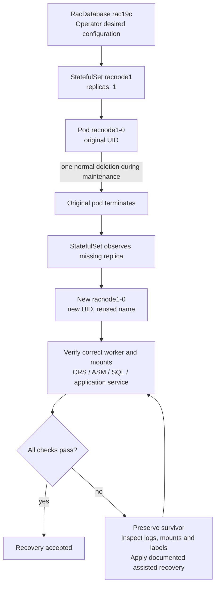

# 4. Operate and troubleshoot RAC with kubectl

[Manual start](OCNE-RAC-END-TO-END-MANUAL.md) | Previous: [3. Provision RAC](MANUAL-03-RAC.md)

This chapter explains the command, its purpose, output interpretation and verification. **Captured output** is from the real lab on11October2026. **Illustrative output** teaches an unexecuted exercise and is not evidence of a successful failure/recovery test. All kubectl/Bash commands run on ocne-cp as labadmin unless another context is stated.

Start with the **[scenario table: command syntax, expected output and actual results](RAC-TEST-SCENARIO-MATRIX.md)**. For the expanded **28-scenario coverage ledger**, complete diagnostic captures, maintenance gates and failure-specific recovery instructions, use the [RAC pod scenario workbook](RAC-POD-EXERCISES.md).

## 4a. Establish a healthy baseline

### 4a.1 Understand the controllers before changing a pod



There is no general `kubectl stop pod` command. Deleting a managed pod asks Kubernetes to remove it; its StatefulSet then attempts to replace it while desired replicas remains1. The replacement can be Pending or fail: recreation is not guaranteed database availability. A container restart increments restart count within a pod; pod replacement changes UID and commonly resets that count. [Kubernetes StatefulSet behavior](https://kubernetes.io/docs/concepts/workloads/controllers/statefulset/).

The current RAC StatefulSets are **OnDelete** following the memory recovery. Editing their template does not immediately replace running pods. `kubectl rollout restart` is therefore not a reliable restart instruction for this lab. The operator also owns these objects and may reconcile manual changes.

Live inspection found required node affinity: racnode1 to ocne-w1.lab.test and racnode2 to ocne-w2.lab.test. Homes are local hostPath volumes `/scratch/rac/cluster01/racnode1` and racnode2; shared ASM uses the two block PVCs. This setup does not automatically relocate a worker's home to another worker when a VM fails. Never remove affinity merely to make a pod schedule on an empty home directory.

### 4a.2 Read-only command reference

| Command | What it answers | Healthy interpretation |
|---|---|---|
| kubectl get nodes -o wide | Are hosts Ready? Which addresses/kernel/runtime? | Three Ready nodes |
| kubectl -n rac get racdatabases | What does the database controller report? | AVAILABLE/OPEN, cross-check SQL |
| kubectl -n rac get pods -o wide | Pod readiness, restarts, placement/IP | Both1/1 Running, separate correct workers |
| kubectl -n rac get statefulsets | Desired workload and current replicas | Each1/1 |
| kubectl -n rac get services | Service/NodePort mapping | Per-node31522/31523, SCAN31521 |
| kubectl -n rac get endpointslices | Are Services selecting ready pod endpoints? | Expected target pods/IPs |
| kubectl get pv; kubectl -n rac get pvc | Volume binding/reclaim policy | Two49Gi Block/RWX Bound, Retain |
| kubectl -n rac describe pod racnode1-0 | Scheduling, mounts, conditions, Events | No unresolved current warnings |
| kubectl -n rac get events --sort-by=.metadata.creationTimestamp | Recent lifecycle/error order | Explain rather than guess failures |
| kubectl logs ... | Container/controller diagnostics | Interpret with installer/SQL state |
| kubectl exec ... | Run a command in an existing container | Exit status plus expected result |
| kubectl wait ... | Wait for an explicit condition | Condition met; bounded timeout |

Use `-n rac` explicitly; operator logs use `-n oracle-database-operator-system`. `kubectl get all` omits some types such as PVCs, Secrets and custom resources; it is not a full inventory. `kubectl top` needs metrics-server, which is not installed in this lab; no metrics output is claimed.

### 4a.3 Full captured Kubernetes and SQL output

The following is the **complete output (tabs expanded for rendering)** from [Capture-RAC-Manual-Evidence.sh](../scripts/Capture-RAC-Manual-Evidence.sh), captured11October2026 at18:45UTC. It uses bounded read-only commands. SQL credentials were passed through stdin, not displayed or placed in process arguments. Ages, generated names/IPs and timestamps will differ on your build.

The CR's `PDB CONNECT STR` still shows ORCLPDB from the original image-variable mismatch. The SQL results below prove the actual PDB is LABPDB and network service labpdb_app reaches it on both instances. Do not copy the stale summary connection string.

```text
Captured UTC: 2026-10-11T18:45:32.914168+00:00

$ kubectl get nodes -o wide
NAME               STATUS   ROLES           AGE   VERSION          INTERNAL-IP     EXTERNAL-IP   OS-IMAGE                  KERNEL-VERSION                     CONTAINER-RUNTIME
ocne-cp.lab.test   Ready    control-plane   9d    v1.29.14+2.el9   192.168.77.11   <none>        Oracle Linux Server 9.8   5.15.0-324.217.5.3.el9uek.x86_64   cri-o://1.29.1
ocne-w1.lab.test   Ready    <none>          9d    v1.29.14+2.el9   192.168.77.12   <none>        Oracle Linux Server 9.8   5.15.0-324.217.5.3.el9uek.x86_64   cri-o://1.29.1
ocne-w2.lab.test   Ready    <none>          9d    v1.29.14+2.el9   192.168.77.13   <none>        Oracle Linux Server 9.8   5.15.0-324.217.5.3.el9uek.x86_64   cri-o://1.29.1

$ kubectl -n rac get racdatabases,pods,statefulsets,services,pvc -o wide
NAME                                     DBNAME   DBSTATE   ROLE      VERSION       PDB CONNECT STR             STATE
racdatabase.database.oracle.com/rac19c   RACCDB   OPEN      PRIMARY   19.32.0.0.0   racnode-scan:1521/ORCLPDB   AVAILABLE

NAME             READY   STATUS    RESTARTS   AGE   IP           NODE               NOMINATED NODE   READINESS GATES
pod/racnode1-0   1/1     Running   0          16h   10.244.1.9   ocne-w1.lab.test   <none>           <none>
pod/racnode2-0   1/1     Running   0          16h   10.244.2.9   ocne-w2.lab.test   <none>           <none>

NAME                        READY   AGE   CONTAINERS   IMAGES
statefulset.apps/racnode1   1/1     16h   racnode1-0   docker.io/roopla/oracle-rac@sha256:d4aa7fecb15b4f62caed83a0f445a275cc5bd8fbd1b01c7ac6216037b656566d
statefulset.apps/racnode2   1/1     16h   racnode2-0   docker.io/roopla/oracle-rac@sha256:d4aa7fecb15b4f62caed83a0f445a275cc5bd8fbd1b01c7ac6216037b656566d

NAME                        TYPE        CLUSTER-IP       EXTERNAL-IP   PORT(S)           AGE   SELECTOR
service/racnode-scan        ClusterIP   None             <none>        <none>            16h   app=oracle-database-operator,database.oracle.com/component=RAC,database.oracle.com/managed-by=racdatabase-controller,database.oracle.com/name=rac19c
service/racnode-scan-lsnr   NodePort    10.104.49.126    <none>        1521:31521/TCP    16h   statefulset.kubernetes.io/pod-name=racnode1-0
service/racnode1-0          ClusterIP   None             <none>        <none>            16h   statefulset.kubernetes.io/pod-name=racnode1-0
service/racnode1-0-lsnr     NodePort    10.96.75.114     <none>        31522:31522/TCP   16h   statefulset.kubernetes.io/pod-name=racnode1-0
service/racnode1-0-ons      NodePort    10.96.6.122      <none>        6200:30200/TCP    16h   statefulset.kubernetes.io/pod-name=racnode1-0
service/racnode1-0-vip      ClusterIP   None             <none>        <none>            16h   statefulset.kubernetes.io/pod-name=racnode1-0
service/racnode2-0          ClusterIP   None             <none>        <none>            16h   statefulset.kubernetes.io/pod-name=racnode2-0
service/racnode2-0-lsnr     NodePort    10.102.225.198   <none>        31523:31523/TCP   16h   statefulset.kubernetes.io/pod-name=racnode2-0
service/racnode2-0-ons      NodePort    10.108.138.93    <none>        6200:30201/TCP    16h   statefulset.kubernetes.io/pod-name=racnode2-0
service/racnode2-0-vip      ClusterIP   None             <none>        <none>            16h   statefulset.kubernetes.io/pod-name=racnode2-0

NAME                                            STATUS   VOLUME                   CAPACITY   ACCESS MODES   STORAGECLASS   VOLUMEATTRIBUTESCLASS   AGE   VOLUMEMODE
persistentvolumeclaim/asm-pvc-16e0716b-rac19c   Bound    asm-pv-16e0716b-rac19c   49Gi       RWX                           <unset>                 16h   Block
persistentvolumeclaim/asm-pvc-ee86c2c9-rac19c   Bound    asm-pv-ee86c2c9-rac19c   49Gi       RWX                           <unset>                 16h   Block

$ kubectl get pv
NAME                     CAPACITY   ACCESS MODES   RECLAIM POLICY   STATUS   CLAIM                         STORAGECLASS   VOLUMEATTRIBUTESCLASS   REASON   AGE
asm-pv-16e0716b-rac19c   49Gi       RWX            Retain           Bound    rac/asm-pvc-16e0716b-rac19c                  <unset>                          16h
asm-pv-ee86c2c9-rac19c   49Gi       RWX            Retain           Bound    rac/asm-pvc-ee86c2c9-rac19c                  <unset>                          16h

$ kubectl -n oracle-database-operator-system get pods,certificates
NAME                                                              READY   STATUS    RESTARTS   AGE
pod/oracle-database-operator-controller-manager-7c5c7c7f4-5k4kv   1/1     Running   1          30h

NAME                                                                 READY   SECRET                AGE
certificate.cert-manager.io/oracle-database-operator-metrics-certs   True    metrics-server-cert   30h
certificate.cert-manager.io/oracle-database-operator-serving-cert    True    webhook-server-cert   30h

$ kubectl -n cert-manager get deployments
NAME                      READY   UP-TO-DATE   AVAILABLE   AGE
cert-manager              1/1     1            1           30h
cert-manager-cainjector   1/1     1            1           30h
cert-manager-webhook      1/1     1            1           30h

$ kubectl -n kube-system get daemonset kube-multus-ds
NAME             DESIRED   CURRENT   READY   UP-TO-DATE   AVAILABLE   NODE SELECTOR   AGE
kube-multus-ds   3         3         3       3            3           <none>          40h

$ kubectl -n rac get statefulsets -o custom-columns=NAME:.metadata.name,STRATEGY:.spec.updateStrategy.type,REPLICAS:.spec.replicas
NAME       STRATEGY   REPLICAS
racnode1   OnDelete   1
racnode2   OnDelete   1
Control-plane TCP to 192.168.77.12:31522: PASS
Network SQL through 192.168.77.12:31522/labpdb_app (client in racnode1-0):

PDB
--------------------------------------------------------------------------------------------------------------------------------------------------------------------------------------------------------
INSTANCE_NAME
--------------------------------------------------------------------------------------------------------------------------------------------------------------------------------------------------------
LABPDB
RACCDB1


PL/SQL procedure successfully completed.

Defaulted container "racnode1-0" out of: racnode1-0, racnode1-init1 (init)
Control-plane TCP to 192.168.77.13:31523: PASS
Network SQL through 192.168.77.13:31523/labpdb_app (client in racnode1-0):

PDB
--------------------------------------------------------------------------------------------------------------------------------------------------------------------------------------------------------
INSTANCE_NAME
--------------------------------------------------------------------------------------------------------------------------------------------------------------------------------------------------------
LABPDB
RACCDB2


PL/SQL procedure successfully completed.

Defaulted container "racnode1-0" out of: racnode1-0, racnode1-init1 (init)
Final SQL identity and memory verification:

   INST_ID INSTANCE_NAME    STATUS   DATABASE_STATUS
---------- ---------------- ------------ -----------------
     1 RACCDB1      OPEN     ACTIVE
     2 RACCDB2      OPEN     ACTIVE


   INST_ID NAME                                                                 OPEN_MODE
---------- -------------------------------------------------------------------------------------------------------------------------------- ----------
     1 PDB$SEED                                                             READ ONLY
     1 LABPDB                                                               READ WRITE
     2 PDB$SEED                                                             READ ONLY
     2 LABPDB                                                               READ WRITE


   INST_ID NAME
---------- --------------------------------------------------------------------------------
VALUE
--------------------------------------------------------------------------------------------------------------------------------------------------------------------------------------------------------
     1 pga_aggregate_target
2147483648

     2 pga_aggregate_target
2147483648

     1 sga_max_size
3221225472

     2 sga_max_size
3221225472

     1 sga_target
3221225472

     2 sga_target
3221225472

     1 use_large_pages
FALSE

     2 use_large_pages
FALSE


8 rows selected.


   INST_ID NAME                                 CON_ID
---------- ---------------------------------------------------------------- ----------
     1 labpdb                                    3
     1 labpdb_app                                    3
     2 labpdb                                    3
     2 labpdb_app                                    3

Defaulted container "racnode1-0" out of: racnode1-0, racnode1-init1 (init)
Network SQL and documentation capture completed successfully.
```

Network checks above used a SQL client inside racnode1-0 through both worker NodePorts; the separate TCP checks originated on ocne-cp. They do not claim a Windows SQL Developer session. Oracle binary/SQL patch and invalid-component acceptance had already passed at10:58EDT; chapter3 shows those commands.

## 4b. kubectl and database exercises

### 4b.1 Inspect owner, UID, placement and desired resources

These are read-only and can run on the current lab:

```bash
kubectl -n rac get pod racnode1-0 -o jsonpath='{.metadata.uid}{"\n"}{.metadata.ownerReferences}{"\n"}'
kubectl -n rac get pods -o custom-columns='NAME:.metadata.name,UID:.metadata.uid,NODE:.spec.nodeName,PHASE:.status.phase'
kubectl -n rac get statefulsets -o custom-columns='NAME:.metadata.name,STRATEGY:.spec.updateStrategy.type,REPLICAS:.spec.replicas'
kubectl -n rac get statefulset racnode1 -o yaml
kubectl -n rac get pod racnode1-0 -o yaml
```

Compare the pod's resources to its StatefulSet template. At the baseline capture, old pods still declared the former HugePages reservation while templates no longer requested it. Both later replacement pods now declare4CPU/16Gi ordinary memory without HugePages requests; the final exercise output records this. Host pools are zero and SQL USE_LARGE_PAGES=FALSE. Do not silently report the declaration as actual usage. Full YAML may expose operational metadata; review it before publishing and do not retrieve Secrets.

### 4b.2 Follow logs and events

```bash
kubectl -n rac get pods -w
# In another terminal:
kubectl -n rac get events --sort-by=.metadata.creationTimestamp
kubectl -n rac logs racnode1-0 -c racnode1-0 --tail=50
kubectl -n oracle-database-operator-system logs deployment/oracle-database-operator-controller-manager --tail=100
```

Ctrl+C stops the watch, not the workload. `kubectl logs --previous` is useful only if a previous container incarnation exists **within that pod**; it does not recover logs from a deleted pod. For Oracle's file logs use their actual GI/DB paths and preserve them before replacing a pod. Do not publish raw installer command lines containing credentials.

### 4b.3 Open a shell and use Oracle tools

```bash
kubectl exec -it -n rac racnode1-0 -- /bin/bash
```

You are now inside the container, not on the worker. Check hostname/id before commands. Exit returns to ocne-cp. Prefer `su - grid` for ASM/GI tools and `su - oracle` for DB tools. A successful shell is not database acceptance.

Noninteractive examples:

```bash
kubectl exec -n rac racnode1-0 -- /u01/app/19c/grid/bin/crsctl check crs
kubectl exec -n rac racnode1-0 -- /u01/app/19c/grid/bin/crsctl stat res -t
kubectl exec -n rac racnode1-0 -- su - oracle -c '/u01/app/oracle/product/19c/dbhome_1/bin/srvctl status database -db RACCDB -verbose'
kubectl exec -n rac racnode1-0 -- su - oracle -c '/u01/app/oracle/product/19c/dbhome_1/bin/srvctl status service -db RACCDB'
```

Avoid nesting these quoted commands through another PowerShell SSH command string. Log into ocne-cp first and paste Bash, or transfer a Bash script. Nested quoting previously stripped `su -c` arguments and caused an unrelated invalid-option error.

### 4b.4 Stop and start one database instance without deleting its pod

**Executed on both instances, sequentially, 11 October 2026 23:40?23:46 UTC.** [Complete output, including failed attempts and recovery](RAC-EXERCISE-RECOVERY-OUTPUT.md). This deliberately interrupts sessions on one instance. Before each test confirm both instances/service healthy, backups available and no installation/patch active. A new successful connection to the survivor does not prove preservation of an existing transaction.

Run **Bash on ocne-cp as labadmin**. Stop the application service on that instance first; the original instance-only stop failed with CRS-2974 because of the service dependency. No force flag was needed after stopping the service.

```bash
kubectl exec -n rac racnode1-0 -- su - oracle -c '/u01/app/oracle/product/19c/dbhome_1/bin/srvctl stop service -db RACCDB -service labpdb_app -instance RACCDB1'
kubectl exec -n rac racnode1-0 -- su - oracle -c '/u01/app/oracle/product/19c/dbhome_1/bin/srvctl stop instance -db RACCDB -instance RACCDB1 -stopoption IMMEDIATE'
kubectl exec -n rac racnode2-0 -- su - oracle -c '/u01/app/oracle/product/19c/dbhome_1/bin/srvctl status database -db RACCDB -verbose'
kubectl -n rac get pods -o wide
```

Captured SRVCTL result:

```text
Instance RACCDB1 is not running on node racnode1-0
Instance RACCDB2 is running on node racnode2-0 with online services labpdb_app. Instance status: Open.
```

Both pods remained 1/1 Ready because their TCP listeners stayed open. Chapter3's network SQL test to worker2 returned LABPDB/RACCDB2. Restore instance1, then inspect the service before starting it:

```bash
kubectl exec -n rac racnode1-0 -- su - oracle -c '/u01/app/oracle/product/19c/dbhome_1/bin/srvctl start instance -db RACCDB -instance RACCDB1'
service_status=$(kubectl exec -n rac racnode1-0 -- su - oracle -c '/u01/app/oracle/product/19c/dbhome_1/bin/srvctl status service -db RACCDB -service labpdb_app')
printf '%s\n' "$service_status"
if [[ "$service_status" != *RACCDB1* ]]; then
  kubectl exec -n rac racnode1-0 -- su - oracle -c '/u01/app/oracle/product/19c/dbhome_1/bin/srvctl start service -db RACCDB -service labpdb_app -instance RACCDB1'
fi
kubectl exec -n rac racnode1-0 -- su - oracle -c '/u01/app/oracle/product/19c/dbhome_1/bin/srvctl status database -db RACCDB -verbose'
```

The automatic service policy restored labpdb_app with the instance. An unconditional extra start returned PRCR-1120/CRS-5702 (already running); this was a wrapper error, not an instance failure. SQL subsequently verified both instances OPEN/ACTIVE and LABPDB READ WRITE. Repeat on instance2 only after these checks pass, changing racnode1-0/RACCDB1 to racnode2-0/RACCDB2 and testing the survivor1 connection. Both directions were executed. Do not stop GI or ASM merely to stop a DB instance.

### 4b.5 Delete one RAC pod and observe its replacement

**Executed sequentially on pod2 then pod1 on 11 October EDT / 11?12 October UTC 2026. Pod2 recovery required manual assistance; pod1 recovered but logged a duplicate-start image defect.** [Complete pod output](RAC-EXERCISE-PODS-OUTPUT.md) and [recovery procedure](RAC-POD-EXERCISES.md#assisted-gi-recovery-observed-after-node2-replacement). The initial missing GI copy was repaired, and an old SELinux category on the copy was corrected. Kubernetes created the pod automatically; Oracle recovery was a separate step. Do not use deletion as a first response to installation errors. Before each exercise: establish a maintenance window, take database/configuration backups, confirm the survivor, and verify mounted homes, own-node GI recovery files and their SELinux labels. Never delete the peer before full Oracle/SQL acceptance.

Check persistence/placement before the exercise:

```bash
kubectl -n rac get statefulset racnode1 -o yaml
kubectl -n rac get configmap racnode1rac19c-cmap -o yaml
kubectl -n rac get pvc
kubectl get pv
kubectl get nodes
kubectl exec -n rac racnode2-0 -- /u01/app/19c/grid/bin/crsctl check crs
kubectl exec -n rac racnode2-0 -- su - oracle -c '/u01/app/oracle/product/19c/dbhome_1/bin/srvctl status service -db RACCDB'
```

Verify on worker1 that /scratch is the correct mounted filesystem, the populated home is present and the same ASM devices remain attached. Keep the other worker running. Save current object/Oracle configuration securely and check image restart scripts against the pinned [operator storage lifecycle examples](https://github.com/oracle/oracle-database-operator/blob/ff6f9178c1650df30afbf203ebdb633e9b80760a/docs/rac/provisioning/add_asm_disk_to_an_existing_rac_database.md). Upstream rolling recreation examples do not establish this particular customized image's recovery test.

Once those prerequisites are met, Terminal1 watches pods:

```bash
kubectl get pods -n rac -w -o wide
```

Terminal2, **Bash on ocne-cp**, performs one normal deletion, then distinguishes the replacement by UID:

```bash
set -euo pipefail
pod=racnode1-0
old_uid=$(kubectl get pod "$pod" -n rac -o jsonpath='{.metadata.uid}')
test -n "$old_uid"
printf 'Original UID: %s\n' "$old_uid"
kubectl delete pod "$pod" -n rac --grace-period=120 --wait=true --timeout=300s
new_uid=''
for attempt in $(seq 1 120); do
  candidate=$(kubectl get pod "$pod" -n rac --ignore-not-found -o jsonpath='{.metadata.uid}')
  if [[ -n "$candidate" && "$candidate" != "$old_uid" ]]; then
    new_uid=$candidate
    break
  fi
  sleep 5
done
test -n "$new_uid" || { echo 'No replacement appeared; inspect controller/events'; exit 1; }
printf 'Replacement UID: %s\n' "$new_uid"
kubectl wait -n rac --for=condition=Ready "pod/$pod" --timeout=900s
kubectl get pod "$pod" -n rac -o wide
```

**Captured node2 watch milestones** (complete polling output, commands and failures are in the transcript):

```text
2026-10-11T23:47:54.688127+00:00 racnode2-0 fb9bdc6d-2737-4291-bedd-121e30724c0a Running Ready=True deleting=True
2026-10-11T23:49:55.338084+00:00 racnode2-0 fb9bdc6d-2737-4291-bedd-121e30724c0a Failed Ready=False deleting=True
2026-10-11T23:50:10.415770+00:00 racnode2-0 e5fb5f48-cfcc-4476-97d9-07338262095d Running Ready=False deleting=False
2026-10-11T23:54:57.103182+00:00 racnode2-0 e5fb5f48-cfcc-4476-97d9-07338262095d Running Ready=True deleting=False
```

The ready transition followed assisted GI recovery, not unattended startup. SQL still showed only instance1 at that instant; full acceptance passed after ASM/database startup completed. The timestamps bound the observed transitions, not a measured client-service SLA.

The pod name returns because StatefulSet maintains its identity; the UID proves replacement. A zero restart counter on the new pod does not mean no interruption occurred. The public pod IP can change; use Services for client routing.

After Ready, verify CRS/ASM on both nodes, two OPEN instances, LABPDB READ WRITE, application service, HugePages0/SQL FALSE, intended patch level and SQL through both NodePorts. Run [Verify-RAC-Database.sh](../scripts/Verify-RAC-Database.sh) after reviewing its fixed lab names, plus the network connection checks. Record actual output and interruption duration. Whichever node you test first, do not move to the peer until the first passes every check; this run tested node2 first.

If deletion times out or the pod remains Pending/failed, **stop the exercise** and preserve the healthy node. Inspect Events, node affinity, mounted scratch, CRI-O image, CNI/private links, ASM devices and GI startup logs. Never use `--force --grace-period=0`, remove finalizers, delete the CR/PVC, or empty homes to make a failed test look successful. OnDelete does not prevent normal replacement of a missing pod; it controls updates to existing pods.

### 4b.6 Stop the database and plan lab shutdown

A whole database stop is an intentional outage; use SRVCTL, not deletion of the RacDatabase. With work stopped and backups addressed:

```bash
kubectl exec -n rac racnode1-0 -- su - oracle -c '/u01/app/oracle/product/19c/dbhome_1/bin/srvctl stop service -db RACCDB -service labpdb_app'
kubectl exec -n rac racnode1-0 -- su - oracle -c '/u01/app/oracle/product/19c/dbhome_1/bin/srvctl stop database -db RACCDB -stopoption IMMEDIATE'
kubectl exec -n rac racnode1-0 -- su - oracle -c '/u01/app/oracle/product/19c/dbhome_1/bin/srvctl status database -db RACCDB'
```

Start it again (pods/GI must be available):

```bash
kubectl exec -n rac racnode1-0 -- su - oracle -c '/u01/app/oracle/product/19c/dbhome_1/bin/srvctl start database -db RACCDB'
```

A database stop/start was executed during the memory fix. A full **post-RAC VM power cycle has not been validated**. The foundation's proven order is clients/workers/control-plane off before NFS/operator; startup operator/NFS first, then control plane, then workers. Add proper Oracle GI/database shutdown/recovery planning before applying it to the RAC system. Ordinary VirtualBox shared-disk snapshots are not a substitute for RMAN and a verified restore. Keep the golden VM off; do not save-state the whole cluster and assume distributed time stays valid.

### 4b.7 Changes that are not ordinary restart commands

| Tempting command/action | Why it is a different operation |
|---|---|
| Delete RacDatabase rac19c | Invokes operator deletion/lifecycle behavior; not a pod restart |
| Delete PVC/PV or wipefs/mkfs | Risks stored database data; Retain is not a backup |
| Scale generated StatefulSet to0 | Conflicts with operator desired state; not a durable database shutdown interface |
| Set spec.nodeCount lower | RAC scale-in workflow, not stopping one instance for a demonstration |
| Drain a worker immediately | Evicts workloads tied to local homes; placement/persistence must be planned |
| Apply fresh YAML to legacy CR | Service-name immutability blocks the change; use the reviewed live manifest |
| Disable webhook/prerequisite checks | Hides the reason deployment is unsafe/inconsistent |

## 4c. Troubleshooting from the actual run

### 4c.1 Foundation issues and verified resolutions

| Observation | Resolution / next check | Recorded outcome |
|---|---|---|
| Source boot disk was only 40 GiB; /var shared its root | Expanded independent clone VDIs to 100 GiB, then guarded growpart and xfs_growfs; verified unchanged partition start/root UUID | All clones had ~99 GiB root; source remained unchanged |
| Golden VM used a normal snapshot chain and a global Downloads share | Inspected every parent; full current-state clones flattened the chain; explicitly reviewed global share while preserving unrelated resources | Independent clone disks; no guest vboxsf mount |
| Identity script rejected the clone's SMBIOS UUID | Compared actual VBox UUID, SMBIOS byte order and MAC; accepted the two verified UUID representations | Unique identities verified on all clones |
| Worker container directory was not literally empty | Confirmed only known empty Podman scaffolding; backed it up and restored metadata on the separately identified XFS disk | Dedicated mounts persisted after reboot; no existing container data discarded |
| Documented repository package resolved to a different release-package name | Inspected installed package and enabled repo IDs | oracle-ocne-release-el9 1.0-7 supplied ol9_olcne19; platform 1.9.6 installed |
| labadmin certificate distribution failed on noninteractive sudo | Preserved generated PKI; used documented copy with temporary restricted root access; verified results and removed access | Platform certificates/services verified; see certificate recovery |
| Certificate copy transport did not exit | Verified copied files and running services; inspected and terminated only identified stalled transports | Recovery completed; normal copy exit success was not claimed |
| OpenSSH rejected Windows configuration permissions | Restricted the included config's ACL to the Windows user and SYSTEM | Four pinned workstation key logins verified |
| Windows hosts resolved guest IPs but NAT subnet had no direct host route | Used per-node SSH aliases overriding HostName to 127.0.0.1 and ports 2220–2223 | Name resolution and SSH routing documented separately |
| Flannel image pull appeared slow; worker2 initially restarted twice | Checked events/logs and transfer progress; waited for networking dependencies | All nodes and pods became Ready without reinstalling |
| NFS helper mounted an already-mounted share again and got access denied | Removed the redundant second mount; checked existing source/options/fstab | All-node labadmin reads/writes and reboot persistence passed |
| Deployment counters appeared ready before all restarted pods were Ready | Added live pod Ready-condition checks to acceptance | Three nodes, 15 pods and all four deployments verified at 22:08 |
| OCNE report detail showed kernel 4.12.0 and closed firewall ports despite healthy status | Compared direct uname, runtime/permanent firewalld, packaged firewall check and real workload readiness | **Cause unresolved**; inconsistent report fields were not used as the acceptance source |


Keep the OCNE report discrepancy unresolved in your notes: a healthy summary and stale kernel/firewall fields are not proof of a kernel problem. Check direct uname, actual firewall rules and workload conditions. See [full foundation troubleshooting](TROUBLESHOOTING.md).

### 4c.2 RAC issues, causes, fixes and verification

| Symptom | Evidence / cause | Actual fix | How to verify / prevent |
|---|---|---|---|
| Guest stalls/time jumps after host inactivity | Windows Modern Standby suspended the host | Recorded60-minute AC timeout, disabled AC automatic standby for lab sessions; recovered guests and time services | Check Chrony, journals, Ready conditions; do not assume running VBox means healthy guest |
| Wrong disk guessed by device letter | Worker2 enumeration changed | Used VBox UUID/serial/slot, bytes, PARTUUID, signatures/mounts | Never guess /dev/sdb or reuse unrelated asm3.vdi |
| Private MACVLAN unicast failed | VBox allow-vms set but Linux parent did not accept extra MACs | Persistent NM accept-all-mac-addresses1 and current promisc setting on private NICs | Both directions/both networks plus persistence check |
| BusyBox stat called hugetlbfs UNKNOWN | Diagnostic tool reporting limitation | Checked /proc/mounts instead | Historical HugePages test only; final profile has none |
| GI INS-30003 | Original generated password32chars exceeded installer30 | Before CRS existed, protected backup,24char replacement, same RSA key, replaced encrypted payload only | Secret encryption/decryption match and both projected file hashes; fresh generator now24 |
| GI software-only retry INS-08109 NullPointer | Retry in already-extracted/partially installed home | Preserved evidence; subsequent full configuration completed | Initial retry error was not falsely called successful |
| PRVE-10323 / INS-13014 systemd degraded | Unused rpc_pipefs mount failed in pod2; no NFS inside container | After inspection, reset only var-lib-nfs-rpc_pipefs.mount failure | systemd running; host NFS independently verified; no blanket reset/SELinux disable |
| DBCA ORA-27125 / ORA-01034 / ENOSPC | 3GiB SGA needed1537x2MiB pages, pool1536; shmall exactly3GiB lacked overhead | User chose HugePages0; IPC ceilings8GiB; desired pod resources ordinary16GiB; resume existing GI/ASM | SQL SGA3GiB, PGA2GiB, USE_LARGE_PAGES FALSE after DB restart; host pools0 |
| sysctl inside pod permission denied | Kubernetes procfs sysctl path read-only | Verified exact CRI PID and separate IPC namespace; nsenter IPC only from worker to repair existing pod | Correct values inside pod, host IPC unchanged; clean-build YAML sets them initially |
| Wrong PDB ORCLPDB | Operator emits ORACLE_PDB; image reads ORACLE_PDB_NAME and defaults ORCLPDB | Added explicit env; after DBCA renamed PDB through supported restricted-open sequence | gv$pdbs shows LABPDB READ WRITE both; fresh YAML avoids repair |
| Application service on CDB root/name collision | Original service labpdb lacked PDB mapping, then collided with automatic LABPDB service | Removed only new root service, created labpdb_app with -pdb LABPDB, preferred both instances | SYS_CONTEXT through both listeners proves PDB/instance |
| ServiceName cannot be changed post creation | Admission webhook compares stored original service name | Retained legacy CR field; separately SRVCTL-managed labpdb_app; separate live/fresh YAML | No webhook bypass/CR deletion; document known metadata mismatch |
| ORA-65042 during global-name experiment | Direct LABPDB to LABPDB.lab.test rename rejected name already used | Two-step temporary LABPDB_RENAME then LABPDB.lab.test succeeded | This did NOT fix service immutability/default name; document as unsuccessful service workaround |
| PRCD-1278 adding service labpdb | Oracle reserves the PDB's default service name, even after domain rename | Restored labpdb_app on both instances | SRVCTL plus real network SQL succeeded |
| CR still displays ORCLPDB connection string | Controller status retained original provisioning metadata | Left status unpatched; verified real SQL service and documented correct string | Do not use stale summary as SQL truth |
| su invalid option from a Windows SSH one-liner | Nested quoting stripped -c payload | Transferred Bash scripts or ran commands after SSH login | bash -n before execution; do not diagnose as an Oracle failure |

### 4c.3 Recovery commands are conditional, not installation steps

The original recovery helpers preserve detailed guards and the exact CR/VM identities. Read them to understand the recorded repair; do not remove their guards or rerun them on a healthy database. For a new deployment use chapter3's preventive configuration.

| Incident evidence/helper | Use boundary |
|---|---|
| [Repair-RAC-Preinstall-Password.sh](../scripts/Repair-RAC-Preinstall-Password.sh) and [Resume-RAC-After-Password-Fix.sh](../scripts/Resume-RAC-After-Password-Fix.sh) | Only the observed pre-CRS/no-database failure; not password rotation for a live DB |
| [Disable-RAC-HugePages.sh](../scripts/Disable-RAC-HugePages.sh) | Verified wholly unused host pool before releasing it |
| [Set-RAC-Live-IPC-Limits.sh](../scripts/Set-RAC-Live-IPC-Limits.sh) | Exact running container PID/IPC namespace, only observed memory recovery |
| [Set-RAC-NoHugePages-Profile.sh](../scripts/Set-RAC-NoHugePages-Profile.sh) | Reconciled desired CR/templates while preventing automatic pod restart |
| [Resume-RAC-After-Memory-Fix.sh](../scripts/Resume-RAC-After-Memory-Fix.sh) | Verified GI/ASM healthy, no active installer/DB resource before retry |
| [Finalize-RAC-PDB-And-Memory.sh](../scripts/Finalize-RAC-PDB-And-Memory.sh) | Historical ORCLPDB rename and explicit FALSE restart, not clean-build setup |
| [Align-RAC-Immutable-Service.sh](../scripts/Align-RAC-Immutable-Service.sh) | Failed experiment; do not execute as a fix |
| [Complete-RAC-Service-Alignment.sh](../scripts/Complete-RAC-Service-Alignment.sh) | Partially changed global name, then PRCD-1278; not a successful service alignment |
| [Start-RAC-Application-Service.sh](../scripts/Start-RAC-Application-Service.sh) | Restored working labpdb_app after the above experiment |

For the PDB mismatch specifically, Oracle's [PDB administration procedure](https://docs.oracle.com/en/database/oracle/oracle-database/19/multi/administering-pdbs-with-sql-plus.html) requires closing the PDB on all instances, opening restricted on one, changing global_name, closing/reopening and saving state. Inspect existing services and active sessions before any rename; the provided historical script checks the expected starting state. [PRCD-1278](https://docs.oracle.com/en/error-help/db/prcd-01278/) explains the reserved default-service collision. The domain-rename attempts were not necessary to create labpdb_app and are excluded from the clean build.

### 4c.4 Diagnose without rebuilding

Start at the failed layer: Windows/VM/time, Linux mounts/network, Kubernetes scheduling/CNI, operator/admission, GI/ASM, database/PDB, then client route/service. Preserve original evidence. Check exact identities before changing state. If a retry helper refuses its expected starting state, that is useful information; never delete a live CR or format shared storage to make the guard pass.

Record actual output for each exercise in your own private run log, then publish only reviewed excerpts. Current acceptance covers database creation and network SQL, not production HA, failover under load, backup restoration or the future pod-deletion exercise.

### 4c. Restart exercise findings added 12 October

The [failure/correction table](RAC-TEST-SCENARIO-MATRIX.md#failure-and-correction-table) and [complete pod transcript](RAC-EXERCISE-PODS-OUTPUT.md) document missing GI copies, retained old SELinux MCS labels, the assisted OS-file recovery, Ready-before-SQL and duplicate CRS start/INS-40401. Do not deinstall working GI to clear the latter message. Existing database recovery passed, but image startup handling still needs a separate correction/retest. Worker/container-crash/full-lab fault tests were not injected while that defect remains.
