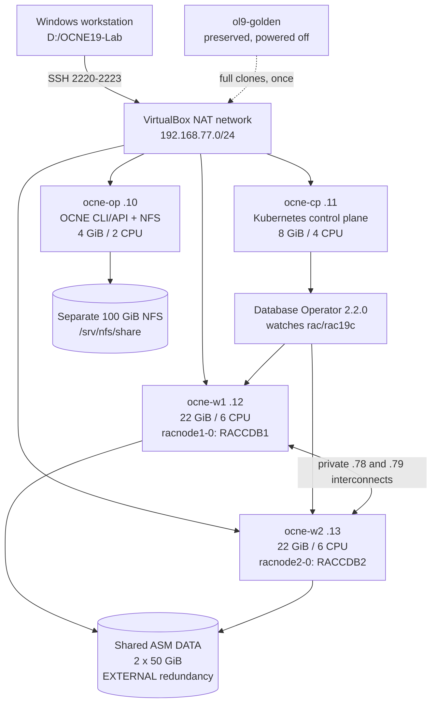

# OCNE 1.9 and Oracle RAC 19.32: end-to-end manual

**Four chapters, in the requested execution order.** See the [28-scenario test table](RAC-TEST-SCENARIO-MATRIX.md) for descriptions, commands, expected output, actual results and full transcripts. Prepared 11 October 2026 from this lab's scripts, Oracle sources and recorded results. Start here for a new build; use chapter 4 for an existing database.

| Order | Prerequisites | Installation / exercises |
|---|---|---|
| **1. OCNE lab** | [1a: host, golden VM, inventory and access](MANUAL-01-OCNE.md#1a-prerequisites-for-setting-up-the-ocne-lab) | [1b: cloning, Linux, OCNE, Kubernetes and NFS](MANUAL-01-OCNE.md#1b-setting-up-the-ocne-lab) |
| **2. Database Operator** | [2a: healthy Kubernetes, versions, permissions and manifests](MANUAL-02-DATABASE-OPERATOR.md#2a-prerequisites-for-installing-oracle-database-operator) | [2b: cert-manager, RBAC, operator and verification](MANUAL-02-DATABASE-OPERATOR.md#2b-installing-oracle-database-operator-step-by-step) |
| **3. RAC database** | [3a: hardware, storage, networks, OS, image, homes, secrets and CVU](MANUAL-03-RAC.md#3a-prerequisites-to-provision-rac) | [3b: complete YAML, provisioning, SQL acceptance and connections](MANUAL-03-RAC.md#3b-provisioning-rac-step-by-step) |
| **4. Operations** | [4a: understand ownership and establish health](MANUAL-04-RAC-OPERATIONS.md#4a-establish-a-healthy-baseline) | [4b: kubectl exercises, pod replacement, stop/start and troubleshooting](MANUAL-04-RAC-OPERATIONS.md#4b-kubectl-and-database-exercises) |

Every command block identifies its execution context. Run one step, inspect its result, and then continue. Commands beginning with `kubectl` run as `labadmin` on the control-plane VM unless stated otherwise. Bash commands execute inside Oracle Linux; PowerShell commands execute on Windows. Output blocks are either dated **captured output** or explicitly **illustrative**, never fabricated observations.

For a new environment, first fill in the inventory in chapter 1 and edit the non-secret YAML/configuration consistently. Disk serials, UUIDs, network interfaces, DNS servers, SSH host fingerprints and free attachment slots must come from that environment. A configuration edit does not rewrite every command in this book. Do not paste all chapters into a single terminal. Formatting an unidentified disk cannot safely be made a blind operation.

## What you are building

An **OCNE operator VM** runs the OCNE management CLI/API. It is different from **Oracle Database Operator**, a Kubernetes controller installed later. Kubernetes runs on one control-plane VM and two worker VMs. The database controller watches a `RacDatabase` custom resource and creates two RAC node pods. Each pod contains Grid Infrastructure and one database instance. Both instances open the **same** database stored on shared ASM disks.

| Term | Meaning in this lab |
|---|---|
| Pod | Kubernetes execution unit containing the RAC container; a replacement has a new UID even if its name is reused |
| StatefulSet | Kubernetes controller maintaining a named pod; this operator creates one StatefulSet per RAC node |
| CRD / custom resource | CRD installs the API type; `rac/rac19c` is one request to provision a RAC database |
| Operator / reconciliation | Controller compares requested configuration to observed state and performs supported actions |
| CNI / Multus / NAD | Pod networking; Multus attaches extra networks described by NetworkAttachmentDefinitions |
| GI / CRS / ASM | Grid Infrastructure; cluster resource management; shared Oracle disk management |
| CDB / PDB / instance | Container database RACCDB; pluggable database LABPDB; processes and memory RACCDB1 or RACCDB2 |
| Service | Kubernetes Service routes TCP; Oracle service labpdb_app selects the database/PDB workload |
| PV / PVC | Kubernetes storage object and its claim; here shared raw block devices, not NFS files |
| Gold home / slim image | Already-patched Oracle software archive / OS-and-runtime container into which homes are extracted |

**Storage is deliberately separate:** OS disks boot guests; container disks hold CRI-O layers; scratch holds Oracle homes and staged ZIPs; shared block disks hold ASM/database data; the operator's NFS export serves general lab files. EXTERNAL ASM redundancy provides no ASM mirroring. A single Windows host and a single Kubernetes control plane do not provide infrastructure high availability.

## Tested inventory and honest limits

Observed: Windows 11 Home, VirtualBox 7.2.18, Oracle Linux 9.8, UEK R7 `5.15.0-324.217.5.3.el9uek.x86_64`, OCNE 1.9.6, Kubernetes `v1.29.14+2.el9`, CRI-O 1.29.1, Database Operator 2.2.0, cert-manager 1.17.4 and RAC 19.32. The image and gold homes are supplied by the lab owner; this repository does not distribute Oracle binaries or grant software licenses.

This is a historical-version home lab. OCNE 1.9 is in Sustaining Support; cert-manager 1.17 is outside community maintenance. The requested operator/control-plane RAM of 4/8 GiB is below Oracle's 8/16 GB minimums. Workers stay at 22 GiB each. Successful installation is not vendor certification, production sizing or a performance result. Recheck the cited compatibility tables when rebuilding rather than mixing in current component releases.

The original lab passed an OCNE/NFS ordered restart on 1 October. RAC completed on 11 October: two OPEN instances, LABPDB READ WRITE on both, 19.32 SQL patches successful, SGA 3 GiB / PGA 2 GiB, `USE_LARGE_PAGES=FALSE`, and SQL connections through both worker listeners passed at 18:45 UTC. Subsequent controlled exercises covered both instance stops/starts, application service maintenance, both worker cordons, both pod replacements and Database Operator restart. Pod2 required assisted GI recovery after an SELinux-label failure; pod1 recovered but logged a duplicate-start/INS-40401 image defect. Both pods now use the no-HugePages resource template. RMAN backup plus RESTORE VALIDATE passed. Both SQL paths and memory/PDB checks remained healthy at11:44UTC12October. **Actual restore, worker failure and a complete post-RAC power cycle remain untested**; the workbook marks these limits.

The existing CR retains an immutable legacy service name and a stale ORCLPDB connection summary. The working application service is `labpdb_app` mapped to LABPDB. **Fresh builds use [rac-database.yaml](../config/rac-database.yaml); this existing deployment uses [rac-database-live.yaml](../config/rac-database-live.yaml) for in-place reconciliation.** Do not apply the fresh service-name change to the existing CR. Chapter 3 explains the incident and prevention.

## How to keep your own execution record

Record date/time, command, exit code, actual identifiers, verification and unresolved issues after each gate. Use [RUN-LOG.md](RUN-LOG.md) and [CLONING-RUN-LOG.md](CLONING-RUN-LOG.md) as examples. Keep raw output under ignored `logs/`, binaries under `ISO/`, disks under `vms/`, and private keys/credentials under `private/` or protected guest paths. Do not capture passwords, `kubectl get secret -o yaml`, kubeconfig contents or installer command lines containing passwords into a public transcript.

This manual incorporates and extends the [cloning guide](OCNE-1.9-Golden-VM-Cloning-Guide.md), [full OCNE installation guide](OCNE-1.9-OL9-Setup-Guide.md), and [RAC prerequisite guide](RAC-PREREQUISITES-GUIDE.md). The adapted OCNE/NFS documentation retains [CC BY-SA 4.0](https://creativecommons.org/licenses/by-sa/4.0/) attribution and licensing as reproduced in chapter1. Oracle code retains its [UPL license](../config/vendor/ORACLE-UPL.txt), and cert-manager retains its Apache2.0 license. Windows/VirtualBox orchestration, resource sizes and the observed troubleshooting adaptations are local implementation.
