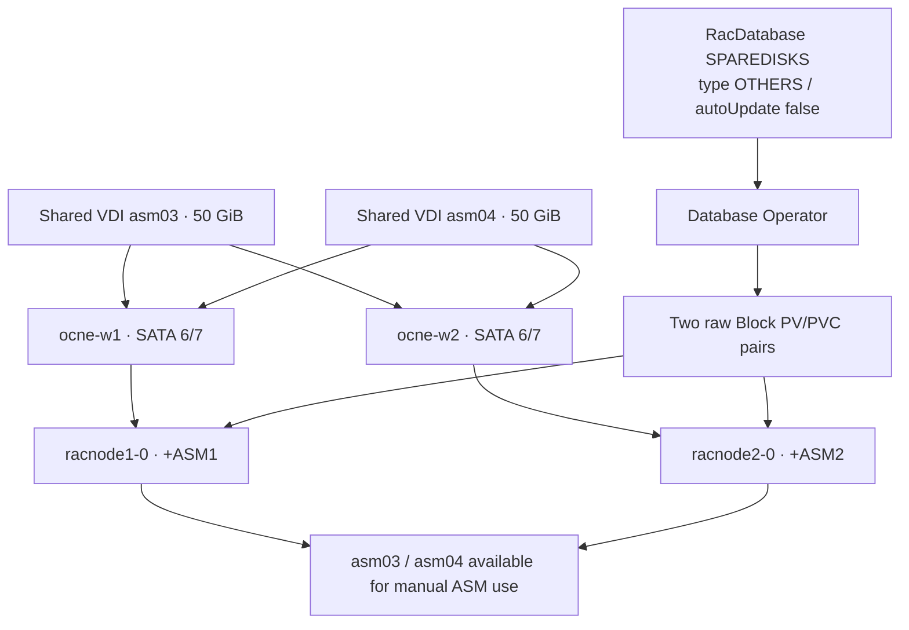

# Add two shared ASM candidate disks to an existing RAC database

Execution date: 14 October 2026. This is a separate maintenance exercise on the existing OCNE/RAC lab. Completed: both shared devices are attached, the YAML is applied, both pods were replaced sequentially, and final ASM/database/application acceptance passed at 23:38 UTC. Do not rerun one-time disk creation or partitioning on this completed hardware.

## 1. What this exercise does

Add two 50 GiB VirtualBox fixed, shareable disks to **both** workers. Expose their partitions inside both RAC pods using the Database Operator's `OTHERS` type. Leave them unused so you can later create an ASM diskgroup or add disks yourself.

`SPAREDISKS` is a configuration placeholder, not an ASM diskgroup. `autoUpdate: "false"` prevents automatic ASM membership changes; it does not prevent pod replacement. No filesystem, ASM label, diskgroup or database is created on the new partitions by our preparation commands.



The PV/PVC objects map existing shared block devices. They do not create the VirtualBox disks. Both workers must see the same underlying media, not independent disks with matching names. VirtualBox **multiattach** uses per-VM differencing images and is unsuitable here; use **shareable** with fixed allocation.

## 2. Prerequisites and execution locations

| Where | Account/tool | Purpose |
|---|---|---|
| Windows workstation | PowerShell, `D:\OCNE19-Lab`, VBoxManage | Create/attach media, inspect VM UUIDs, save evidence |
| `ocne-w1` | root via SSH, or `labadmin` with interactive sudo | Inspect blank disk identities and create GPT partitions once |
| `ocne-w2` | root via SSH, or `labadmin` with interactive sudo | Refresh partition tables and verify the same partition UUIDs |
| `ocne-cp` | `labadmin`, configured kubectl | Validate/apply YAML, replace one RAC pod at a time, SQL checks |
| Inside each RAC pod | `grid` / `oracle` through `kubectl exec` | Verify ASM candidates, GI and database health |

The operator VM `ocne-op` needs no disk or NFS changes for this exercise. Worker RAM remains 22 GiB each. The existing NFS share is unrelated to ASM storage.

Before making changes, have the existing RAC deployment healthy and preserve its working manifest. This lab already had node-specific `/etc/oracle` backups with corrected SELinux labels. The image has a recorded duplicate-CRS-start problem on replacement; see [pod exercises](RAC-POD-EXERCISES.md). Do not assume Kubernetes Ready or the CR's AVAILABLE label proves SQL recovery.

### Initial checks — Windows

```powershell
Set-Location D:\OCNE19-Lab
.\scripts\00-Inspect-Host.ps1
Get-PSDrive D | Select-Object Name,Free,Used
$vbox = 'C:\Program Files\Oracle\VirtualBox\VBoxManage.exe'
& $vbox showvminfo ocne-w1 --machinereadable
& $vbox showvminfo ocne-w2 --machinereadable
ssh -F config/windows-ssh.conf ocne-cp
```

The original inspection helper mixes differently shaped PowerShell objects, so its default table can hide free-space columns. The explicit `Get-PSDrive` check above avoids that display issue. Actual initial D: free space was **572.8 GiB**, VirtualBox **7.2.18**, both workers running, SATA ports **6 and 7 empty**. Existing ASM disks occupied ports 4 and 5.

### Initial checks — control plane

```bash
kubectl get nodes
kubectl get pods -n rac -o wide
kubectl get racdatabase rac19c -n rac
kubectl get pvc -n rac
kubectl get pods -n rac-app
```

Actual: three Ready nodes, two RAC pods Running/Ready, two existing Bound ASM PVCs, eight application pods Running/Ready. SQL verification showed RACCDB1 and RACCDB2 OPEN/ACTIVE, LABPDB READ WRITE on both; DATA mounted with 102392 MiB total, no offline disks or rebalance. SGA remained 3 GiB and HugePages disabled.

**If a check fails:** diagnose existing health first. Do not delete/recreate the CR, database, existing disks, or VMs to resolve a conflict.

## 3. Create and attach the shared disks — Windows

Use [Add-RAC-Spare-Disks.ps1](../scripts/Add-RAC-Spare-Disks.ps1). This is our local VirtualBox implementation, not an Oracle Database Operator requirement. It verifies VM UUIDs, original ASM attachment UUIDs, empty target ports, absent target files and free storage; it verifies original disk attachments again after each new attachment.

```powershell
Set-Location D:\OCNE19-Lab
$tokens = $null
$errors = $null
[System.Management.Automation.Language.Parser]::ParseFile(
  (Join-Path $PWD 'scripts/Add-RAC-Spare-Disks.ps1'),
  [ref]$tokens, [ref]$errors) | Out-Null
if ($errors.Count) { throw ($errors | Out-String) }
.\scripts\Add-RAC-Spare-Disks.ps1 -SizeGiB 50
# Only on a fresh run, after reviewing the plan:
.\scripts\Add-RAC-Spare-Disks.ps1 -SizeGiB 50 -Apply
```

Expected plan:

```text
PLAN ocne-rac-asm03: 50 GiB fixed/shareable, both workers SATA 6
PLAN ocne-rac-asm04: 50 GiB fixed/shareable, both workers SATA 7
```

The script executes `VBoxManage createmedium disk --size 51200 --format VDI --variant Fixed`, then `modifymedium disk ... --type shareable`, and `storageattach ... --storagectl SATA --port 6/7 --device 0 --type hdd --medium UUID` for each worker. Read the linked script for the exact guards and commands; do not run a second creation workflow afterward.

Actual: both disks hot-attached successfully to the existing Intel AHCI controller while the workers were running. No VM reboot or NIC change was required. No `--hotpluggable` property was changed on running VMs. If attachment is rejected in another environment, stop and inspect partial creation/attachment state; do not overwrite media or detach an existing DATA disk. Arrange an orderly one-worker-at-a-time shutdown only if that environment requires it.

| Disk file under `vms/rac-shared/` | VirtualBox medium UUID | Linux serial | Port on both workers |
|---|---|---|---:|
| ocne-rac-asm03.vdi | c4bffe32-3530-4ba2-bb93-9546fcc6efd7 | VBc4bffe32-d7efc6fc | 6 |
| ocne-rac-asm04.vdi | 35658d62-7254-49b9-b8c3-6cd196579d76 | VB35658d62-769d5796 | 7 |

Hardware evidence: local ignored directory `logs/asm-spares-20261014-080115/`, including before/after attachments, medium information and inventory. Disks stay out of Git.

## 4. Inspect and partition — workers

### a. Inspect BOTH workers before writing

Run on each worker:

```bash
hostname
lsblk -b -o NAME,SIZE,TYPE,FSTYPE,MOUNTPOINTS,PARTLABEL,PARTUUID,SERIAL
ls -l /dev/disk/by-id/
# Read signatures only after matching the actual serials in lsblk:
sudo wipefs -n /dev/sdf
sudo wipefs -n /dev/sdg
```

The `/dev/sdf` and `/dev/sdg` commands above are read-only and use this run's observed names. Substitute your verified devices; the write helper selects by exact `lsblk` serial, never by these kernel names. Never select only by `/dev/sdX` or capacity. Actual new disks were `/dev/sdf` and `/dev/sdg`, each **53687091200 bytes**, with no partitions, mounts, holders or signatures on either worker. Those kernel names are observations, not portable identifiers.

Automated evidence used [Inspect-RAC-Spare-Disks.sh](../scripts/Inspect-RAC-Spare-Disks.sh), run with the existing pinned root SSH helper. For manual execution, transfer the helper and use `sudo bash` on the named worker; no passwordless sudo changes are needed.

### b. Create the partition tables ONCE, on worker 1 only

Use [Prepare-RAC-Spare-Partitions.sh](../scripts/Prepare-RAC-Spare-Partitions.sh). It has exact observed serial, capacity, machine-ID, empty-signature, mount, holder and absent-label guards. Adapt those inputs from inspection for another environment.

Windows transfer / manual login:

```powershell
scp -F config/windows-ssh.conf scripts/Prepare-RAC-Spare-Partitions.sh ocne-w1:/home/labadmin/
ssh -F config/windows-ssh.conf ocne-w1
```

On **ocne-w1**:

```bash
sed -i 's/\r$//' ~/Prepare-RAC-Spare-Partitions.sh
bash -n ~/Prepare-RAC-Spare-Partitions.sh
sudo bash ~/Prepare-RAC-Spare-Partitions.sh
```

After checking both disks first, the helper runs `parted -s -a optimal "$disk" mklabel gpt mkpart "$name" 1MiB 100%`, `partprobe`, and `udevadm settle`. It does **not** run mkfs or ASM diskgroup SQL.

Actual result:

| Label | Partition size, bytes | Partition UUID |
|---|---:|---|
| ocne-rac-asm03 | 53684994048 | 4ada60ba-ae3c-45b0-9a86-aa656fbb57e6 |
| ocne-rac-asm04 | 53684994048 | 1bd08689-797c-4d7b-834c-cee370025d39 |

The slight size reduction is GPT/alignment space. The operator reports 49Gi after rounding the partition capacity down to whole GiB; that does not mean a 49 GiB virtual disk was created.

### c. Refresh worker 2; do NOT partition again

On Windows, transfer [Refresh-RAC-Spare-Partitions.sh](../scripts/Refresh-RAC-Spare-Partitions.sh):

```powershell
scp -F config/windows-ssh.conf scripts/Refresh-RAC-Spare-Partitions.sh ocne-w2:/home/labadmin/
ssh -F config/windows-ssh.conf ocne-w2
```

Then on worker 2:

```bash
# ocne-w2
sed -i 's/\r$//' ~/Refresh-RAC-Spare-Partitions.sh
bash -n ~/Refresh-RAC-Spare-Partitions.sh
sudo bash ~/Refresh-RAC-Spare-Partitions.sh
```

This identifies the same two serials, runs `partprobe` only against them, and verifies both partition UUIDs match worker 1. Actual: both UUIDs matched; both partitions remained blank and unmounted.

**If missing/mismatched:** check the VirtualBox medium UUID attached to both VMs and rescan only the verified new disks. Do not recreate a partition table or create an independent replacement disk.

## 5. Update the existing RAC manifest — control plane

The executed manifest is [config/rac-database-live.yaml](../config/rac-database-live.yaml). The fresh-build manifest intentionally remains a two-disk starting point. Existing legacy service metadata is immutable, so use the existing-lab file for this maintenance.

The complete storage section is:

```yaml
spec:
  asmDiskGroupDetails:
    - name: DATA
      redundancy: EXTERNAL
      type: CRSDG
      disks:
        - /dev/disk/by-partlabel/ocne-rac-asm01
        - /dev/disk/by-partlabel/ocne-rac-asm02
    - name: SPAREDISKS
      type: OTHERS
      autoUpdate: "false"
      disks:
        - /dev/disk/by-partlabel/ocne-rac-asm03
        - /dev/disk/by-partlabel/ocne-rac-asm04
```

This is a section of the full manifest, not a complete resource to apply by itself. Preserve all existing spec fields and DATA entries. Only one group of type OTHERS is permitted by this operator's webhook. `autoUpdate` is a string, so retain the quotes.

Windows:

```powershell
ssh -F config/windows-ssh.conf ocne-cp 'mkdir -p -m 700 ~/asm-spares-20261014'
scp -F config/windows-ssh.conf config/rac-database-live.yaml ocne-cp:asm-spares-20261014/
scp -F config/windows-ssh.conf scripts/Preflight-RAC-Spare-Update.sh ocne-cp:asm-spares-20261014/
ssh -F config/windows-ssh.conf ocne-cp
```

On **ocne-cp**, before the first apply:

```bash
sed -i 's/\r$//' ~/asm-spares-20261014/Preflight-RAC-Spare-Update.sh
bash -n ~/asm-spares-20261014/Preflight-RAC-Spare-Update.sh
bash ~/asm-spares-20261014/Preflight-RAC-Spare-Update.sh
kubectl diff -f ~/asm-spares-20261014/rac-database-live.yaml
# diff exit 1 means differences; exit greater than 1 means an error.
kubectl apply -f ~/asm-spares-20261014/rac-database-live.yaml
```

The helper saves pre-change non-secret CR, StatefulSet, pod and PVC JSON; verifies the expected CR UID and node-specific GI pointer backups; runs `kubectl apply --dry-run=server -o json`; compares old/new specs and rejects any unrelated field change. It is a first-apply preflight and intentionally stops once the new group already exists.

Actual dry-run: `Other spec fields changed: []`, followed by `PASS: server dry-run accepted; only spare disk group entry changes`. Apply returned `racdatabase.database.oracle.com/rac19c configured` at 12:22 UTC. A separate `kubectl diff` is shown as a manual review aid; the executed helper used the stronger parsed-spec comparison instead.

### Observe operator discovery and raw block claims

```bash
kubectl get pods,ds,pvc -n rac -o wide
kubectl get pv
kubectl logs -n oracle-database-operator-system \
  deployment/oracle-database-operator-controller-manager -c manager --since=5m
```

Actual operator log at 12:23:34 UTC: detected addition of asm03 and asm04; disk-check DaemonSet created on the workers. At 12:23:44 it created the PV/PVC objects below. They briefly showed Pending and then Bound. Allow reconciliation time; do not create duplicates manually.

| Device | Operator-created PV | Operator-created PVC | Expected state/mode |
|---|---|---|---|
| asm03 | asm-pv-9e992939-rac19c | asm-pvc-9e992939-rac19c | Bound / Block / RWX / 49Gi |
| asm04 | asm-pv-4775bc2f-rac19c | asm-pvc-4775bc2f-rac19c | Bound / Block / RWX / 49Gi |

An AVAILABLE CR and updated observedGeneration can precede the completed device update. Inspect actual claims, StatefulSet templates, replacement pod devices and ASM queries.

## 6. Replace one RAC pod at a time

Both StatefulSets use **OnDelete** in this lab. The operator updates the pod template, but that strategy requires an explicit pod deletion to adopt the new devices. Do not change the strategy to roll both nodes together. Wait for each template to contain all four `volumeDevices` before replacing its pod. Inspect on **ocne-cp**:

```bash
for sts in racnode1 racnode2; do
  echo "$sts"
  kubectl get sts "$sts" -n rac -o jsonpath='{.spec.updateStrategy.type}{"\n"}{.spec.template.spec.containers[0].volumeDevices}{"\n"}'
done
```

Expected: OnDelete and paths asm01 through asm04 on the target template. Initially only node 1 had the updated template; after its replacement the operator updated node 2.

On Windows, transfer the helper:

```powershell
scp -F config/windows-ssh.conf scripts/Replace-RAC-Pod-For-Spares.sh ocne-cp:asm-spares-20261014/
```

Use [Replace-RAC-Pod-For-Spares.sh](../scripts/Replace-RAC-Pod-For-Spares.sh), transferred to `~/asm-spares-20261014/` on the control plane. It checks the peer's CRS and both instances/PDBs with SQL, checks the target's exact template devices and GI backups, records the old UID, and deletes only the named pod with 120-second grace. It waits for a new Ready UID, all four device mappings, CRS health and both SQL instances/PDBs before reporting PASS.

```bash
# ocne-cp
sed -i 's/\r$//' ~/asm-spares-20261014/Replace-RAC-Pod-For-Spares.sh
bash -n ~/asm-spares-20261014/Replace-RAC-Pod-For-Spares.sh
bash ~/asm-spares-20261014/Replace-RAC-Pod-For-Spares.sh 1
# Continue ONLY after node 1 recovery and the node 2 template has all four devices:
bash ~/asm-spares-20261014/Replace-RAC-Pod-For-Spares.sh 2
```

The central Kubernetes operation is `kubectl delete pod racnode1-0 -n rac --grace-period=120 --wait=false`, followed later by the equivalent for node 2. Do not force-delete a pod or delete the StatefulSet/CR. The script refuses to repeat deletion once the pod already has four devices.

If recovery fails, keep the peer running and collect `crsctl check crs`, the startup log at `/tmp/orod/oracle_db_setup.log`, `/etc/oracle` and its node-specific persistent backup, and worker SELinux labels. Review [recorded GI recovery](RAC-POD-EXERCISES.md) before intervention. Never run GI deinstallation, DBCA or disk formatting to fix a replacement-container startup error.

## 7. Final verification

### Candidate device permissions

The new OTHERS device nodes initially appeared as `root:disk` with mode 0666 inside the pods. We set only asm03/04 to `grid:asmadmin` mode 0660, matching the image's 19c ASM device ownership convention. This changes device-node ownership, not disk contents. Verify/reapply it after a future pod replacement because the container device nodes are recreated.

Windows transfer:

```powershell
scp -F config/windows-ssh.conf scripts/Set-RAC-Spare-Permissions.sh ocne-cp:asm-spares-20261014/
```

On **ocne-cp**, after both replacement containers exist:

```bash
sed -i 's/\r$//' ~/asm-spares-20261014/Set-RAC-Spare-Permissions.sh
bash -n ~/asm-spares-20261014/Set-RAC-Spare-Permissions.sh
bash ~/asm-spares-20261014/Set-RAC-Spare-Permissions.sh
```

The [helper](../scripts/Set-RAC-Spare-Permissions.sh) verifies each path is a block device of the observed partition size before `chown grid:asmadmin` and `chmod 0660`. It acts on only the two new candidate paths in each pod. Actual output was `grid:asmadmin 660` for all four mappings. SELinux remains Enforcing.

### ASM, database and application checks

Quick block-device listing on **ocne-cp**:

```bash
kubectl exec -n rac racnode1-0 -- ls -l /dev/disk/by-partlabel/
kubectl exec -n rac racnode2-0 -- ls -l /dev/disk/by-partlabel/
kubectl get pvc -n rac -o wide
```

Both pods should show asm01, asm02, asm03 and asm04. Listing paths alone does not distinguish ASM membership; use the SQL checks below.

On Windows:

```powershell
scp -F config/windows-ssh.conf scripts/Verify-RAC-Spare-Candidates.sh scripts/Verify-RAC-Database.sh ocne-cp:asm-spares-20261014/
```

Run the transferred [Verify-RAC-Spare-Candidates.sh](../scripts/Verify-RAC-Spare-Candidates.sh) on **ocne-cp**. It checks both pods and bound raw-block PVs and queries each ASM instance as grid. Then run the existing [Verify-RAC-Database.sh](../scripts/Verify-RAC-Database.sh) for GI, database, PDB, RU and memory acceptance.

```bash
sed -i 's/\r$//' ~/asm-spares-20261014/Verify-RAC-Spare-Candidates.sh ~/asm-spares-20261014/Verify-RAC-Database.sh
bash -n ~/asm-spares-20261014/Verify-RAC-Spare-Candidates.sh
bash ~/asm-spares-20261014/Verify-RAC-Spare-Candidates.sh
bash ~/asm-spares-20261014/Verify-RAC-Database.sh
kubectl get pods -n rac -o wide
kubectl get pvc -n rac
```

For manual inspection on **ocne-cp**, open SQL*Plus on ASM1:

```bash
kubectl exec -it -n rac racnode1-0 -- su - grid
export ORACLE_HOME=/u01/app/19c/grid ORACLE_SID=+ASM1
/u01/app/19c/grid/bin/sqlplus / as sysasm
```

Repeat with `racnode2-0` and `+ASM2` for the second instance. The ASM query is:

```sql
show parameter asm_diskstring
select path, header_status, mount_status, mode_status, state,
       group_number, total_mb
from v$asm_disk order by path;
select name, type, state, total_mb, free_mb from v$asm_diskgroup;
```

Expected on **both +ASM1 and +ASM2**: asm01/02 MEMBER in DATA, asm03/04 CANDIDATE with group_number 0; DATA still 102392 MiB; no SPAREDISKS diskgroup. An unused disk can report total_mb 0 in v$asm_disk before group membership; use block-device size to verify its actual capacity. If candidates are absent, inspect device mappings, grid permissions and ASM discovery string. Do not use FORCE or overwrite headers to make a device appear.

## 8. Troubleshooting and boundaries

| Symptom | Interpretation / correction |
|---|---|
| Script says occupied port or existing VDI | Inspect partial state and medium UUIDs; never overwrite or recreate |
| Wrong serial, signatures, child devices or mounts | Stop before partitioning; select only new disks verified against host inventory |
| Worker 2 lacks the new labels | Run partprobe only on the verified new serials; compare partition UUIDs |
| New PVC initially Pending | Watch binding/events; the operator creates these resources asynchronously |
| Template has four devices, old pod has two | OnDelete requires controlled replacement of that specific pod |
| CR AVAILABLE but no candidate devices | Status alone is insufficient; verify pod spec and ASM SQL |
| GI duplicate start / INS-40401 | Inspect CRS and SQL; preserve existing installation and peer; see recorded startup defect |
| Permission denied restoring GI backup | Check old SELinux MCS labels; apply the established worker restorecon policy, retain Enforcing |
| Bash heredoc warning after Windows transfer | Normalize CRLF to LF before bash -n; see actual execution notes below |
| ASM rejects RAISE_APPLICATION_ERROR | ASM is not a full database PL/SQL environment. Use SELECT/CASE count assertions with WHENEVER SQLERROR EXIT; no package installation needed |

The initially written PowerShell helper had a variable-delimiter parse error; it was corrected and parsing/preflight passed **before hardware execution**. An inline SSH JSONPath display command also suffered nested quoting; monitoring was moved to a saved Bash/Python helper. Neither issue changed a live resource.

No manual CREATE DISKGROUP or ALTER DISKGROUP ADD DISK is part of this exercise. Do not remove these device mappings after allocating the disks to ASM without a separate checked ASM removal procedure. Keeping the CR's eventual diskgroup membership consistent with manual ASM changes is a separate task. Do not blindly apply the fresh two-disk manifest to this expanded live cluster.

## 9. Sources

- [Oracle Database Operator: different diskgroups / OTHERS placeholder](https://github.com/oracle/oracle-database-operator/blob/ff6f9178c1650df30afbf203ebdb633e9b80760a/docs/rac/provisioning/provisioning_oracle_rac_database_using_diff_dg.md). The local inspected 2.2.0 checkout is pinned at `ff6f9178c1650df30afbf203ebdb633e9b80760a`.
- [Oracle Database Operator: adding ASM disks and autoUpdate behavior](https://github.com/oracle/oracle-database-operator/blob/main/docs/rac/provisioning/add_asm_disk_to_an_existing_rac_database.md).
- [VirtualBox 7.2 virtual storage: fixed shareable disks](https://docs.oracle.com/en/virtualization/virtualbox/7.2/user/storage.html).
- [VirtualBox 7.2 VBoxManage command reference](https://docs.oracle.com/en/virtualization/virtualbox/7.2/user/vboxmanage.html).
- [Oracle Linux 9: disk partitions](https://docs.oracle.com/en/operating-systems/oracle-linux/9/stordev/stordev-UsingDiskPartitions.html).
- [Oracle Database 19c V$ASM_DISK](https://docs.oracle.com/en/database/oracle/oracle-database/19/refrn/V-ASM_DISK.html).

The local guard scripts, VirtualBox orchestration, serials, node identities and maintenance sequencing are lab implementation. The OTHERS behavior and operator storage workflow come from the cited Oracle sources.

## 10. Execution notes and acceptance evidence

Node 1 was deleted at **12:32:35 UTC**, replaced at approximately **12:34:40 UTC**, and passed CRS plus both-instance/PDB SQL gates at **12:37:52 UTC**. New UID: `98728859-0a26-4339-af70-5d5d2ebcd5f7`, pod IP `10.244.1.24`. The existing image again attempted redundant GI installation and logged `INS-40401`; CRS and SQL recovered without manual GI restoration.

The first replacement wrapper had one CRLF-terminated heredoc delimiter. Bash warned and Python interpreted the trailing `PY` as a name **after** the operational checks passed, returning a wrapper error. The helper was corrected to LF, and independent CRS/device/SQL checks established the outcome; we did not repeat node 1 deletion. This was an automation error, not a failed database recovery.

The first ASM acceptance helper used `RAISE_APPLICATION_ERROR`, which the ASM instance rejected with `PLS-00201`. Its SELECT output already showed both candidates. The helper was corrected to read-only SELECT/CASE assertions and rerun successfully before node 2 deletion. A failing assertion now raises divide-by-zero and makes SQL*Plus return failure. No ASM or database packages were installed or changed.

At **23:32 UTC**, fresh peer/SQL/template checks passed and node 2 replacement started. The gap between node replacements was not a database recovery duration: node 1 had already passed its checks at 12:37 UTC, and node 2 remained running until the later operation.


Node 2 was deleted at **23:32:23 UTC**, replaced at approximately **23:34:25 UTC**, and passed CRS plus both-instance/PDB SQL checks at **23:37:25 UTC**. New UID: `05ce7fd1-3172-4bdd-82f9-faeae76484c9`, pod IP `10.244.2.28`. No manual GI restore was needed. Its startup log still contained CRS-4640/CRS-4000; node 1 also logged INS-40401. This establishes successful recovery in these two runs, not correction of the image's startup logic or proof of worker/full-lab reboot recovery.

Final verification at **23:37-23:38 UTC** passed on both ASM instances:

```text
PATH                                      HEADER_STATUS  GROUP_NUMBER
/dev/disk/by-partlabel/ocne-rac-asm01       MEMBER         1
/dev/disk/by-partlabel/ocne-rac-asm02       MEMBER         1
/dev/disk/by-partlabel/ocne-rac-asm03       CANDIDATE      0
/dev/disk/by-partlabel/ocne-rac-asm04       CANDIDATE      0

DISKGROUP  TYPE    STATE    TOTAL_MB
DATA       EXTERN  MOUNTED  102392
```

This is a compact transcription of the captured query, not a prediction. Full commands/output, including the failed helper checks and successful reruns, are in [the captured-output appendix](RAC-EXERCISE-SHARED-DISKS-OUTPUT.md). The two new disks remain unused; no new ASM diskgroup was created and DATA was not expanded. Both new device nodes in both pods are grid:asmadmin 0660. Worker memory/vCPUs remain 22 GiB/6 each, and D: had 471.04 GiB free at final inspection.

### Scenario results

| ID | Scenario and execution location | Command syntax / helper | Expected | Actual |
|---|---|---|---|---|
| A01 | Host capacity and empty ports; Windows | `Get-PSDrive D`; `VBoxManage showvminfo ocne-w1 --machinereadable` and worker 2 | Enough space, correct VMs, ports 6/7 empty | 572.8 GiB initially; both empty; UUIDs verified |
| A02 | Fixed shared media; Windows | `Add-RAC-Spare-Disks.ps1 -SizeGiB 50 -Apply`; `VBoxManage showmediuminfo disk FILE` | Two fixed/shareable 51200 MiB media | Passed; same medium UUIDs attached to both running workers |
| A03 | Blank-device identity; both workers | `lsblk -b -o NAME,SIZE,TYPE,FSTYPE,MOUNTPOINTS,SERIAL`; `wipefs -n DEVICE` | Exact new serials, blank disks | Passed; sdf/sdg observed, no signatures before partitioning |
| A04 | Single partitioning writer; worker 1 then worker 2 | `Prepare-RAC-Spare-Partitions.sh`; `Refresh-RAC-Spare-Partitions.sh` | Identical labels and partition UUIDs | Passed; both UUID pairs matched, no filesystem |
| A05 | Manifest admission and drift; CP | `Preflight-RAC-Spare-Update.sh` | Only OTHERS entry differs; server accepts | Passed; unrelated spec changes empty |
| A06 | Operator storage discovery; CP | `kubectl get pv`; `kubectl get pvc -n rac` | Two additional Bound Block claims | Passed; 4 total Bound claims, new claims 49Gi/RWX |
| A07 | Node 1 replacement; CP | `Replace-RAC-Pod-For-Spares.sh 1` | New UID, 4 devices, peer retained, both DB/PDB instances open | Live gates passed 12:37 UTC; wrapper trailing-PY error corrected and independent checks passed |
| A08 | Node 2 replacement; CP | `Replace-RAC-Pod-For-Spares.sh 2` | Same gates, node 1 stays running | Passed 23:37 UTC, helper exit 0, no manual GI restore |
| A09 | Candidate ownership; CP/pods | `Set-RAC-Spare-Permissions.sh`; `stat -c '%U:%G %a' DEVICE` | grid:asmadmin 660 | Passed on both paths in both pods |
| A10 | ASM discovery/membership; both ASM instances | `Verify-RAC-Spare-Candidates.sh`; query `v$asm_disk` | 2 new CANDIDATE/group 0 disks and 2 original MEMBER disks | Passed on +ASM1 and +ASM2 |
| A11 | Preserve DATA and no placeholder group; ASM | query `v$asm_diskgroup` | DATA 102392 MiB; no SPAREDISKS diskgroup | Passed; no rebalance/offline disks |
| A12 | RAC/PDB/patch/memory acceptance; CP | `Verify-RAC-Database.sh` | 2 OPEN/ACTIVE instances, LABPDB READ WRITE, 19.32 RU SUCCESS, SGA 3 GiB, HugePages FALSE | Passed, service labpdb_app on both instances |
| A13 | Application service after replacement; CP | `curl --fail http://192.168.77.12:30080/api/status` and .13 | Python/Java healthy against Oracle LABPDB | Passed via both worker paths; final output includes RACCDB1 and RACCDB2 |
| A14 | Image restart diagnostics; CP | `Capture-RAC-Spare-Final.sh` | Record errors independently of health | Both recovered, duplicate-start errors remain; node 1 also INS-40401 |

The application was sampled during node 2 recovery and after both instances recovered. This was not a continuous load test and does not establish zero failed requests throughout maintenance. No worker reboot, full-lab restart, CREATE DISKGROUP, ADD DISK, disk removal or ASM rebalance was executed.

### Recheck later without changing anything

On **ocne-cp**, use the final read-only helpers:

```bash
bash ~/asm-spares-20261014/Verify-RAC-Spare-Candidates.sh
bash ~/asm-spares-20261014/Verify-RAC-Database.sh
curl --fail --max-time 25 -sS http://192.168.77.12:30080/api/status
curl --fail --max-time 25 -sS http://192.168.77.13:30080/api/status
```

After you intentionally allocate the candidates to ASM, the candidate-only assertion should fail; use a new acceptance query matching your new diskgroup/membership. Do not try to make an allocated disk a candidate again by wiping it.
