# Consolidated user instructions and project decisions

**Project:** OCNE 1.9, Oracle Database Operator, Oracle RAC, and the RAC Lab Board application  
**Workspace:** `D:\OCNE19-Lab`  
**Compiled:** 16 October 2026

This is a consolidated brief from the user's requests in the available conversation, reconciled with the checked-in project records. Repeated requests to continue are merged. It is not a verbatim chat export, a new execution request, or a claim that every requested test passed. Detailed commands and dated results remain in the linked manuals/logs.

**How to use it:** give this document to a future collaborator together with [AGENTS.md](../AGENTS.md) and the project README. Preserve the standing constraints, consult the decision history before interpreting an older request, and inspect actual state before acting. User requests, repository rules, and implementation choices are distinguished below.

**Before any wipe/rebuild:** read the [readiness audit and fixed rebuild sequence](REBUILD-READINESS.md). It records verified assets, complete storage/network details, fresh/live YAML handling, and unresolved preservation gates.

## Workflow at a glance

Read top to bottom: establish the foundation, install OCNE, prepare/provision RAC, then operate the application and storage workstreams. This is a map of the requested work, not a current health/status dashboard or an instruction to rebuild the existing lab. Application work and the additional ASM-disk exercise are separate workstreams after RAC readiness.



[Open full-size SVG](diagrams/user-instructions-workflow.svg) | [PNG for sharing](diagrams/user-instructions-workflow.png) | [Editable Mermaid source](diagrams/user-instructions-workflow.mmd)

**Apply this verification loop at every stage:**



[Open verification loop](diagrams/user-instructions-checkpoint.svg) | [Editable source](diagrams/user-instructions-checkpoint.mmd)

| Applies throughout | Meaning |
|---|---|
| Preserve | Golden VM, unrelated resources, existing data; never guess disk identity |
| Respect the selected workflow | Cloning only; no fresh-ISO scripts 02/03; retain the documented OCNE procedure |
| Keep selected settings | Workers 22 GiB each; SGA 3 GiB; HugePages disabled; OP/CP remain documented resource exceptions |
| Use supplied artifacts | User-built slim image and patched Grid/DB homes; preparation details are in the separate gold-home guide |
| Continue within scope | Earlier RAC/app deployment holds were later lifted; do not request the same approval again or restart completed work |
| Record evidence | Separate expected output, actual results, failed/recovered steps and unexecuted scenarios |
| Publish carefully | Keep Oracle media, VM disks, credentials and raw private logs out of Git |

The workflow's deployment checkpoints refer to the recorded sequence, not a new approval requirement. Obtain genuinely missing information or required interactive access when needed. The unused ASM candidates remain available for the user's later diskgroup work. Documentation runs throughout all phases, even though the diagram also shows a final handoff.

## 1. Overall objective

Build an understandable, reproducible home lab by cloning an existing golden VirtualBox VM, installing OCNE 1.9 and Oracle Database Operator, provisioning Oracle RAC from supplied software, and running a simple multi-language application against that RAC database in the same Kubernetes cluster.

Document the entire exercise so someone unfamiliar with Oracle RAC Database Operator can follow it manually in their own environment. Explain prerequisites, execution locations, commands, expected output, actual observed results, troubleshooting, deployment, and teardown. Keep source and documentation organized locally on D drive and publish reviewed project assets to the identified GitHub repository when requested.

## 2. Standing working rules

These requirements came directly from the user's setup and follow-up requests:

- Work from `D:\OCNE19-Lab`; keep new project assets and VM disks under this folder.
- Inspect before changing anything. Start with the Windows host, storage capacity, VirtualBox VMs, and networks.
- Preserve the golden VM and unrelated resources. Diagnose partial work rather than deleting/recreating resources to resolve conflicts.
- Validate scripts before running them. Adapt only from observed state and cited documentation.
- Never guess which disk to partition or format. Verify identity, attachment, size, signatures, partitions, and mounts first.
- Prepare unique clone identities, networking, SSH, and required storage; verify each stage.
- Continue authorized work autonomously. The user explicitly requested proceeding without repeated approval requests.
- Ask for genuinely missing information, credentials through an appropriate private mechanism, or interactive console/login actions when necessary. Required execution-permission boundaries still apply.
- Record actual progress. Do not mark a step successful without checking its result; distinguish unexecuted instructions from observed output.
- Keep secrets and VM media out of Git. Do not expose credentials in documentation or tool output.
- Save progress so the user can return later without losing context.

Repeated messages such as "go ahead", "please continue", and "++" expressed continuation of the active task. They do not independently request a fresh rebuild or a repeat of a disruptive test.

## 3. Initial reading and authoritative project rules

The original task requested reading these before setup:

1. [AGENTS.md](../AGENTS.md)
2. [README-CLONING.md](../README-CLONING.md)
3. [config/lab.psd1](../config/lab.psd1)
4. [Golden VM cloning guide](OCNE-1.9-Golden-VM-Cloning-Guide.md)
5. [OCNE 1.9 OL9 setup guide](OCNE-1.9-OL9-Setup-Guide.md)

AGENTS.md additionally requires reading [README.md](../README.md). Its repository instructions supply these implementation boundaries:

| Area | Repository instruction to retain |
|---|---|
| OCNE procedure | Follow the cited Oracle Installation guide and linked Kubernetes continuation; do not substitute Quick Install, `olcnectl provision`, standalone kubeadm, or OCNE 2.x |
| Platform | Preserve OL9 / UEK R7 and the documented eligible-update policy; inspect actual OS/kernel |
| Attribution | Identify Windows/VirtualBox orchestration as local implementation; preserve Oracle sources, attribution, and license |
| Security | Do not introduce blanket passwordless sudo, disable SELinux, or replace Oracle firewall rules without a concrete source/explanation |
| Configuration | `lab.psd1` supplies script inputs; editing it alone does not change live nodes or rewrite manuals |
| Guest operations | Use SSH; Linux state and platform certificates remain at their guest paths |
| NFS safety | Inspect the disk; mount before exporting; preserve exports/fstab, root squashing and SELinux; match labadmin IDs and test real access |
| Tracking | Put raw logs under `logs/`, secrets under `private/`, media under `ISO/`, and VM files under `vms/` |
| Git | Review diffs and staged filenames; ignore rules alone are not a credential scan |

The original cloning task explicitly excludes fresh-ISO scripts **02 and 03**, even though the repository contains a separate fresh-install workflow. That exclusion controls this exercise.

## 4. OCNE lab requirements

### 4.1 Inspection and cloning

List existing VMs and have the user identify the golden source before cloning. Inspect its OS, kernel, disk layout, accounts, and existing software. Use the **cloning workflow**, preserving the source VM and its unrelated resources.

The recorded source selection is `ol9-golden`; see [cloning history](CLONING-RUN-LOG.md). A future rebuild must confirm that identity and current state, rather than treating an old name as sufficient evidence. The existing lab must not be cloned again just because the original task is reproduced here.

### 4.2 User-selected resources

| VM | Role | RAM | vCPUs |
|---|---|---:|---:|
| `ocne-op` | OCNE operator / additional NFS server | 4 GiB | 2 |
| `ocne-cp` | Kubernetes control plane | 8 GiB | 4 |
| `ocne-w1` | Worker / workload host | 22 GiB | 6 |
| `ocne-w2` | Worker / workload host | 22 GiB | 6 |

The user emphasized allocating resources to workers, where workloads run. Keep the selected 22 GiB per worker unless the user requests a change. Repository guidance identifies operator/control-plane allocations as below Oracle's minimums: retain that lab exception and report actual resource failures rather than asserting general capacity/support validation.

### 4.3 Access, networking, and NFS

- Add/update Windows hosts-file entries to reflect the correct VM IPs, using observed addresses.
- Enable SSH key authentication from the Windows workstation to every VM, and among all VMs. This request concerns SSH authentication; it is not a request for unrestricted passwordless sudo.
- Prepare unique machine/network/SSH identities for clones.
- Configure an **additional 100 GiB NFS disk/share on the operator**, accessible from all nodes; verify real read/write access.
- Keep this NFS addition separate from OCNE prerequisites and from RAC ASM shared block storage.

Implementation details and verification: [SSH access](SSH-ACCESS.md), [operating the lab](OPERATING-LAB.md), and [cloning log](CLONING-RUN-LOG.md).

## 5. Oracle Database Operator and RAC requirements

### 5.1 Preparation and deployment sequence

First finish prerequisites and prepare a reviewable final RAC YAML without deploying. Explain its upstream sample/provenance and document adaptations. Inspect supplied media, including CVU, and perform appropriate validation. The user later reviewed the deployment and explicitly authorized provisioning; the original hold no longer describes that completed phase.

The user wanted OCNE documentation corrected/completed before moving into the larger Operator/RAC task. Operator setup and RAC setup must be explained as separate phases, each with prerequisites and ordered installation steps.

### 5.2 User-supplied artifacts

| Input / decision | User instruction |
|---|---|
| Download location | Use project `ISO/` for supplied software |
| Slim image ownership | User builds the image; do not take over that build task without a new request |
| Slim image tag | `docker.io/roopla/oracle-rac:19.3.0-slim` |
| Image staging | Initially user planned to stage it; later explicitly asked the assistant to pull/stage this image on workers |
| Grid archive | `oracle-gridhome-19.32.zip` |
| Database archive | `oracle-dbhome-19.32.zip` |
| Patch strategy | Use supplied fully patched homes to avoid applying binary patches during RAC deployment |
| CVU | Inspect and use the supplied CVU ZIP; record checks/results |
| DBCA fix 34436514 | User stated the fix was unnecessary for these supplied homes; record this as the owner's applicability decision, not independently proven patch supersedence |

The early phrase describing OPatch as "19.32" was clarified by artifact inspection: **19.32 is the RU level; recorded OPatch is 12.2.0.1.53**. See [artifact acceptance](RAC-ARTIFACT-ACCEPTANCE.md) and [CVU results](RAC-CVU-RESULTS.md).

### 5.3 Final memory and provisioning inputs

The user approved **3 GiB SGA** after requesting an increase and later explicitly requested **HugePages disabled**. Preserve these later choices rather than restoring earlier trial settings.

The following values are recorded in the supplied manifest fragment; not every value was separately requested in conversation:

| Input | Recorded value |
|---|---|
| Grid home / base | `/u01/app/19c/grid` / `/u01/app/grid` |
| DB home / base | `/u01/app/oracle/product/19c/dbhome_1` / `/u01/app/oracle` |
| Inventory | `/u01/app/oraInventory` |
| Worker stage | `/scratch/software/stage/19c/19.32-gold` |
| SGA / PGA | `3G` / `2G` |
| Processes / CPU count | `500` / `4` |
| Database / PDB | `RACCDB` / `LABPDB` |

Use [fresh manifest](../config/rac-database.yaml) for its documented fresh-build purpose and [live manifest](../config/rac-database-live.yaml) for the existing resource's documented reconciliation path. Do not overwrite immutable live choices by applying a fresh example.

### 5.4 Additional ASM disks after provisioning

The user clarified that they wanted **additional unused ASM disks**, allowing later manual creation of diskgroups or extension of existing ones. They explicitly asked to create two shared devices, attach them to both workers, update the YAML, execute the change, and document it as a separate exercise.

Requested manifest shape:

```yaml
- name: SPAREDISKS
  type: OTHERS
  autoUpdate: "false"
  disks:
    - /dev/disk/by-partlabel/ocne-rac-asm03
    - /dev/disk/by-partlabel/ocne-rac-asm04
```

Do not turn that request into permission to create a diskgroup or add those candidates to an existing diskgroup. The implementation used two **50 GiB** shared disks; that size is a recorded implementation choice, not a separately quoted user requirement.

The user's earlier question about avoiding PV/PVCs was a question, not a standing prohibition. The recorded operator workflow maps the existing shared block devices through raw Block PV/PVCs; it does not create physical shared media. See [separate shared-disk exercise](RAC-ADD-SHARED-CANDIDATE-DISKS.md) and [captured results](RAC-EXERCISE-SHARED-DISKS-OUTPUT.md). Include commands for inspecting devices inside RAC pods.

## 6. Documentation requirements across all phases

The user requested all of the following:

- Full manual reproduction instructions for a reader unfamiliar with Oracle RAC Database Operator.
- Clear architecture diagrams that can be viewed on GitHub.
- Copy/paste commands, equivalent Bash commands alongside Windows orchestration where applicable, and environment substitutions.
- Label **where each command runs and where it is verified**: Windows, op, cp, w1, w2, or inside a pod; identify the account/tool.
- Explain each step's purpose and expected result, and how to correct a failed result.
- Document actual hiccups, their fixes, and remaining limitations.
- Include captured output and screenshots where useful; distinguish examples from actual captures.
- Capture test scenarios in a table with description, command syntax, expected output/result, and actual result.
- Do not represent all scenarios as executed merely because a workbook contains instructions for them.
- Record actual setup progress in [CLONING-RUN-LOG.md](CLONING-RUN-LOG.md) and subsequent work in [RUN-LOG.md](RUN-LOG.md).

Required major breakdown:

| Part | Requested organization |
|---|---|
| 1. OCNE | a) Prerequisites; b) setting up the lab |
| 2. Database Operator | a) Prerequisites; b) installation, every step explained |
| 3. RAC | a) Prerequisites; b) provisioning, every step explained |
| 4. Operations | kubectl/RAC exercises, including deleting one pod and observing recreation, with output and explanation |

The user also requested a **shorter fresh-build version in a separate folder**, with a generic starting point, the same first three stages, command locations, expected results, and corrections. That is [fresh-build/](../fresh-build/README.md). The longer [four-part manual](OCNE-RAC-END-TO-END-MANUAL.md), [RAC exercises](RAC-POD-EXERCISES.md), and [scenario matrix](RAC-TEST-SCENARIO-MATRIX.md) retain detail and evidence.

## 7. Application requirements

Build a simple educational application with a frontend and three microservices: **Node.js, Python, and Java**. Use this Oracle RAC database as the backend and deploy the containers as pods in the same cluster. Make the architecture and behavior easy to understand and provide failover exercises.

- Keep code locally on D drive, separated into frontend, backend, and related folders.
- Initially develop everything without deployment; later authorization explicitly permitted deployment.
- Document both **deployment and destroy/redeploy** so the user can repeat them manually.
- Explain how to access/test the main URL and how the frontend, services, Kubernetes networking, and database work together.
- Include commands, output, screenshots, and the results/limits of failover testing.
- Publish reviewed source when requested.

The chosen implementation is **RAC Lab Board** under [apps/rac-lab-board/](../apps/rac-lab-board/README.md). Its specific business features are implementation choices; the language/layer/cluster requirements came from the user. See its [illustrated manual](../apps/rac-lab-board/docs/MANUAL.md), [failover guide](../apps/rac-lab-board/docs/FAILOVER.md), and [destroy procedure](../apps/rac-lab-board/docs/DESTROY.md). Documenting teardown is not an instruction to destroy the running application now.

## 8. Patched-home preparation documentation

The user requested a separate, illustrated document describing their own preparation of both 19.32 ZIPs, followed by a GitHub push:

1. Separate Oracle Linux 9.8 preparation VM.
2. Oracle/Grid users, groups, and directories; Oracle 19c preinstallation RPM.
3. Downloaded original Grid/DB home ZIPs from Oracle's 19c download page.
4. Upgraded OPatch and used installer `-applyRU` to prepare 19.32 homes.
5. Archived the homes and referenced them in RAC `configParams` to reduce deployment-time patching.

The user supplied a 21c RAC installation link as their historical reference, a 19c download link, and the 19c apply-patches-during-installation link. Preserve those references while using matching 19c sources for repeat instructions. The exact original archive command and full installer choices were not supplied; do not invent them. The resulting [gold-home-build guide](../gold-home-build/README.md) distinguishes reported preparation, suggested future commands, and verified artifact records.

## 9. GitHub and local organization

The user identified **[roopla/ocne-lab-codex](https://github.com/roopla/ocne-lab-codex)** as the destination and repeatedly requested pushes at specific milestones. Preserve that remote; do not choose a different public destination. Those completed publication requests are not permission to publish secrets, Oracle software media, or arbitrary unrelated files.

| Location | Purpose |
|---|---|
| `docs/` | Manuals, architecture, exercises, sanitized evidence and logs |
| `scripts/`, `config/` | Reviewed helpers and non-secret configuration/manifests |
| `ISO/` | Local installation/patch/home media, ignored |
| `vms/` | VM files and disks, ignored |
| `logs/`, `private/` | Raw local evidence and protected inputs/tooling, ignored |
| `fresh-build/` | Condensed manual build sequence |
| `gold-home-build/` | Patched Grid/DB ZIP preparation guide |
| `apps/rac-lab-board/` | Separate frontend/backend/database/Kubernetes/application docs |

Review content and staged filenames before publishing. Do not confuse permission to proceed with setup with permission to bypass execution permissions or expose sensitive data.

## 10. Later decisions superseding earlier requests

| Earlier instruction or discussion | Later instruction / current interpretation |
|---|---|
| Prepare RAC prerequisites/YAML, do not provision | Later explicit authorization allowed provisioning; retain the earlier hold as history |
| Develop application, do not deploy | Later explicit authorization allowed deployment; do not rerun it unnecessarily |
| User would stage slim image | Later supplied the image tag and asked the assistant to pull/stage it |
| Base/RU/OPatch downloads available | Later supplied fully patched homes; use that artifact workflow for this build |
| Raise SGA / ask maximum | User selected 3 GiB; no permission to silently increase further |
| Earlier HugePages configuration | User explicitly said to disable HugePages |
| DBCA fix applicability question | Owner stated 34436514 unnecessary for supplied homes; preserve attribution |
| Ask permission when needed | Later requested autonomous continuation; still ask for missing inputs/required interactive actions |
| Discuss new ASM diskgroups | User clarified additional candidate disks only; leave ASM allocation for later |
| Questions about kubeadm, k3s, EKS/GKE/AKS | Compatibility discussion, not authorization to migrate this OCNE cluster |

## 11. Questions and limits that must not become invented instructions

The user asked where the operator is tested, whether kubeadm/k3s can work, how cloud shared block devices are provided, whether ASM uses PV/PVCs, how to add devices after provisioning, and what the image's GI restart defect means. Preserve the answers/references where documented, but do not turn those questions into requirements to deploy alternate clusters or certify untested platforms.

Likewise, requests to cover all failover scenarios establish documentation/testing goals; they do not establish that every outage, restore, or full-cluster recovery has been verified. Existing evidence records successful stages alongside image recovery limitations and unexecuted scenarios. Check the dated manuals/test matrix rather than answering "all good" without qualification.

## 12. Handoff checklist for the next session

1. Read this brief, AGENTS.md, README, current configuration, and relevant stage/run logs.
2. Identify the active user request and current observed state; do not restart completed provisioning.
3. Preserve the golden VM, unrelated resources, current worker allocations and selected RAC memory settings. The owner subsequently waived database/application data preservation for a future fresh rebuild; this does not authorize deletion during backup preparation.
4. Use the correct fresh/live manifests and the recorded supplied-artifact workflow.
5. Follow documented identity/storage/security checks before any affected operation.
6. Continue within the authorized scope; obtain missing facts or required interactive access without repeatedly asking about already-approved routine work.
7. Verify actual results, record failures/fixes and remaining uncertainty, and update manual instructions and logs.
8. Review any files intended for GitHub; keep media and secrets private.

This compilation is an index of intent and decisions. It does not replace the manuals, modify live configuration, or authorize new destructive work.

## 13. Rebuild preservation decisions

The owner approved `E:\OCNE19-Rebuild-Backup` for reconstruction assets, does not need current application/database data, and explicitly prohibits destroying the golden VM. Prepare and verify the kit before a separately authorized destructive phase. Follow the existing exact rebuild sequence; create fresh schemas instead of restoring current data. See [backup preparation and receipt](REBUILD-BACKUP.md).
