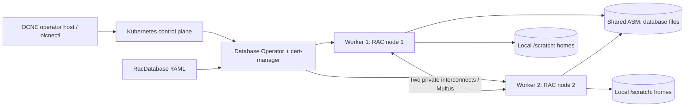

# Fresh build: OCNE -> Database Operator -> RAC

A shorter, sequential route through a **new lab**, with three chapters. Each operational step states **where to run**, **commands**, **expected results**, and **what to correct** before proceeding. Commands and expected output are instructions, not evidence that your new environment has passed.

| Order | Chapter | a) Prerequisites | b) Setting up | Completion gate |
|---|---|---|---|---|
| 1 | [Setting up OCNE](01-OCNE.md) | Four prepared Linux hosts, names, capacity, storage, access | Repositories, OS/network, certificates, OCNE environment and Kubernetes | Three Ready Kubernetes nodes and healthy base workloads |
| 2 | [Installing Database Operator](02-DATABASE-OPERATOR.md) | Healthy cluster, privileges, pinned manifests | cert-manager, RAC RBAC, operator and webhook | Controller/certificates Ready, RacDatabase API available |
| 3 | [Provisioning RAC](03-RAC.md) | Shared disks, scratch, private networks, worker OS, gold homes, CVU and secrets | Validate YAML, create once, verify GI/ASM/SQL and connections | Two OPEN instances, LABPDB READ WRITE, services and patches verified |

**Reproducing the existing lab exactly:** use the [rebuild contract](../docs/REBUILD-READINESS.md#4-exact-sequence-to-follow-on-a-future-rebuild). This condensed guide is generic; the agreed reconstruction uses cloning, the selected 4/8/22/22 GiB VM allocations, required additional NFS, the application, and the later ASM candidates.

## Before copying commands

Read a whole numbered step, then execute its blocks in order. Fix a failed expectation before the next step. Blocks are Bash on the named Linux host unless marked workstation; SQL blocks go at SQL>. A block beginning `set -euo pipefail` exits on failure; reconnect if its interactive shell closes. A step marked **root** starts with `sudo -i`; use `exit` to return to labadmin afterward. Supply sudo passwords interactively. Do not enable shell tracing when creating secrets.

Use a separate, empty target environment. Never execute new-install disk or create commands on the running completed lab. These instructions were condensed and statically checked; the corrected complete fresh-build sequence has **not** been executed from zero as a new acceptance test.

### Change these example values before starting

| Example | Where it must agree |
|---|---|
| labadmin | Linux account, sudo access, SSH commands; choose consistent numeric UID/GID if adding NFS |
| ocne-op/cp/w1/w2.lab.test | Hostname, DNS/hosts, SSH, node selectors, OCNE certificates/CLI |
| 192.168.77.10/.11/.12/.13 | Public host addresses; reserve four unused stable addresses on your subnet |
| homelab / cluster1 | OCNE environment and module, including Multus module reference |
| 192.168.78.0/24 and 192.168.79.0/24 | Isolated RAC private networks, NADs and network-check pod addresses |
| enp0s8 / enp0s9 | Actual worker private NICs, matched by MAC; never substitute the SSH NIC |
| rac / rac19c / racnode | Namespace, CR name and generated RAC node prefix |
| RACCDB / LABPDB / labpdb_app | CDB, PDB, and distinct application service, including SQL checks |
| /scratch and ocne-rac-asm01/02 | Actual verified mount and shared partition labels; never a guessed device letter |
| RAC image digest / ZIP names | Your compatible image and patched gold homes, staged identically on both workers |

Changing `config/lab.psd1` does not rewrite guides, YAML or a live cluster. Customize copies consistently before execution. Keep database service naming final before creation because operator fields are immutable.

Use the repository as the command/manifest bundle: open a workstation Bash shell in its root (`cd /d/OCNE19-Lab` in Windows Git Bash). Copy only the explicitly listed files. If public guest IPs are not directly reachable, substitute verified SSH aliases/ports from your own hypervisor setup; chapter 1 does not assume this lab's Windows SSH configuration exists on another workstation.

### Version and capacity boundaries

This reproduces **OCNE 1.9 / Kubernetes 1.29 / Database Operator 2.2.0 / Oracle RAC 19.32**. OCNE 1.9 is in [Sustaining Support](https://docs.oracle.com/en/operating-systems/olcne/1.9/install/hosts.html); cert-manager 1.17 is historical. Keep the requested versions for this exercise and independently evaluate lifecycle/support for other uses. Windows/VirtualBox sizing, transport and the no-HugePages profile are local adaptations.

The fresh host example meets Oracle's operator/control-plane minimum RAM (8/16 GiB); existing 4/8 GiB guests remain unchanged. Both workers stay 22 GiB / 6 vCPU. Each RAC pod requests 16 GiB / 4 CPU, with SGA 3 GiB and PGA target 2 GiB. HugePages are disabled by the owner's choice; Oracle's upstream procedure uses HugePages. Recheck CVU against this final profile rather than treating an earlier run as validation.

### What's intentionally outside the short path

Hypervisor-specific OS installation/cloning: use the [golden VM cloning guide](../docs/OCNE-1.9-Golden-VM-Cloning-Guide.md) if needed. The optional 100 GiB NFS share has its complete commands in [guide Part D](../docs/OCNE-1.9-OL9-Setup-Guide.md#part-d-additional-100-gib-nfs-server-on-the-operator); it does not replace ASM. Application deployment and failure exercises are separate from these three installation stages.

For full historical outputs/recovery, use the [long manual](../docs/OCNE-RAC-END-TO-END-MANUAL.md) and [scenario matrix](../docs/RAC-TEST-SCENARIO-MATRIX.md). The supplied RAC slim image had missing GI recovery-file and duplicate-start problems during pod replacement. Initial database readiness is not proof of unattended restart recovery; chapter 3 links the required backup/recovery steps.

Keep archives under ISO/, VM disks under vms/, raw local logs under logs/, and host secrets under private/ in your project root. Never commit passwords, private keys, kubeconfigs, Oracle media or database disks. Guest keys and platform certificates remain in their guest paths. Record your own timestamps/results as you pass each completion gate.

Documentation adapted from Oracle OCNE installation/Kubernetes manuals retains [CC BY-SA 4.0 attribution and license](../docs/OCNE-1.9-OL9-Setup-Guide.md#attribution-and-license). Changes here condense the procedure, separate prerequisites/setup, add expected-result and correction gates, and retain local implementation choices. Oracle operator assets retain their original UPL license; see [vendor provenance](../config/vendor/README.md).
