# Preparing the Oracle 19.32 Grid and Database home ZIPs

**A separate build-VM workflow for the OCNE RAC lab**  
Documented 15 October 2026 from the owner's account, Oracle documentation, and recorded artifact checks.

| Artifact | Contents | RAC manifest field |
|---|---|---|
| `oracle-gridhome-19.32.zip` | Patched Grid Infrastructure home | `spec.configParams.gridSwZipFile` |
| `oracle-dbhome-19.32.zip` | Patched Database home | `spec.configParams.dbSwZipFile` |

Preparing the homes once moves binary patching into the build stage. RAC pods extract the prepared software and perform target-specific installation/configuration. Clusterware, ASM, database creation, and SQL patch validation still take place during/after provisioning. No deployment-duration benchmark was captured.

**Start here:** [Step-by-step build guide](BUILD-GUIDE.md): prerequisites, users, directories, OPatch, `-applyRU`, archive creation, verification, staging, and troubleshooting. Its commands describe a future build; they are not a recovered shell history.



[Editable Mermaid source](diagrams/patched-homes.mmd)

## What the owner did

1. Created a separate **Oracle Linux 9.8 VM**.
2. Prepared `grid` and `oracle`, their groups, and their home/base directories, using the linked [Oracle RAC installation guide (21c)](https://docs.oracle.com/en/database/oracle/oracle-database/21/rilin/installing-oracle-rac-and-oracle-rac-one-node.html) and its surrounding prerequisites.
3. Installed the **Oracle Database 19c preinstallation RPM** for operating-system dependencies/settings.
4. Downloaded the **19.3 Linux x86-64 Grid and Database base-home ZIPs** from [Oracle's 19c download page](https://www.oracle.com/database/technologies/oracle19c-linux-downloads.html).
5. Downloaded the required RU media and newer OPatch, upgraded OPatch, and applied **19.32 RU** with installer `-applyRU`, following [Oracle's patch-during-installation procedure](https://docs.oracle.com/en/database/oracle/oracle-database/19/ladbi/apply-patches-during-db-install.html).
6. Archived the patched homes with the two filenames above and supplied them for staging on both workers.
7. Referenced those files in the RAC provisioning manifest below.

The original build VM's hostname/kernel, exact account-creation commands, full installer choices, and archive command were not supplied. The archive inventories and later RAC acceptance are recorded; the original build transcript is not. Preparation was not rerun for this documentation update.

## How the versions fit together

| Label | Meaning in this lab |
|---|---|
| Oracle Linux **9.8** | Owner-reported build OS; also observed in the supplied slim image |
| Oracle **19c / 19.3** | Major release and original downloadable base media |
| RU **19.32.0.0.260721** | Patch level recorded in the supplied homes |
| OPatch **12.2.0.1.53** | Patching-tool version in both homes; OPatch itself is not version 19.32 |
| `roopla/oracle-rac:19.3.0-slim` | Container tag; its name does not determine the version of separately supplied homes |

The owner's 21c link is retained as historical context. The guide uses matching **19c** sources for installer commands and requirements. OL9.8 alone does not establish support eligibility: check the RU, kernel, architecture, prerequisites, and applicable Oracle Support information. The build VM is distinct from the preserved golden VirtualBox VM and from the four OCNE nodes.

## The manifest mapping

This fragment belongs **inside `spec`**; it is not a complete resource to apply. It matches the [fresh RAC manifest](../config/rac-database.yaml). The deployed cluster uses [the live manifest](../config/rac-database-live.yaml), retaining its original immutable service field.

```yaml
configParams:
  gridHome: /u01/app/19c/grid
  gridBase: /u01/app/grid
  dbHome: /u01/app/oracle/product/19c/dbhome_1
  dbBase: /u01/app/oracle
  inventory: /u01/app/oraInventory
  gridSwZipFile: oracle-gridhome-19.32.zip
  dbSwZipFile: oracle-dbhome-19.32.zip
  hostSwStageLocation: /scratch/software/stage/19c/19.32-gold
  sgaSize: 3G
  pgaSize: 2G
  processes: 500
  cpuCount: 4
  dbName: RACCDB
  pdbName: LABPDB
```

| Field | Meaning |
|---|---|
| `gridSwZipFile`, `dbSwZipFile` | Exact filenames under the worker stage directory |
| `hostSwStageLocation` | Directory on **each eligible worker**, not on Windows or `ocne-op` |
| `gridHome`, `dbHome` | Target home paths inside RAC containers |
| `gridBase`, `dbBase`, `inventory` | Target base and installation-inventory paths |
| Memory/process/CPU settings | Database configuration inputs; they do not patch software or allocate VM resources |
| `dbName`, `pdbName` | Database/container database and pluggable database names |

This lab omits the image's deployment-time RU, OPatch, and one-off inputs because the supplied homes are already patched. Do not introduce a second patching workflow because the image tag says `19.3`. Inspect the image's contract before assuming this behavior for another image/operator version.

## What was actually checked

The [10 October artifact acceptance](../docs/RAC-ARTIFACT-ACCEPTANCE.md) records these results. Its early pending-provisioning statements describe that date's sequence; later results appear in [RAC deployment and acceptance](../docs/RAC-DEPLOYMENT.md).

| Check | Recorded result |
|---|---|
| ZIP integrity | Full CRC, member-path, and source-stability checks passed |
| Root layout | `gridSetup.sh` / `runInstaller` at ZIP root; no enclosing home directory |
| OPatch | Both contain **12.2.0.1.53** |
| Patch metadata | DB RU **39472050**, OCW **39526364**, OJVM **39222882** in both; Grid also ACFS **39503034**, TOMCAT **39107855**, DBWLM **39107825** |
| Transfer | Destination hashes matched on **both workers** |
| Later runtime | 19.32 RAC acceptance; RU **39472050** and OJVM **39222882** SQL status `SUCCESS` in root/PDB |

The source GI RU bundle was **39467003**. Individual component IDs appear in inventory, so the bundle ID need not appear as one installed patch. Additional component/OJVM records do not prove how each patch was applied: the precise sequence was not supplied.

| File | ZIP bytes | Expanded bytes |
|---|---:|---:|
| `oracle-gridhome-19.32.zip` | 5,100,099,678 | 11,540,170,217 |
| `oracle-dbhome-19.32.zip` | 5,142,587,720 | 11,724,672,142 |

```text
d02d04276e767d7715006fa3690851f2203ff578ff35e963e18b67b15ddcc917  oracle-gridhome-19.32.zip
da75d72a2c1491d129e70ac0c3cdbb86c19024d5d80931f0e9c7714d25ef7e5f  oracle-dbhome-19.32.zip
```

These identify the **supplied user-built files**, not Oracle-published downloads. A newly generated ZIP can legitimately have a different hash at the same patch level. Record its approved inventory and checksum; never rename an unverified archive to imply equivalence.

## Related walkthroughs

- [Build and package the homes](BUILD-GUIDE.md)
- [Fresh OCNE, Database Operator, and RAC setup](../fresh-build/README.md)
- [RAC handoff and worker transfer commands](../docs/RAC-PROVISIONING-HANDOFF.md)
- [RAC deployment and known image recovery issues](../docs/RAC-DEPLOYMENT.md)
- [Project execution log](../docs/RUN-LOG.md)

Only documentation and diagrams belong here. Media stays in ignored `ISO/`, raw logs in `logs/`, and private inputs in `private/`. Oracle binaries, patches, credentials, and VM disks are not published to GitHub.
